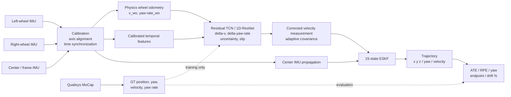
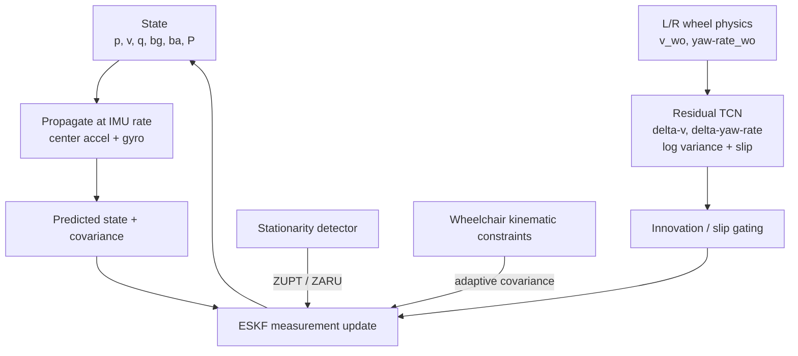
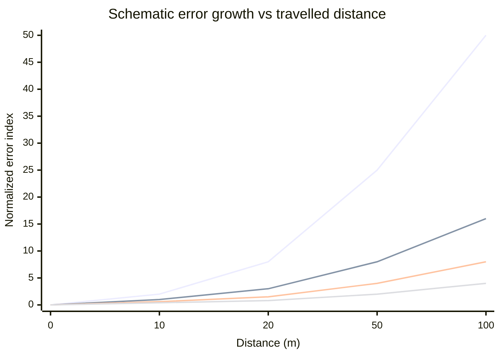

# ระบบสร้างเส้นทางรถเข็นด้วย IMU สามตัวและ Qualisys MoCap: แนวทางเพื่อความแม่นยำสูงสุดและการแก้ Drift

## สรุปผู้บริหาร

จากงานวิจัยที่เกี่ยวข้องและจากการตรวจไฟล์จริง **`trial_07.csv` และ `trial_07.c3d`** ข้อเสนอหลักของผมคือ **ไม่ควร train neural network ให้ทำนายตำแหน่ง \(x,y\) โดยตรงเป็นวิธีหลัก** แต่ควรใช้โครงสร้างแบบ **physics-first hybrid estimator**:

\[
\boxed{
\text{Wheel physics}
+
\text{learned residual correction}
+
\text{uncertainty/slip estimation}
+
\text{ESKF}
}
\]

กล่าวคือ ใช้ IMU ที่ล้อซ้ายและล้อขวาเพื่อสร้าง wheel odometry ทางฟิสิกส์ก่อน ใช้ IMU กลาง/frame เป็นตัว propagate orientation, velocity และ IMU bias ใน Error-State Kalman Filter (ESKF) แล้วให้ neural network เรียนรู้เฉพาะ **สิ่งที่ physics model ทำผิด** เช่น error ของ forward velocity และ yaw rate รวมถึง uncertainty/slip probability จากนั้นใช้ผลของ network เป็น measurement update ของ ESKF แทนที่จะให้ network รับผิดชอบ trajectory ทั้งหมด

แนวคิดนี้สอดคล้องกับหลักฐานจากหลายสายงาน: งาน TLIO แสดงว่าการให้ network เรียนรู้ relative-motion measurement พร้อม uncertainty แล้ว fuse ใน Kalman filter มีข้อได้เปรียบเหนือการต่อ neural-network outputs เป็น trajectory โดยตรง; งาน RINS-W แสดงแนวทาง learned motion constraints + Kalman filtering สำหรับยานล้อ; และงาน wheel-inertial correction แสดงว่าสามารถให้ network เรียนรู้ correction ของ wheel odometry จาก wheel velocity และ IMU แบบ real-time ได้ citeturn14search2turn18search2turn14search3

สำหรับ wheelchair โดยตรง งาน *Sensors* ปี 2026 ใช้ **IMU สามตัว** บริเวณล้อซ้าย ล้อขวา และตัวรถ และคำนวณ wheel speed/distance/turning variables โดยอาศัย geometry ของล้อ รถ และ camber ซึ่งใกล้เคียงกับ hardware concept ของงานนี้มาก ขณะที่งาน *Real-Life Wheelchair Mobility Metrics from IMUs* ปี 2023 แสดงว่าการใช้ IMU บน frame และ wheel ที่ 100 Hz สามารถสร้าง wheelchair distance, velocity, turns และ slope metrics ได้ และเน้นว่าการ sync IMU อย่างแม่นยำเป็นเรื่องสำคัญ citeturn14search0turn14search1

**ผลจาก `trial_07` สนับสนุน architecture นี้อย่างมาก**:

| สิ่งที่พบจาก `trial_07` | ผล |
|---|---:|
| IMU sensors | `L`, `R`, `C` ครบทั้งสามตัว |
| จำนวน sample | C = 18,377, R = 18,375, L = 18,366 |
| IMU sampling rate จาก device timestamps | ≈ **102.396 Hz** |
| missing packet ตาม `missing_before` | **0** |
| IMU duration | ≈ 179.4 s |
| Qualisys frame rate | **100 Hz** |
| Qualisys frames | 18,031 |
| MoCap points | `L_FAL`, `R_FAL` |
| mean marker separation | ≈ **0.64494 m** |
| L_FAL valid | ≈ 89.39% |
| R_FAL valid | ≈ 99.48% |
| longest L_FAL dropout | ≈ **2.76 s** |
| center-IMU gyro axis ที่สัมพันธ์กับ GT yaw rate ดีที่สุด | **`gx_raw`** |
| best correlation \(g_x^C\) vs MoCap yaw rate | ≈ **0.987** |
| preliminary time lag | MoCap ≈ IMU common time + **0.775 s** |
| direct diagnostic fit ของ wheel gyros → forward speed | \(R^2\approx0.996\) |
| direct diagnostic fit ของ wheel gyros → yaw rate | \(R^2\approx0.818\) |

สองบรรทัดสุดท้ายมีความหมายสำคัญมาก: **wheel IMUs ของคุณมีข้อมูล forward speed ที่แรงมากอยู่แล้ว แต่ yaw จาก wheel differential มีข้อผิดพลาดมากกว่า** ดังนั้นสำหรับชุด sensor นี้ ผมจะให้ **ล้อเป็น primary source สำหรับ translational velocity** และให้ **frame IMU + wheel differential + ESKF เป็น primary source สำหรับ heading/yaw** โดย network ทำหน้าที่เรียนรู้ correction ใน pivot, slalom, sprint และ slope

ข้อแนะนำลำดับแรกจึงเป็น:

\[
\boxed{
\textbf{Tiny TCN residual + learned covariance/slip + 15-state ESKF}
}
\]

และควรมี **1D-ResNet residual + ESKF** เป็น accuracy challenger เพราะ TLIO มีหลักฐานที่แข็งแรงสำหรับแนวคิด network-predicted motion + uncertainty + EKF ส่วน LSTM, Transformer และ end-to-end pose regression ควรเป็น comparative baselines มากกว่าจะเป็นระบบหลัก citeturn14search2turn15search0

ข้อจำกัดพื้นฐานที่ต้องระบุใน thesis/paper คือ ระบบ IMU + wheel dead reckoning ที่ไม่มี external absolute-position observation ขณะ deploy **ไม่สามารถรับประกัน zero drift ตลอดไป** ได้ เพราะ bias และ unmodelled wheel slip สามารถสะสมเป็น position/heading error ได้ เป้าหมายของระบบนี้จึงควรเป็น “ลด drift อย่างมีนัยสำคัญและทำให้ drift เติบโตช้าลง/robust ขึ้น” ไม่ใช่ “eliminate drift absolutely” งาน inertial-odometry และ wheel-inertial literature สะท้อนปัญหานี้อย่างชัดเจน citeturn14search2turn15search3turn18search0

## สิ่งที่ไฟล์ `trial_07` บอกเกี่ยวกับระบบจริง

ไฟล์ CSV มีโครงสร้างดีสำหรับงานนี้มาก:

```text
session_id
wheel                    C / L / R
seq
timestamp_device_us
timestamp_pc_monotonic_ns
ax_raw ay_raw az_raw
gx_raw gy_raw gz_raw
packet_id
sequence_class
missing_before
```

แต่มีปัญหา timing ที่ต้องแก้ **ก่อน train model** เพราะ device clock ของ IMU สามตัวไม่ได้เริ่มจาก origin เดียวกัน ใน trial นี้ค่าเริ่มต้นของ `timestamp_device_us` ต่างกันถึงระดับหลายวินาที:

\[
t^C_0\approx807.56\text{ s}
\]

\[
t^L_0\approx802.13\text{ s}
\]

\[
t^R_0\approx821.66\text{ s}
\]

ดังนั้นการทำ

```python
timestamp_device_us - global_min
```

แล้ว merge สาม sensor โดยตรง **ผิด** ถึงแม้ sampling interval ภายในแต่ละ IMU จะสวยมากก็ตาม

ในทางกลับกัน `timestamp_pc_monotonic_ns` ให้ common PC-side clock แต่ sample ประมาณ 10 ตัวใน packet เดียวกันมี PC timestamp เดียวกัน ดังนั้น timestamp นี้ไม่ควรถูกใช้เป็น sample-level time โดยตรง วิธีที่เหมาะกว่าคือ fit:

\[
t_{\text{PC}}
=
\alpha_i t_{\text{device},i}
+
\beta_i
\]

สำหรับ sensor \(i\in\{L,R,C\}\)

จาก trial นี้ clock scale ที่ผมประมาณได้คือประมาณ:

\[
\alpha_C = 0.9999954,\qquad
\alpha_L = 1.0000217,\qquad
\alpha_R = 1.0000081
\]

หรือ clock-rate differences ระดับประมาณ \(-4.6,+21.7,+8.1\) ppm ตามลำดับ นี่เล็กพอที่จะมองข้ามได้ในหน้าต่างสั้น แต่เมื่อ trial ยาวหลายนาทีจะเริ่มสร้าง phase error ได้

ที่สำคัญ PC-side timing residual ของ L IMU แย่กว่าตัวอื่นอย่างเห็นได้ชัด โดย median absolute residual ประมาณ 31 ms และบาง packet สูงถึงหลายร้อย ms ขณะที่ C/R ส่วนใหญ่อยู่ระดับไม่กี่มิลลิวินาที เพราะฉะนั้นแนวทางที่ผมแนะนำคือ:

\[
\boxed{
\text{device timestamp สำหรับ intra-IMU timing}
+
\text{robust affine map สู่ PC clock}
+
\text{signal correlation refinement}
}
\]

แนวคิด synchronization ด้วย recognizable angular-velocity pattern และ cross-correlation มี precedent โดยตรงใน wheelchair IMU literature: de Vries et al. ใช้ rigid beam หมุน IMU ก่อนและหลัง trial แล้ว cross-correlate gyro signals และรายงานการตรวจสอบ synchronization ในระดับ 1–2 samples สำหรับข้อมูล 100 Hz หรือประมาณ 10–20 ms citeturn14search5

สำหรับ **IMU ↔ Qualisys synchronization** มีหลักฐานที่ดีมากใน `trial_07`: เมื่อสร้าง yaw จาก baseline ระหว่าง `L_FAL` และ `R_FAL` แล้ว differentiate เป็น yaw rate, `C.gx_raw` ให้ absolute correlation ประมาณ **0.987** ที่ offset ประมาณ:

\[
\boxed{
t_{\text{MoCap}}
\approx
t_{\text{IMU-common}}+0.775\text{ s}
}
\]

ดังนั้น `gx` ของ center IMU ดูเหมือนเป็น yaw-sensitive mounting axis ใน trial นี้อย่างชัดเจน

อย่างไรก็ตาม **อย่า hard-code** ว่า center yaw axis ต้องเป็น `gx` ในทุก session จนกว่าจะยืนยัน mounting orientation ว่าไม่เปลี่ยน เพราะ axis mapping ควรมาจาก calibration transformation:

\[
\boldsymbol{\omega}^{B}
=
R_{B\leftarrow I_C}
(\boldsymbol{\omega}^{I_C}-\mathbf b_g)
\]

ไม่ใช่การเลือก `gx` แบบ ad hoc

การ regress trial นี้โดยตรงให้ความสัมพันธ์เชิง diagnostic:

\[
\dot\psi_{GT}
\approx
0.0012054\,g_{x,\mathrm{raw}}^C
-0.01284
\quad [\mathrm{rad/s}]
\]

โดย \(R^2\approx0.970\) และ RMSE ประมาณ \(0.038\) rad/s แต่สมการนี้ **ไม่ใช่ calibration constant ที่ควรนำไปใช้กับทุก trial** เพราะ slope นี้รวม sensor scale, mounting-axis projection, filtering และ trial-specific behaviour เข้าไว้ด้วยกัน

`static` trial ที่คุณมีจึงสำคัญมากกว่า สำหรับ `trial_07` เมื่อเลือกเฉพาะช่วงที่ Qualisys บอกว่าแทบไม่เคลื่อนที่ ค่า center gyro raw โดยประมาณคือ:

\[
g_x^C=11.5\pm6.3,\quad
g_y^C=-31.2\pm1.9,\quad
g_z^C=-9.5\pm1.1
\]

ซึ่งใช้เป็น sanity check ได้ แต่ bias/noise model จริงควรมาจาก dedicated `static` dataset และหากต้องการ process-noise parameters ที่มีเหตุผลทางสถิติ ควรใช้ static record ที่ยาวพอสำหรับ Allan-deviation analysis

ฝั่ง Qualisys `trial_07.c3d` มี trajectory point เพียงสองตัวคือ `L_FAL` และ `R_FAL` ที่ 100 Hz และมี 12 analog force/moment channels ที่ 1000 Hz ด้วย ตำแหน่ง point ถูกเก็บในหน่วย mm ตาม metadata ของ C3D

ถ้า `L_FAL` และ `R_FAL` เป็น landmarks ที่ยึด rigid กับสองด้านของ wheelchair จริง เราสามารถสร้าง wheelchair center proxy:

\[
\mathbf p_c
=
\frac{\mathbf p_L+\mathbf p_R}{2}
\]

และ lateral axis:

\[
\mathbf e_y
=
\frac{\mathbf p_L-\mathbf p_R}
{\|\mathbf p_L-\mathbf p_R\|}
\]

แล้วสร้าง planar heading จากเวกเตอร์ที่ตั้งฉากกับ \(\mathbf e_y\):

\[
\mathbf e_x
=
\begin{bmatrix}
e_{y,y}\\
-e_{y,x}\\
0
\end{bmatrix}
\]

หรือเครื่องหมายตรงข้าม ขึ้นกับ marker convention

ดังนั้น:

\[
\psi_{GT}
=
\operatorname{atan2}(e_{x,y},e_{x,x})
\]

แล้ว unwrap ก่อน differentiate

แต่มีประเด็นสำคัญสองข้อ:

**หนึ่ง:** marker separation เฉลี่ยประมาณ **0.64494 m** และ SD เพียงประมาณ 1.25 mm เมื่อทั้งคู่ valid แสดงว่า pair มีลักษณะ rigid ดี แต่ **0.645 m นี้ไม่ควรถูกใช้เป็น wheelchair track width \(B\) อัตโนมัติ** เพราะเป็นระยะ marker-to-marker ไม่จำเป็นต้องเท่ากับ effective wheel-ground contact track width

**สอง:** ด้วยสอง marker แบบ lateral pair เรากู้ center, lateral direction และ planar yaw ได้ดี แต่ **full 3D pitch ไม่ observable อย่างสมบูรณ์จาก pair นี้** ดังนั้น slope experiment ต้องพึ่ง frame IMU attitude หรือ Qualisys rigid-body orientation/marker เพิ่มเติม ถ้ามีอยู่ในไฟล์อื่น

อีกปัญหาที่ต้องแก้ก่อนสร้าง labels คือ `L_FAL` มี missing data ประมาณ 10.6% และมี gap ยาวสุดราว **2.76 s** จึงไม่ควร cubic-interpolate ข้าม gap ยาวเหล่านี้แล้วนำไป train neural network เพราะ network จะเรียน “trajectory ที่ interpolation แต่งขึ้น” แทน ground truth จริง

ผมแนะนำ:

\[
\text{interpolate only if gap}\leq50\text{–}100\text{ ms}
\]

ส่วน gap ยาวกว่านั้นให้ตั้ง `gt_valid=False` และ **ตัด window นั้นออกจาก supervised training**

## สถาปัตยกรรมที่แนะนำสำหรับความแม่นยำสูงสุด

หลักการสำคัญคือให้แต่ละ sensor ทำงานในสิ่งที่มันเก่งที่สุด:

- **L/R wheel IMUs:** wheel angular rate, travelled distance และ forward velocity
- **Center/frame IMU:** gravity, roll/pitch, yaw-rate dynamics, inertial propagation
- **Physics:** kinematic relationship ของ wheelchair
- **TCN/1D-CNN:** slip/nonlinearity/model residual
- **ESKF:** temporal integration, bias estimation, uncertainty propagation
- **Qualisys:** training labels + validation/test ground truth เท่านั้น

งาน wheelchair IMU ปี 2026 ที่มี IMU สามตัวใช้ล้อทั้งสองและ sensor บนตัว wheelchair โดยคำนึงถึง wheel geometry, camber และ true wheel speed ส่วนงาน wheelchair ปี 2023 แสดงว่าการประมวลผล wheel IMU สามารถให้ distance และ linear velocity ที่ดีเมื่อ calibration และ alignment ถูกต้อง citeturn14search0turn14search1



สำหรับ wheel odometry พื้นฐาน หลังจาก project gyroscope onto true wheel axle และจัด sign ให้ถูก:

\[
v_L=r_L\omega_L
\]

\[
v_R=r_R\omega_R
\]

\[
v_{WO}
=
\frac{v_R+v_L}{2}
\]

\[
\dot\psi_{WO}
=
\frac{v_R-v_L}{B}
\]

โดย \(r_L,r_R\) คือ effective rolling radii และ \(B\) คือ effective track width

แต่ถ้าล้อมี camber หรือ IMU orientation ที่ทำให้ measured wheel-axis gyro มี chassis rotation ปนอยู่ การใช้สูตร \(\omega r\) อย่างเดียวอาจไม่พอ งาน wheelchair สาม-IMU ปี 2026 ใช้ geometry correction สำหรับ true wheel speed โดยพิจารณาคุณสมบัติของ wheelchair และ wheel geometry; ดังนั้นในระบบของคุณควร calibrate wheel-axis projection/camber ก่อนสร้าง \(v_L,v_R\) citeturn14search0

บน slope ไม่ควรสร้าง pure 2-D EKF ที่สมมติ roll/pitch = 0 เพราะคุณมี `SlopeF`, `SlopeB`, `SlopeFBAR`, `SlopeFBCW`, `SlopeHAR`, `SlopeHCW` อยู่แล้ว ให้ ESKF มี full 3-D attitude:

\[
\mathbf v^W
=
R_{WB}
\begin{bmatrix}
v_x^B\\
v_y^B\\
v_z^B
\end{bmatrix}
\]

ดังนั้น forward wheel motion บนทางลาดจะถูก project เข้าสู่ \(x,y,z\) ผ่าน attitude แทนการแก้ slope แยกแบบ heuristic

ผมแนะนำ nominal ESKF state:

\[
\mathbf x =
\left[
\mathbf p^W,
\mathbf v^W,
\mathbf q_{WB},
\mathbf b_g,
\mathbf b_a
\right]
\]

ได้ nominal variables 3+3+quaternion+3+3 และใช้ conventional **15-dimensional error state**:

\[
\delta\mathbf x=
[
\delta\mathbf p,
\delta\mathbf v,
\delta\boldsymbol\theta,
\delta\mathbf b_g,
\delta\mathbf b_a
]
\]

การใช้ quaternion/error-state formulation สำหรับ IMU integration เป็น framework มาตรฐานที่ Solà แจกแจงไว้อย่างละเอียด และเหมาะกับ propagation ของ inertial attitude/bias โดยตรง citeturn15search1turn15search5



ระหว่าง straight/coasting สามารถใช้ non-holonomic constraint:

\[
v_y^B\approx0
\]

แต่ **อย่าบังคับ constraint นี้ด้วย covariance ต่ำตลอดเวลา** เพราะ pivot, caster movement, wheel slip และ aggressive slalom สามารถทำให้ model นี้ผิดได้ งาน wheeled inertial navigation แสดงประโยชน์ของการ detect motion conditions ก่อนเปิด/ปิด pseudo-measurements และงาน wheel-inertial filtering สมัยใหม่ก็ใช้ wheel measurements ร่วมกับ kinematic constraints และ outlier handling แทนที่จะเชื่อ wheel odometry เท่ากันทุกสถานการณ์ citeturn18search2turn18search3

ดังนั้น network output ที่ผมแนะนำคือ:

\[
\boxed{
\mathbf y=
[
\delta v_x,
\delta\dot\psi,
v_y,
s_v,
s_\omega,
s_y,
p_{\text{slip}}
]
}
\]

เมื่อ

\[
\delta v_x
=
v_{x,GT}^B-v_{WO}
\]

\[
\delta\dot\psi
=
\dot\psi_{GT}-\dot\psi_{WO}
\]

\[
s_v=\log\sigma_v^2,\qquad
s_\omega=\log\sigma_\omega^2
\]

จากนั้น:

\[
v_x^*
=
v_{WO}+\widehat{\delta v_x}
\]

\[
\dot\psi^*
=
\dot\psi_{WO}+\widehat{\delta\dot\psi}
\]

และ covariance ที่ network ทำนายถูกส่งเข้า filter:

\[
R_v=\exp(s_v)
\]

\[
R_\omega=\exp(s_\omega)
\]

เมื่อ \(p_{\text{slip}}\) สูง ให้ inflate \(R_v,R_\omega\) หรือ reject measurement ชั่วคราว

นี่เป็นจุดที่ hybrid model เหนือกว่า network ที่ output correction อย่างเดียว เพราะ filter ได้รู้ว่า **เมื่อใดควรเชื่อ network** แนวคิด learned motion measurement + learned uncertainty มีหลักฐานจาก TLIO ซึ่งรายงานว่าการ fuse relative displacement และ covariance ที่ network ทำนายเข้า EKF ให้ผลดีกว่า baseline ที่ concatenate network motion estimates โดยตรงในชุดข้อมูลของงานนั้น citeturn14search2turn14search6

อย่างไรก็ตาม เนื่องจาก center IMU ถูกใช้ทั้งใน ESKF propagation และ network input จะเกิด statistical correlation ระหว่าง process error และ learned measurement error ได้ TLIO ระบุปัญหานี้โดยตรงและเพิ่ม perturbations ของ IMU bias/gravity ในการ training เพื่อเพิ่ม robustness ดังนั้นสำหรับระบบนี้ควรทำ augmentation แบบเดียวกัน และใน ablation ควรทดสอบ network ที่ใช้เฉพาะ wheel IMUs เทียบกับ network ที่ใช้ L+R+C เพื่อดูว่าประโยชน์จาก center IMU outweigh correlation issue หรือไม่ citeturn14search2

**ตารางตัดสินใจเรื่อง model**

| Model | Input | Output / target | จุดแข็ง | จุดอ่อน | Compute โดยประมาณ | คำแนะนำ |
|---|---|---|---|---|---|---|
| Physics wheel odometry | L/R gyro + geometry | \(v,\dot\psi\) | เร็ว, explainable | slip/camber/model errors | ต่ำมาก | Baseline A0 |
| Classical ESKF | C IMU + L/R WO | state | robust, no training | fixed model ไม่รู้ complex slip | ต่ำมาก | **Mandatory baseline** |
| **TCN residual + ESKF** | L/R/C + physics features | \(\delta v,\delta\dot\psi,\sigma,p_{slip}\) | causal, parallel, lightweight | ต้อง train ดีและป้องกัน leakage | ต่ำ–กลาง | **ตัวเลือกหลัก** |
| 1D-ResNet residual + ESKF | L/R/C | same | strong inertial-learning precedent | ใหญ่กว่า Tiny-TCN | กลาง | **accuracy challenger** |
| LSTM residual + ESKF | same | same | recurrent state เหมาะ time series | inference เป็น sequential | กลาง | Baseline ML |
| Tiny Transformer + ESKF | same | same | global temporal interactions | overhead สูงกว่าและอาจไม่คุ้มกับ dataset เล็ก | กลาง–สูง | Exploratory |
| End-to-end local pose | raw L/R/C | \(\Delta x,\Delta y,\Delta\psi\) | architecture ง่าย | physics/generalization อ่อนกว่า | กลาง | Research baseline |
| End-to-end global \(x,y\) | raw IMU | global position | implementation ดูง่าย | frame-dependent, leakage-prone, poor extrapolation | กลาง | **ไม่แนะนำ** |

TCN เป็น candidate ที่ดีเพราะ causal dilated convolutions ให้ receptive field ยาวโดยไม่ต้อง recurrent execution และงานต้นฉบับ TCN พบว่า generic TCN outperform canonical LSTM/GRU บน sequence benchmarks หลายชุด แต่ผลนั้นไม่ได้หมายความว่า TCN จะชนะบน wheelchair dataset โดยอัตโนมัติ ดังนั้น LSTM ต้องถูกเก็บเป็น controlled baseline citeturn15search0turn15search7

Transformer สามารถสร้าง direct interactions ระหว่าง temporal positions ผ่าน self-attention และประมวลผลแบบ parallel ได้ แต่สำหรับหน้าต่างเพียง 100–400 samples และ dataset wheelchair ที่อาจมี participant ไม่มาก ความซับซ้อนเพิ่มอาจไม่ให้ประโยชน์เท่า TCN; ข้อนี้เป็น hypothesis ที่ต้องตัดสินจาก validation ไม่ใช่ assumption ว่า Transformer จะดีกว่าเพราะใหม่กว่า citeturn18search1

WMINet เป็นตัวอย่างที่มีประโยชน์สำหรับ end-to-end baseline เพราะใช้ wheel-mounted IMUs และ CNN เพื่อทำนาย displacement พร้อม wheelbase constraint และใช้ window 120 samples แต่เป็น mobile-robot dataset และ motion regime ต่างจาก manual wheelchair มาก จึงไม่ควรนำ numerical performance ของ WMINet มาใช้เป็น expected accuracy ของงานนี้โดยตรง citeturn15search3turn15search6

## การ calibration, synchronization และสร้าง ground-truth labels

ก่อน deep learning สิ่งที่จะเพิ่ม accuracy มากที่สุดน่าจะเป็น **time synchronization + sensor frame calibration + wheel geometry calibration** เพราะ network ไม่ควรถูกบังคับให้เรียนรู้ error ที่เกิดจาก coordinate transform ผิดหรือ clock shift

ลำดับ processing ที่ผมแนะนำคือ:

| ขั้นตอน | การประมวลผล | Output |
|---|---|---|
| 1 | แยก CSV ตาม `wheel = L,R,C` | 3 IMU streams |
| 2 | ตรวจ `seq`, `missing_before`, duplicate | data-quality mask |
| 3 | Fit robust affine device→PC clocks | synchronized IMU timeline |
| 4 | Refine L/R/C relative timing ด้วย cross-correlation | sub-sample alignment |
| 5 | Convert raw counts → SI จาก sensor metadata | m/s², rad/s |
| 6 | ใช้ `static` หา gyro/accel bias + noise | \(b_g,b_a,Q\) |
| 7 | หา IMU-to-body/wheel rotations | \(R_{B\leftarrow I_C}\), wheel axes |
| 8 | Parse Qualisys C3D และสร้าง GT | \(p,\psi,v,\dot\psi\) |
| 9 | Sync MoCap↔IMU | common timeline |
| 10 | Estimate wheel physics parameters จาก train only | \(r_L,r_R,B,\) camber/effective scales |
| 11 | สร้าง \(v_{WO},\dot\psi_{WO}\) | physics baseline |
| 12 | สร้าง residual labels | \(\delta v,\delta\dot\psi\) |
| 13 | Split โดย trial/subject ก่อน windowing | leakage-free partitions |
| 14 | สร้าง causal windows | train tensors |

### Calibration ของ center IMU

จาก static:

\[
\hat{\mathbf b}_g
=
\frac{1}{N}\sum_{k=1}^{N}\boldsymbol\omega_k
\]

Accelerometer หลัง bias correction ควรให้ magnitude ใกล้ \(g\):

\[
\|\mathbf a-\mathbf b_a\|\approx9.80665~\text{m/s}^2
\]

แต่ static orientation เพียง orientation เดียวไม่สามารถแยก 3-axis scale factor, non-orthogonality และ bias ของ accelerometer ได้ครบ ถ้าต้องการ accuracy สูง ควรมี six-position static calibration ในอนาคต

จาก `trial_07` magnitude ของ accelerometer raw ของทั้งสาม IMU อยู่แถว ๆ **8192 counts ต่อ 1 g** โดยประมาณ แต่ผม **ไม่แนะนำให้สมมติ scale = 8192 counts/g โดยยังไม่ตรวจ datasheet/configuration** เพราะ sensor model, full-scale range และ firmware conversion ของชุดนี้ยังไม่ได้ระบุ

### Calibration ของ wheel IMUs

ให้หา wheel axle direction จากช่วง straight propulsion:

\[
\mathbf u_{\text{axle}}
=
\frac{\overline{\boldsymbol\omega}}
{\|\overline{\boldsymbol\omega}\|}
\]

แล้ว project:

\[
\omega_{\text{wheel}}
=
\mathbf u_{\text{axle}}^\top
(\boldsymbol\omega-\mathbf b_g)
\]

วิธีใช้ mean angular-velocity direction ในช่วง propulsion เพื่อหา wheel-axis orientation มีความสอดคล้องกับ wheelchair IMU processing ที่ถูกใช้ในงาน validation ก่อนหน้า citeturn14search1

จาก trial นี้ `gz_raw` ของ wheel L/R มีลักษณะตรงข้ามกันชัดเจน:

- L: rotation หลักเป็น positive
- R: rotation หลักเป็น negative

จึงต้องกำหนด sign convention หลัง axle projection ให้:

\[
+\omega_L,+\omega_R
\]

หมายถึงรถเคลื่อนหน้าเหมือนกัน

อย่า train network ให้จำเครื่องหมาย mounting เดิม เพราะถอด sensor แล้วติดใหม่เพียง 180° โมเดลอาจพังทันที

### Calibrate wheel radius และ track width จาก training/calibration trials

แนะนำ robust least-squares optimization:

\[
\theta=
[r_L,r_R,B,k_L,k_R,\ldots]
\]

โดย minimize:

\[
\sum_t
\rho
\left(
v_{GT}(t)-v_{WO}(t;\theta)
\right)^2
+
\lambda_\psi
\rho
\left(
\dot\psi_{GT}(t)-\dot\psi_{WO}(t;\theta)
\right)^2
\]

ใช้:

- straight / `10x5` เพื่อหา wheel scale/radius
- `Pvar`, `Pvcr`, `Celw`, `Ar` เพื่อ constrain turn geometry
- CW และ CCW ทั้งคู่เพื่อลด asymmetric bias

**ห้าม calibrate \(r_L,r_R,B\) ด้วย test trajectory แล้วรายงาน test accuracy** เพราะเป็น ground-truth leakage

เมื่อเอาไป deploy จริง wheel radius ควรถูกมองเป็น **effective rolling radius** เพราะ tire pressure, load และ deformation สามารถทำให้ scale ต่างจาก geometric radius ที่วัดด้วยไม้บรรทัดได้ ดังนั้น thesis ควรรายงานทั้ง physical radius และ fitted effective scale แยกกัน

### Qualisys label generation

หลัง convert mm → m:

\[
\mathbf p_{GT}(t)
=
\frac{\mathbf p_{L,FAL}(t)+\mathbf p_{R,FAL}(t)}{2}
\]

หา yaw ดังที่อธิบายข้างต้น แล้ว smooth อย่างระมัดระวังก่อน derivative เช่น local polynomial/Savitzky–Golay:

\[
\mathbf v_{GT}^W
=
\frac{d\mathbf p_{GT}}{dt}
\]

\[
\dot\psi_{GT}
=
\frac{d\,\mathrm{unwrap}(\psi_{GT})}{dt}
\]

แล้ว transform GT velocity ไป body frame:

\[
\mathbf v_{GT}^B
=
R_{BW}\mathbf v_{GT}^{W}
\]

ได้:

\[
v_{x,GT}^B,\qquad
v_{y,GT}^B
\]

สำหรับ training ควรใช้ derivative ที่ smooth แล้ว แต่สำหรับ trajectory evaluation ให้ใช้ original positional MoCap samples หลัง quality filtering เพื่อไม่ให้ evaluation ได้รับ artificial smoothing benefit

### Synchronization กับ MoCap

สำหรับทุก trial ทำ algorithm นี้ใหม่:

\[
\dot\psi_{\text{MoCap}}(t)
\leftrightarrow
\omega_x^C,\omega_y^C,\omega_z^C
\]

ค้นหา:

\[
\tau^*
=
\arg\max_\tau
\left|
\operatorname{corr}
(\dot\psi_{GT}(t),
\omega_C(t-\tau))
\right|
\]

ใน `trial_07`:

\[
\tau^*\approx0.775\text{ s}
\]

และ:

\[
|\rho|\approx0.987
\]

กับ `C.gx_raw`

แต่ควรทำ sliding-window synchronization เช่นต้น/กลาง/ท้าย trial ด้วย ถ้าพบ:

\[
\tau(t)=\tau_0+kt
\]

แสดงว่ามี residual clock skew และควรใช้ affine time warp ไม่ใช่ constant offset

### Training inputs

หลัง calibration ผมแนะนำ base channels:

\[
\mathbf X_\text{raw}
=
[
a_L^x,a_L^y,a_L^z,\omega_L^x,\omega_L^y,\omega_L^z,
\]

\[
a_R^x,a_R^y,a_R^z,\omega_R^x,\omega_R^y,\omega_R^z,
\]

\[
a_C^x,a_C^y,a_C^z,\omega_C^x,\omega_C^y,\omega_C^z
]
\]

รวม 18 channels และเพิ่ม engineered physics channels:

\[
[
\omega_L^{axle},
\omega_R^{axle},
\omega_L+\omega_R,
\omega_R-\omega_L,
v_{WO},
\dot\psi_{WO},
\]

\[
g_x^B,g_y^B,g_z^B,
\|\mathbf a_C\|,
\|\boldsymbol\omega_C\|,
\text{stationary likelihood}
]
\]

รวมประมาณ 26–30 channels ก็เพียงพอ ไม่จำเป็นต้องสร้าง features หลายร้อยตัว

ผมแนะนำ resample ทุก stream ไป **100 Hz** เพราะ Qualisys = 100 Hz และ IMU จริง ≈102.4 Hz การใช้ 100 Hz ทำ alignment/window definition ง่าย และความแตกต่างนี้ไม่น่าทำให้สูญเสีย wheelchair dynamics ที่สำคัญ

Normalize ด้วย statistics จาก **training partition เท่านั้น**:

\[
x'=\frac{x-\mu_{\text{train}}}{\sigma_{\text{train}}}
\]

หรือ robust:

\[
x'=\frac{x-\operatorname{median}_{train}}
{IQR_{train}}
\]

ห้ามคำนวณ normalization จากทั้ง dataset ก่อน split

## โมเดล การฝึก และ protocol สำหรับ seen/unseen maneuvers

สำหรับ dataset ของคุณ ผมจะเริ่มด้วย window **2.0 s = 200 samples ที่ 100 Hz** แล้วทำ ablation:

\[
T\in\{0.5,1,2,4\}\text{ s}
\]

ไม่ควรสมมติว่า window ยาวที่สุดจะดีที่สุด เพราะ TLIO พบว่าการเพิ่ม temporal context สามารถลด sample-wise loss ได้โดยไม่จำเป็นต้องลด trajectory ATE และ overlapping predictions สามารถมี temporally correlated error ได้ citeturn14search6

**Recommended Tiny-TCN**

```text
Input: [B, C≈26–30, T=200]

1x1 Conv:
C -> 64

Residual causal TCN blocks:
Block 1: 64 -> 64, kernel=3, dilation=1
Block 2: 64 -> 64, kernel=3, dilation=2
Block 3: 64 -> 64, kernel=3, dilation=4
Block 4: 64 -> 64, kernel=3, dilation=8
Block 5: 64 -> 64, kernel=3, dilation=16
Block 6: 64 -> 64, kernel=3, dilation=32

Each block:
Conv1D
GroupNorm or LayerNorm
SiLU
Dropout 0.10
Conv1D
Norm
SiLU
Residual connection

Readout:
last causal feature / causal pooling

MLP:
64 -> 64 -> output heads
```

dilated causal convolutions และ residual blocks เป็นองค์ประกอบหลักของ TCN architecture ในงานต้นฉบับ citeturn15search0

Outputs แยกเป็น heads:

```text
motion head:
delta_vx
delta_yaw_rate
optional vy

uncertainty head:
log_var_v
log_var_yaw
optional log_var_vy

classification head:
slip_probability
```

ขนาดโมเดลนี้ควรอยู่ประมาณ **0.15–0.25 M parameters** ขึ้นกับ input channels และ exact norm/head implementation ซึ่งหมายถึงประมาณ 0.6–1 MB ใน FP32 หรือประมาณ 0.15–0.25 MB หลัง INT8 quantization โดยตัวเลขเหล่านี้เป็น engineering estimates ที่ต้อง benchmark จาก implementation จริง ไม่ใช่ผลทดลองของ `trial_07`

**1D-ResNet challenger**

```text
Stem:
Conv1D C -> 64, k=7

Residual stages:
2 x blocks @ 64
2 x blocks @ 64
2 x blocks @ 128
2 x blocks @ 128

kernel=3
downsample only if required

Global/causal temporal pooling
128 -> 64
same output heads as TCN
```

เหตุผลที่ควรมี candidate นี้คือ TLIO ใช้ 1-D ResNet-style inertial network เพื่อทำนาย relative displacement พร้อม uncertainty แล้วส่งเป็น EKF measurement ซึ่งเป็น evidence ที่ใกล้ hybrid architecture ที่เราต้องการมาก citeturn14search2

**LSTM baseline**

```text
Input projection C -> 64
2-layer unidirectional LSTM
hidden = 128
dropout = 0.10

last hidden
128 -> 64 -> same heads
```

**Transformer baseline**

```text
Input projection -> d_model=64
positional encoding
4 causal encoder blocks
4 attention heads
FFN = 128
dropout = 0.10
causal mask

last-token / causal pooled representation
64 -> same heads
```

**End-to-end baseline** ควรใช้ backbone เดียวกับ TCN แต่เปลี่ยน target เป็น local displacement:

\[
[
\Delta x^B,\Delta y^B,\Delta\psi
]
\]

ไม่ควรให้ output global \(x,y\) เพราะ local displacement ไม่ขึ้นกับ arbitrary global origin/heading เท่ากับ absolute pose และเปรียบเทียบ architecture ได้ยุติธรรมกว่า

### Loss function

ช่วงต้น 5–10 epochs ให้ train residual mean ก่อน:

\[
\mathcal L_{Huber}
=
Huber(\widehat{\delta v}-\delta v)
+
\lambda_\omega
Huber(\widehat{\delta\omega}-\delta\omega)
\]

จากนั้น switch ไป heteroscedastic negative log-likelihood:

\[
\mathcal L_v
=
\frac{1}{2}
e^{-s_v}
(\hat{\delta v}-\delta v)^2
+
\frac{1}{2}s_v
\]

\[
\mathcal L_\omega
=
\frac{1}{2}
e^{-s_\omega}
(\hat{\delta\omega}-\delta\omega)^2
+
\frac{1}{2}s_\omega
\]

แนวทาง train mean ก่อนแล้วจึง likelihood/covariance มี precedent ใน TLIO ซึ่งฝึก displacement ด้วย MSE ก่อนแล้วเปลี่ยนไป likelihood objective สำหรับ displacement + uncertainty citeturn14search2

ผมแนะนำเพิ่ม local trajectory-consistency loss:

\[
\mathcal L_{pose}
=
Huber(
\Delta\hat{\mathbf p},
\Delta\mathbf p_{GT}
)
+
\lambda_\psi
Huber(
\Delta\hat\psi,
\Delta\psi_{GT}
)
\]

โดย \(\Delta\hat p,\Delta\hat\psi\) มาจากการ integrate corrected velocities ภายใน window

Slip head:

\[
\mathcal L_{slip}
=
BCE(\hat p_{slip},y_{slip})
\]

และ temporal smoothness:

\[
\mathcal L_{smooth}
=
\|\delta v_t-\delta v_{t-1}\|_1
+
\lambda
\|\delta\omega_t-\delta\omega_{t-1}\|_1
\]

ค่าเริ่มต้นสำหรับ experiment:

\[
\boxed{
\mathcal L=
\mathcal L_{NLL}
+
0.2\mathcal L_{pose}
+
0.1\mathcal L_{slip}
+
0.02\mathcal L_{smooth}
}
\]

ตัวเลข weight เหล่านี้เป็น **starting hyperparameters ไม่ใช่ค่าที่ literature พิสูจน์ว่า optimal** ต้องเลือกจาก validation trajectories

### Slip label

ไม่จำเป็นต้อง hand-label slip ทุก sample ใช้ physics discrepancy สร้าง weak supervision เช่น:

\[
e_v=
|v_{GT}-v_{WO}|
\]

\[
e_\omega=
|\dot\psi_{GT}-\dot\psi_{WO}|
\]

และเรียก `slip=1` เมื่อ normalized discrepancy เกิน threshold ต่อเนื่องมากกว่า 50–100 ms โดย threshold ต้อง fit จาก training distribution เท่านั้น

หรือดีกว่าใน version แรก: **ไม่สร้าง hard slip label** แต่ให้ network ทำนาย uncertainty แล้วใช้ ESKF innovation/NIS เป็น gating จากนั้นค่อยเพิ่ม explicit slip classification ใน version 2

RINS-W สนับสนุนหลักการนี้ในภาพรวม โดย network ของงานนั้นเรียนรู้ motion conditions เช่น zero velocity/no lateral slip แล้วใช้ผลเป็น pseudo-measurements ใน filtering แทนการให้ network ทำนาย global pose ทั้งหมด citeturn18search2turn18search6

### Training schedule

ค่าเริ่มต้นที่ผมแนะนำ:

| Hyperparameter | ค่าเริ่มต้น |
|---|---:|
| Sample rate | 100 Hz |
| Window | 200 samples / 2 s |
| Window stride training | 10 samples / 100 ms |
| Batch | 128 |
| Optimizer | AdamW |
| LR | \(3\times10^{-4}\) |
| Weight decay | \(10^{-4}\) |
| Gradient clipping | 1.0 |
| Warm-up | 5 epochs |
| Schedule | cosine decay |
| Minimum LR | \(10^{-6}\) |
| Maximum epochs | 100 |
| Dropout | 0.10 |
| Early-stop patience | 12 epochs |
| Seeds | ≥5 |

อย่าเลือก checkpoint ด้วย window RMSE อย่างเดียว ให้ทุก epoch หรือทุก 2–5 epochs **roll out validation trials แบบเต็ม trajectory** และเลือก model จาก trajectory metric composite เช่น:

\[
S=
RPE_{5m}^{trans}
+
\lambda_\psi RPE_{5m}^{yaw}
+
0.5ATE_{xy}
\]

เพราะ network ที่มี window-level MSE ต่ำที่สุดไม่จำเป็นต้องสร้าง trajectory drift ต่ำที่สุด ซึ่ง TLIO แสดง observation ในทิศทางเดียวกันในการวิเคราะห์ network windows กับ trajectory-level ATE citeturn14search6

### Data augmentation

ใช้ augmentation ที่มีความหมายทางฟิสิกส์:

\[
\mathbf b_g
\leftarrow
\mathbf b_g+\epsilon_b
\]

\[
\mathbf b_a
\leftarrow
\mathbf b_a+\epsilon_a
\]

โดย sample จาก distribution ที่วัดจาก static sessions

เพิ่ม:

- random sensor-axis rotation ประมาณ ±2–5°
- gyro/acc noise ตาม static/Allan statistics
- random timing jitter ±1–2 samples
- wheel scale/radius variation ±1–2%
- track-width/effective geometry ±1–2%
- packet dropout bursts
- temporary wheel-slip gain/dropout
- center-IMU bias perturbation
- gravity-direction perturbation

Bias และ gravity perturbations มีเหตุผลเฉพาะสำหรับ learned-inertial fusion เพราะช่วยลด sensitivity ต่อ correlation/initialization errors ดังที่ TLIO วิเคราะห์ไว้ citeturn14search2

augmentation ที่มีประโยชน์มากสำหรับ dataset ของคุณคือ **left-right mirror**:

\[
L\leftrightarrow R
\]

และ:

\[
\dot\psi\rightarrow-\dot\psi
\]

\[
\Delta\psi\rightarrow-\Delta\psi
\]

เพื่อสร้าง symmetric CW ↔ CCW examples แต่ต้อง transform accelerometer/gyro axes ตาม reflection convention ให้ถูก ไม่ใช่แค่ swap file columns

### Dataset split

นี่เป็นหนึ่งในจุดที่สำคัญที่สุดของงาน

**ห้าม** สร้าง windows ทั้งหมดก่อนแล้ว random split 80/10/10 เพราะ window ที่อยู่ติดกันจาก trial เดียวกันมี raw samples ซ้ำกันเกือบทั้งหมด ตัวอย่าง window 2 s stride 0.1 s จะ share 95% ของ samples และทำให้ test accuracy สูงเกินจริงอย่างรุนแรง

ให้:

\[
\boxed{\text{split trial/participant ก่อน → window ทีหลัง}}
\]

ผมเสนอ maneuver families ดังนี้:

| Family | Trials |
|---|---|
| Calibration | `static` |
| Straight / U-turn | `10x5`, `10x5up` |
| Pivot / rotation | `Pvar`, `Pvcr`, `Celw`, `Ar` |
| Slalom | `Sl`, `Slup` |
| Sprint | `Sp`, `7_5_mspt` |
| Slope | `SlopeB`, `SlopeF`, `SlopeFBAR`, `SlopeFBCW`, `SlopeHAR`, `SlopeHCW` |

**Seen-maneuver protocol:** ทุก maneuver family ปรากฏใน train/validation/test ได้ แต่ trial เดียวกันห้ามข้าม partition ถ้ามี participant หลายคน ให้ participant เป็น outer grouping ด้วย

ตัวอย่างเมื่อจำนวน trials เพียงพอ:

\[
70\% / 15\% / 15\%
\]

โดยแบ่งเป็น whole trials ไม่ใช่ windows

ถ้าจำนวน participant เพียงพอ วิธีที่แข็งแรงกว่าคือ **Leave-One-Subject-Out (LOSO)**:

\[
\text{train subjects }1...N-1
\rightarrow
\text{test unseen subject}
\]

**Unseen-maneuver protocol:** ใช้ Leave-One-Maneuver-Family-Out:

```text
Fold A: hold out Straight/U-turn
Fold B: hold out Pivot
Fold C: hold out Slalom
Fold D: hold out Sprint
Fold E: hold out Slope
```

นี่จะตอบคำถามที่สำคัญกว่าค่า accuracy ทั่วไปว่า:

> โมเดลเรียนรู้ wheelchair physics/slip correction จริง หรือจำ pattern ของ maneuver ที่เคยเห็น?

ผมอยากเพิ่ม **compositional generalization test** โดยเฉพาะ:

Train เห็น:

```text
SlopeF
SlopeB
Pvar
Pvcr
Celw
Ar
```

แต่ **ไม่ให้เห็น**:

```text
SlopeFBAR
SlopeFBCW
SlopeHAR
SlopeHCW
```

แล้วทดสอบว่าระบบสามารถ combine ความรู้ “slope” กับ “turn” ได้หรือไม่

นี่เป็น test ที่แข็งแรงมากสำหรับ paper เพราะสะท้อน deployment มากกว่า random test split

`static` ไม่ควรถูกนับเป็น maneuver generalization test แต่สามารถใช้เป็น standard deployment calibration ก่อนทุก session ได้ ตราบใดที่ calibration procedure เหมือนกันสำหรับ train และ test และไม่ใช้ test Qualisys มาปรับ model parameters

## การประเมินผล Ablation และรูปแบบผลลัพธ์ที่ควรรายงาน

อย่ารายงานเพียง global position RMSE ตัวเดียว เพราะ maneuver ของคุณมี failure modes ต่างกันมาก:

- straight → wheel-scale drift
- U-turn → transient heading
- pivot → differential-wheel slip / yaw
- slalom → rapidly changing curvature
- sprint → vibration/high angular speed
- slope → gravity-attitude coupling
- slope + turn → combined failure mode

สำหรับ trajectory research ควรใช้ทั้ง **ATE** และ **RPE**: RPE วัดความผิดพลาดของ relative motion และจึงเหมาะกับการวิเคราะห์ local drift ขณะที่ ATE เปรียบเทียบ absolute trajectory หลัง coordinate alignment งาน TUM benchmark นิยาม metric ทั้งสองในลักษณะนี้ citeturn15search2

แต่สำหรับ wheelchair odometry ผมเสนอให้รายงาน **ATE สองแบบแยกกัน**:

**Initial-pose aligned ATE** — แนะนำเป็น primary:

ตั้ง:

\[
\hat{\mathbf p}_0=\mathbf p_{GT,0},\qquad
\hat\psi_0=\psi_{GT,0}
\]

แล้ว **ไม่ทำ whole-trajectory alignment เพิ่ม**

เพราะนี่วัด drift จริง

**Standard rigid-aligned ATE** — secondary เพื่อเปรียบเทียบกับ SLAM literature

แต่ห้ามใช้ scale alignment เพราะ wheel scale เป็นส่วนหนึ่งของสิ่งที่ระบบต้อง estimate อย่างถูกต้อง

Metric set ที่แนะนำ:

\[
ATE_{xy}
=
\sqrt{
\frac{1}{N}
\sum_k
\|\hat{\mathbf p}_{xy,k}-\mathbf p_{xy,k}^{GT}\|^2
}
\]

RPE translation ที่ path-distance horizons:

\[
d\in\{1,5,10\}\text{ m}
\]

รายงาน:

\[
RPE_{1m},\quad
RPE_{5m},\quad
RPE_{10m}
\]

พร้อม yaw:

\[
RMSE_\psi,\quad
MAE_\psi,\quad
P95_\psi
\]

และ:

\[
E_{\text{endpoint}}
=
\|\hat{\mathbf p}_{end}-\mathbf p_{end}^{GT}\|
\]

Drift percentage:

\[
\boxed{
Drift\%=
100
\frac{E_{\text{endpoint}}}
{D_{\text{travelled}}}
}
\]

แต่อย่ารายงาน endpoint drift อย่างเดียว เพราะ trajectory ที่ไป-กลับหรือ loop อาจมี error cancellation ผมแนะนำ **5-m segment drift% median และ P95** เพิ่มด้วย

ควรรายงาน:

\[
RMSE_v,\qquad
RMSE_{\dot\psi}
\]

เพื่อแยกคำถามว่า neural measurement ดีหรือ filter integration ดี

สำหรับ slope ถ้า GT รองรับ:

\[
RMSE_z,\quad
RMSE_{\text{grade/pitch}}
\]

ผลลัพธ์สุดท้ายควรอยู่ในรูป:

| Maneuver | Model | ATE_xy RMSE (m) | RPE 1 m | RPE 5 m | Yaw RMSE (°) | Endpoint (m) | Drift % | \(v\) RMSE | Latency |
|---|---|---:|---:|---:|---:|---:|---:|---:|---:|
| 10x5 | Physics | mean ± CI | … | … | … | … | … | … | … |
| 10x5 | ESKF | … | … | … | … | … | … | … | … |
| 10x5 | TCN+ESKF | … | … | … | … | … | … | … | … |
| Pivot | TCN+ESKF | … | … | … | … | … | … | … | … |
| Slalom | TCN+ESKF | … | … | … | … | … | … | … | … |
| Sprint | TCN+ESKF | … | … | … | … | … | … | … | … |
| Slope | TCN+ESKF | … | … | … | … | … | … | … | … |
| **Macro average** | **TCN+ESKF** | … | … | … | … | … | … | … | … |

ควรรายงานทั้ง **micro average** ซึ่งรวมทุก sample และ **macro average per maneuver family** เพื่อไม่ให้ `10x5` ที่อาจมีข้อมูลเยอะกว่าครอบ metric ทั้งระบบ

ถ้ามีหลาย participants ให้ bootstrap ที่ระดับ **participant/trial** ไม่ใช่ sample windows แล้วรายงาน 95% confidence intervals

Ablation ที่ผมถือว่าเป็นขั้นต่ำสำหรับ paper:

| ID | System | คำถามที่ตอบ |
|---|---|---|
| A0 | Physics wheel odometry only | wheel physics baseline ดีแค่ไหน |
| A1 | Center IMU inertial only | raw inertial drift รุนแรงแค่ไหน |
| A2 | Physics + classical ESKF | filter ให้ improvement เท่าไร |
| A3 | TCN residual → integrate โดยไม่มี ESKF | network ล้วนดีแค่ไหน |
| **A4** | **TCN residual + ESKF** | hybrid improvement |
| A5 | A4 + learned uncertainty | covariance learning มีประโยชน์หรือไม่ |
| A6 | A5 + slip gating | robust ต่อ pivot/slip เพิ่มเท่าไร |

และ sensor ablation:

| Input | เหตุผล |
|---|---|
| L only | minimum wheel sensing |
| R only | sensor symmetry |
| L + R | differential wheel information |
| C only | inertial-only learning |
| L + C | reduced sensor configuration |
| R + C | reduced sensor configuration |
| **L + R + C** | full system |

จาก `trial_07` ผมคาดว่า **L+R จะดีมากด้าน speed แต่ L+R+C จะได้ประโยชน์ชัดในการ yaw/pivot/slalom/slope** เพราะผล diagnostic ของไฟล์นี้แสดง forward-speed relationship จาก wheel gyros แข็งแรงกว่าการทำนาย yaw จาก wheel differential

ควรมี preprocessing ablation ด้วย:

```text
no refined synchronization
vs
affine clock + cross-correlation

no wheel-axis calibration
vs
calibrated axes

raw-only network
vs
physics-only features
vs
raw + physics features
```

ถ้า `raw+physics` ชนะทั้งสองแบบ จะเป็น evidence ที่แข็งแรงว่า hybrid representation มีประโยชน์จริง

อีก experiment ที่สำคัญคือ architecture-controlled comparison:

```text
TCN
1D-ResNet
LSTM
Transformer
```

โดยให้ **input channels, 2-s window, target, loss, train/test split เดียวกันทั้งหมด**

อย่าเปรียบเทียบ TCN 2 s กับ Transformer 4 s และ LSTM 1 s เพราะจะตอบไม่ได้ว่าความต่างมาจาก architecture หรือ context length

### กราฟ error กับ distance ที่ควรคาดหวังเชิงแนวคิด

กราฟต่อไปนี้เป็น **schematic normalized error index เท่านั้น ไม่ใช่ผลที่วัดจาก dataset และไม่ใช่ prediction เป็นเมตร** จุดประสงค์คือแสดง hypothesis ที่การทดลองควรทดสอบ: pure inertial integration ควร drift เร็วที่สุด, physics wheel odometry ลด drift, ESKF ลดอีก และ learned residual + ESKF ควรให้ slope ของ drift ต่ำสุด งาน learned-inertial และ learned wheel-correction สนับสนุนทิศทางเชิงคุณภาพนี้ แต่ magnitude จริงต้องวัดจาก wheelchair dataset ของคุณ citeturn14search2turn14search3turn18search2



จากบนลงล่างในระยะไกลให้ตีความเป็น **Frame-IMU INS → wheel physics → physics+ESKF → residual-TCN+ESKF** และ paper จริงควรแทนกราฟ schematic นี้ด้วย empirical median/P95 curves เช่น:

\[
E(d)
=
\|\hat p(d)-p_{GT}(d)\|
\]

แยกตาม maneuver

## Deployment และข้อสมมติที่ยังต้องระบุ

เป้าหมาย deployment ที่เหมาะคือ **ESKF ทำงาน 100 Hz** ส่วน network ไม่จำเป็นต้อง update 100 Hz เสมอไป สามารถ infer ที่ 20–50 Hz แล้ว hold/interpolate covariance-corrected wheel measurement ได้

TCN 0.15–0.25 M parameters น่าจะเหมาะกับ edge CPU มากกว่า full Transformer แต่ latency จริงขึ้นกับ hardware/compiler มากจึงควร benchmark ไม่ใช่อนุมานจากจำนวน parameters อย่างเดียว งาน online wheel-odometry correction ก่อนหน้าสามารถรัน neural correction บน CPU i3-4330TE ที่ 2.4 GHz โดยรายงาน mean estimation time ประมาณ 4 ms ที่ระบบ 25 Hz ซึ่งแสดงว่า learned wheel correction ระดับ lightweight มีความเป็นไปได้ real-time แต่ตัวเลขนั้นเป็น architecture/hardware ของงานนั้น ไม่ใช่ guarantee สำหรับระบบนี้ citeturn14search3

Deployment stack ที่ผมแนะนำ:

```text
100 Hz sensor acquisition
        ↓
timestamp reconstruction
        ↓
bias / axis / scale calibration
        ↓
wheel physics
        ↓
TCN @ 20–50 Hz
        ↓
adaptive measurement covariance
        ↓
ESKF @ 100 Hz
        ↓
pose output @ 50–100 Hz
```

เป้าหมายที่สมเหตุสมผลสำหรับ implementation:

| รายการ | Target engineering goal |
|---|---:|
| Model | Tiny-TCN |
| Parameters | ~0.15–0.25 M |
| FP32 storage | <1 MB |
| INT8 storage | ~0.2 MB |
| Input buffer | 2 s |
| Network update | 20–50 Hz |
| ESKF update/propagation | 100 Hz |
| Target network latency | <10 ms บน target CPU |
| Total system latency | <20–30 ms ถ้า hardware ทำได้ |

`2-s window` ไม่ได้หมายความว่าระบบต้องมี delay 2 s หลัง initialization ถ้าเป็น causal model: หลัง buffer เริ่มเต็มแล้ว prediction ณเวลา \(t\) ใช้เฉพาะข้อมูล \([t-2,t]\) และ output ได้ทันที ไม่ต้องรอ future samples

สำหรับ embedded deployment ให้ทดสอบ:

1. FP32 PyTorch/ONNX เป็น reference  
2. ONNX Runtime CPU  
3. INT8 quantization  
4. ตรวจ degradation ของ \(RPE_{5m}\), yaw RMSE และ slip recall หลัง quantization  
5. benchmark p50/p95 inference latency ไม่ใช่ค่าเฉลี่ยอย่างเดียว

ข้อสมมติที่ **ยังไม่ได้ระบุ** และห้ามเดาใน paper ได้แก่:

| Parameter | สถานะ |
|---|---|
| wheel radius \(r_L,r_R\) | **unspecified** |
| physical/effective track width \(B\) | **unspecified** |
| wheel camber | **unspecified** |
| IMU manufacturer/model | **unspecified** |
| configured accel/gyro range | **unspecified** |
| raw-count → SI conversion | **unspecified** |
| exact IMU mounting axes | **unspecified** |
| number of participants | **unspecified** |
| number of trials per maneuver | **unspecified** |
| subject IDs / participant split | **unspecified** |
| tire pressure/load variation | **unspecified** |
| floor/surface conditions | **unspecified** |
| maneuver identity ของ `trial_07` | **unspecified** |
| exact physical meaning of `L_FAL/R_FAL` | ต้องยืนยัน |
| whether additional Qualisys rigid-body pose exists elsewhere | **unspecified** |

โดยเฉพาะ **อย่าใช้ 0.64494 m เป็น track width จนกว่าจะยืนยันว่า `L_FAL/R_FAL` อยู่ที่ตำแหน่งใดบนรถ**

งาน MDPI ที่ตรงกับ architecture ของคุณมากที่สุดที่เข้าถึงได้ในการตรวจครั้งนี้คือ *Smart Wheelchair and Sensor System for Tracking Performance and Accessibility in Urban Environments*, *Sensors* 2026 ซึ่งใช้ wheelchair ที่ instrument ด้วย IMU สามตัว และ *Real-Life Wheelchair Mobility Metrics from IMUs*, *Sensors* 2023 ซึ่งให้รายละเอียดเรื่อง wheel/frame IMU processing และ synchronization โดยตรง citeturn14search0turn14search1 ไฟล์แนบที่เข้าถึงโดยตรงใน environment ปัจจุบันคือ `trial_07.csv` และ `trial_07.c3d`; ไม่มี PDF MDPI แยกที่สามารถอ่านจาก attachment ได้ จึงไม่ควรอ้างว่าผมตรวจ PDF ที่ไม่ได้เข้าถึง

## ลำดับงานที่ควรทำต่อกับ `trial_07` และทั้ง dataset

สำหรับ `trial_07` ขั้นตอน processing ที่ควรรันจริงควรเป็นลำดับนี้:

**สร้าง master time axis ก่อน** โดยแยก L/R/C และ fit robust affine clock mapping:

\[
t_i^{common}=\alpha_i t_i^{device}+\beta_i
\]

ใช้ PC monotonic timestamps เป็น anchor แต่ไม่ใช้ PC timestamp ซ้ำของ packet เป็น sample time

จากนั้น refine inter-IMU synchronization โดยใช้ high-energy gyro events และ cross-correlation แล้ว resample L/R/C ไป 100 Hz

**อ่าน calibration constants ของ IMU จริงก่อน convert raw counts** ไม่ควร reverse-engineer conversion factor จาก `trial_07` ถึงแม้ acceleration norm จะดูคล้ายประมาณ 8192 counts/g

ใช้ `static` trial เพื่อสร้าง:

\[
b_g,\quad b_a,\quad\sigma_g,\quad\sigma_a
\]

และถ้า static ยาวพอให้ estimate Allan-deviation parameters สำหรับ ESKF process noise

จากนั้นหา wheel axle axes จาก straight trials และ transform ทั้งสาม IMU เข้าสู่นิยาม coordinate frame ที่คงที่ เช่น:

\[
x_B=\text{forward},\qquad
y_B=\text{left},\qquad
z_B=\text{up}
\]

แล้วตรวจ sanity:

```text
straight forward:
v > 0
yaw_rate ≈ 0

CCW:
yaw_rate > 0

CW:
yaw_rate < 0
```

ถัดไป parse `trial_07.c3d`, convert mm → m, ใช้ validity/residual flag ตัด missing samples และ **mask L_FAL gaps >100 ms**

สร้าง:

\[
p_c(t),\qquad
\psi_{GT}(t),\qquad
v_{GT}(t),\qquad
\dot\psi_{GT}(t)
\]

จากนั้น sync MoCap กับ IMU โดยเริ่ม search รอบค่าที่พบใน trial นี้:

\[
\tau\approx+0.775\text{ s}
\]

แต่ต้อง optimize ใหม่ทุก trial และตรวจ clock skew ด้วย

ต่อจากนั้น calibrate wheel physics จาก **training trials เท่านั้น**:

\[
r_L,r_R,B
\]

และ optional left/right scale factors

สร้าง:

\[
v_{WO}(t)
\]

\[
\dot\psi_{WO}(t)
\]

จากนั้นสร้าง labels:

\[
y_1(t)
=
v_{x,GT}(t)-v_{WO}(t)
\]

\[
y_2(t)
=
\dot\psi_{GT}(t)-\dot\psi_{WO}(t)
\]

optional:

\[
y_3(t)=v_{y,GT}(t)
\]

แล้ว assign **whole trials → train/val/test ก่อนสร้าง windows**

สร้าง 2-s causal windows, stride 0.1 s ใน training และเก็บเฉพาะ windows ที่ GT valid อย่างน้อย 95–100%

ให้สร้างระบบ baseline ตามลำดับ:

\[
\boxed{
A0:\;Wheel\ Physics
}
\]

\[
\boxed{
A2:\;Wheel\ Physics + ESKF
}
\]

ก่อน train deep model เสมอ ถ้า A2 ยัง drift ผิดปกติใน straight/pivot ต้องแก้ calibration/synchronization ก่อน เพราะ neural network ไม่ควรถูกใช้เป็น patch สำหรับ bug ใน coordinate system

หลัง A2 ถูกต้องจึง train:

\[
\boxed{
A4:\;TinyTCN_{\text{residual}}
+
ESKF
}
\]

แล้วเพิ่ม:

\[
\boxed{
A5:\;TinyTCN_{\text{residual+uncertainty}}
+
ESKF
}
\]

และสุดท้าย:

\[
\boxed{
A6:\;TinyTCN_{\text{residual+uncertainty+slip}}
+
ESKF
}
\]

พร้อมเปรียบเทียบ 1D-ResNet, LSTM, Transformer และ end-to-end local pose ภายใต้ split และ inputs เดียวกัน

**เกณฑ์ตัดสิน final model ไม่ควรเป็น training loss** แต่ควรเป็น:

\[
\boxed{
\text{lowest unseen-trial/unseen-subject }
RPE_{5m}
+
\text{low yaw drift}
+
\text{low P95 error}
}
\]

พร้อมเงื่อนไขว่า model ต้องไม่พังใน pivot และ slope

สำหรับชุด maneuver ของคุณ ผมจะให้น้ำหนัก scientific validation สูงเป็นพิเศษกับ:

\[
\boxed{
\text{SlopeFBAR/SlopeFBCW/SlopeHAR/SlopeHCW}
}
\]

เพราะเป็น compositional stress test ที่ combine gravity orientation, wheel differential motion, turning และ potential slip ในเหตุการณ์เดียว หาก hybrid TCN+ESKF ชนะ classical ESKF อย่างสม่ำเสมอในกลุ่มนี้ **และ** ไม่เสีย accuracy ใน `10x5`/straight จะเป็นหลักฐานที่แข็งแรงกว่าการรายงาน average RMSE ต่ำเพียงตัวเดียว

ดังนั้น final system ที่ผมแนะนำสำหรับงานวิจัยนี้คือ:

\[
\boxed{
\begin{aligned}
&\text{Left + Right wheel IMUs}\\
&\downarrow\\
&\text{axle projection + wheel geometry}\\
&\downarrow\\
&(v_{WO},\dot\psi_{WO})\\[2mm]
&+\;\text{Center IMU gravity/attitude/dynamics}\\
&\downarrow\\
&\textbf{Causal Tiny-TCN residual}\\
&[\delta v,\delta\dot\psi,\sigma,p_{slip}]\\
&\downarrow\\
&\textbf{15-state ESKF}\\
&\downarrow\\
&x,y,z,\psi,v\;\text{trajectory}
\end{aligned}
}
\]

โดย **Qualisys อยู่ฝั่ง training/validation เท่านั้น**

นี่น่าจะเป็นเส้นทางที่สมดุลที่สุดระหว่าง **accuracy, generalization, interpretability และ deployability** สำหรับข้อมูลที่คุณได้เก็บมาแล้ว และมีข้อได้เปรียบอีกอย่างคือหาก neural network เจอ maneuver ที่ไม่คุ้นเคย ระบบยังมี physics + ESKF เป็น safety net แทนที่จะสูญเสีย trajectory ทั้งหมดแบบ end-to-end pose regression ซึ่งเป็นเหตุผลหลักที่ผมให้ **Residual TCN + learned uncertainty + ESKF** เป็น model หลักสำหรับ thesis/paper นี้.