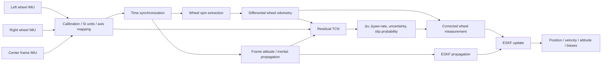
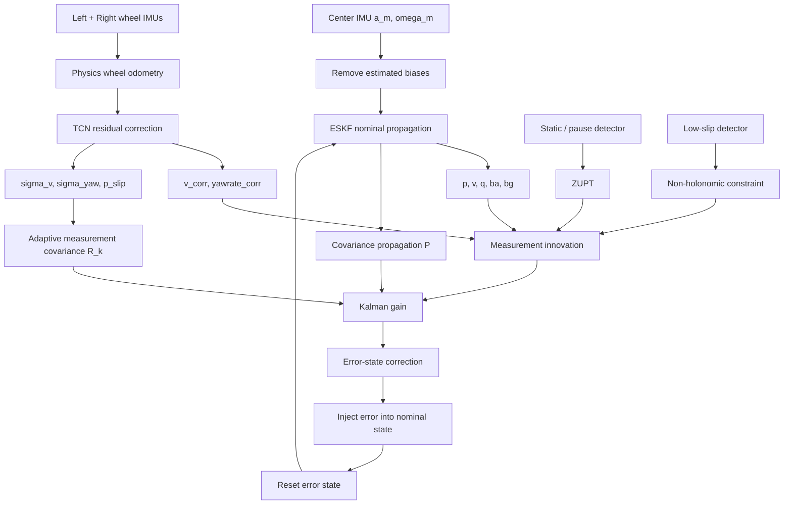

# รายงานเชิงวิเคราะห์: ระบบสร้างวิถีการเคลื่อนที่และแก้ drift ของรถเข็นด้วย IMU สามตัวร่วมกับ Qualisys MoCap

## บทสรุปผู้บริหาร

จากการทบทวนงานวิจัยด้าน wheel-mounted inertial navigation, learned inertial odometry, neural wheel-kinematic correction และ Error-State Kalman Filtering ร่วมกับการตรวจไฟล์จริง `trial_07.csv` และ `trial_07.c3d` ที่คุณอัปโหลด ข้อเสนอที่มีโอกาสให้ **accuracy สูงที่สุดโดยไม่ overfit กับ maneuver ที่เก็บมา** คือไม่ฝึก neural network ให้ทำนาย \(x,y\) โดยตรง แต่ใช้โครงสร้างแบบ **physics + residual learning + probabilistic filtering**:

\[
\boxed{
\text{3 IMUs}
\rightarrow
\text{calibration + synchronization}
\rightarrow
\text{wheel odometry}
\rightarrow
\text{TCN residual/uncertainty/slip}
\rightarrow
\text{ESKF}
\rightarrow
\hat{\mathbf p},\hat{\psi}
}
\]

แนวคิดนี้สอดคล้องกับงาน Wheel-INS ที่แสดงประโยชน์ของ wheel-mounted IMU สำหรับ dead reckoning, งาน RINS-W ที่นำ learned motion constraints เข้า Kalman filtering, TLIO ที่รวม learned motion prediction และ uncertainty เข้ากับ EKF และงานล่าสุดด้าน learned wheel kinematics ที่แสดงว่าความผิดพลาดจาก wheel slip/kinematic model มีลักษณะ nonlinear และสามารถเรียนรู้เพื่อช่วยระบบ odometry ได้ citeturn7view1turn0search13turn3search1turn7view3

สำหรับ wheelchair โดยตรง มีงานล่าสุดที่ใช้ IMU สามตัวใน configuration คล้ายกับของคุณ คือ IMU ที่ hub ของล้อซ้ายและขวา และ IMU บนตัวรถเข็น โดยบันทึก angular velocity ที่ 100 Hz จึงสนับสนุนว่าสถาปัตยกรรมเซนเซอร์ของคุณเหมาะสมต่อการศึกษาการเคลื่อนที่ของ wheelchair จริง citeturn0search8

**ข้อค้นพบสำคัญจากไฟล์จริงของคุณ** คือ:

| ประเด็น | ผลจาก `trial_07` | ความหมายต่อระบบ |
|---|---:|---|
| IMU ทั้งสาม | `L`, `R`, `C` | ตรงกับระบบสาม IMU ที่ต้องการ |
| จำนวนตัวอย่าง | 55,118 rows | เพียงพอสำหรับตรวจ pipeline จริง |
| IMU median period | 9.766 ms | \(\approx 102.396\) Hz |
| Qualisys point rate | 100 Hz | ต้อง resample/synchronize ก่อน train |
| Qualisys frames | 18,031 | \(\approx180.31\) s |
| IMU duration | \(\approx179.35-179.45\) s | capture start/end ไม่ตรง MoCap |
| CSV NaN | ไม่พบ | data transport trial นี้ค่อนข้างสมบูรณ์ |
| `missing_before` | 0 ทุก IMU | ไม่พบ packet loss ตาม field นี้ |
| Qualisys markers | `L_FAL`, `R_FAL` | export นี้มีเพียงสอง 3D trajectories |
| `L_FAL` valid | 89.39% | มี occlusion ที่ต้องระวัง |
| `R_FAL` valid | 99.48% | ค่อนข้างสมบูรณ์ |
| markers ทั้งคู่ valid | 88.87% | GT yaw ใช้ได้ประมาณ 89% ของเวลา |
| maximum L-marker gap | 2.76 s | **ห้าม interpolate เพื่อสร้าง GT derivative ข้าม gap นี้** |
| mean marker separation | \(644.94\pm1.25\) mm | สนับสนุนว่า markers เป็น rigid pair |
| Center-IMU yaw correlation | \(r\approx0.991\) | มีสัญญาณร่วมกับ MoCap ชัดมาก |
| software sync offset โดยประมาณ | \(0.778\) s | ต้องแก้ก่อนสร้าง labels |
| center yaw-like gyro axis ใน trial นี้ | `gx_raw` | แต่ต้องยืนยัน calibration ทุก session |
| IMU units | ยังเป็น raw counts | **ยังไม่ควรคำนวณ physical wheel speed จนทราบ scale/range** |

จุดที่สำคัญที่สุดในตอนนี้ไม่ใช่ neural network แต่คือ **time synchronization, IMU scale/orientation และ Qualisys ground-truth quality** เพราะ trial นี้มี software time offset ราว \(0.78\) s; ถ้า train ก่อนแก้ synchronization โมเดลจะพยายามเรียนรู้ time-delay artifact แทน wheel-slip physics

ผล cross-correlation จากไฟล์จริงแสดงว่าเมื่อเลื่อน Center IMU ให้สัมพันธ์กับ yaw rate ที่คำนวณจาก marker pair แล้ว `gx_raw` ให้ correlation ประมาณ 0.991:

ข้อเสนอหลักสำหรับงานวิจัยคือให้ตั้ง **TCN แบบ multi-task residual model** เป็นโมเดลหลัก โดย window เริ่มต้นประมาณ **128 samples ≈ 1.25 s ที่ 102.4 Hz**, ใช้ 5 dilated residual blocks, 64 channels, kernel 3, dilations \(1,2,4,8,16\) และ output

\[
[
\Delta v,\;
\Delta\dot{\psi},\;
\log\sigma_v^2,\;
\log\sigma_{\dot\psi}^2,\;
p_{\text{slip}}
]
\]

แล้วนำ

\[
v_{\text{corr}}=v_{\text{wheel}}+\Delta v
\]

\[
\dot{\psi}_{\text{corr}}
=
\dot{\psi}_{\text{wheel}}+\Delta\dot{\psi}
\]

เข้า **15-dimensional error-state ESKF** ที่ propagate ด้วย frame IMU และปรับ measurement covariance ตาม uncertainty และ slip probability จาก network

\[
R_k
=
R_{\text{network},k}
\times f(p_{\text{slip},k})
\]

จุดเด่นของวิธีนี้คือ network ไม่ต้องเรียนรู้ Newtonian mechanics ใหม่ทั้งหมด แต่เรียนเฉพาะส่วนที่ differential-drive model ทำไม่ดี เช่น effective wheel radius, asymmetric propulsion, caster-induced motion, slope, wheel slip, pivot และ nonlinear wheel-ground interaction งาน TCN แสดงให้เห็นว่า temporal convolution เป็นจุดเริ่มต้นที่แข็งแรงสำหรับ sequence modeling และ RoNIN ก็ประเมิน TCN/LSTM/ResNet สำหรับ inertial navigation โดยตรง ขณะที่ TLIO แสดงประโยชน์ของการให้ network ทำนายทั้ง motion และ uncertainty ก่อน fuse เข้า EKF citeturn1search3turn7view4turn3search1

อย่างไรก็ตาม **Transformer ยังไม่ควรเป็นโมเดลหลัก** จนทราบว่าคุณมี participant และจำนวน trial มากพอหรือไม่ เพราะข้อได้เปรียบจาก capacity ที่สูงขึ้นอาจกลายเป็น participant/maneuver memorization เมื่อ dataset ขนาดจำกัด ข้อสรุปเชิงงานวิจัยจึงควรเกิดจาก participant/trial-level cross-validation ไม่ใช่ random window split

ข้อจำกัดที่ยังต้องถือเป็น **open constraints** ได้แก่ จำนวน participant ทั้งหมด, จำนวน repetition ต่อ maneuver, IMU รุ่นและ full-scale setting, wheel radius, axle/track width, wheel camber, ตำแหน่งและแกน mounting ที่แน่นอน, มี hardware synchronization หรือไม่ และ Qualisys ของ trial อื่นมี rigid body/markers มากกว่าสองตัวหรือไม่

## สิ่งที่ข้อมูลจริงบอกเราและขั้นตอนเตรียมข้อมูล

การ inspect ไฟล์จริงเปลี่ยนรายละเอียดของ pipeline อย่างมีนัยสำคัญ เพราะ `trial_07.csv` ไม่ใช่ IMU data ที่อยู่ใน SI units แต่เป็น raw integer counts และมี timestamp สองแบบ ได้แก่ `timestamp_device_us` และ `timestamp_pc_monotonic_ns`

จากการตรวจพบว่าแต่ละ sensor มีประมาณ 18.3k samples:

\[
N_C=18377,\qquad
N_R=18375,\qquad
N_L=18366
\]

และ median device interval เหมือนกันที่ประมาณ

\[
\Delta t=0.009766\,s
\]

หรือ

\[
f_s \approx 102.396\,Hz
\]

device timestamps มีความสม่ำเสมอมากกว่า PC timestamps ดังนั้น **เวลาหลักของ sample ควรเป็น `timestamp_device_us`** หลังแก้ clock offset/drift ส่วน `timestamp_pc_monotonic_ns` ควรใช้เป็น anchor เชื่อม clock ของอุปกรณ์แต่ละตัว ไม่ใช่เวลา sample โดยตรง ใน trial นี้ PC timestamp มีเพียงประมาณ 1,837–1,838 ค่า unique ต่อ sensor ทั้งที่มีมากกว่า 18,000 samples ซึ่งบ่งชี้ว่ามันทำหน้าที่คล้าย packet/batch receive timestamp มากกว่า sample-by-sample timestamp

สิ่งที่ควรตรวจในทุก trial ก่อน training คือ:

| ตรวจอะไร | วิธี | เกณฑ์การตัดสินใจ |
|---|---|---|
| sample frequency | median/IQR ของ \(\Delta t\) | เก็บ actual rate ต่อ sensor |
| timestamp monotonicity | \(\Delta t>0\) | clock reset/wrap ต้อง segment |
| missing packets | `seq`, `packet_id`, `missing_before` | สร้าง valid mask |
| duplicate timestamps | uniqueness | ห้าม blindly interpolate |
| accelerometer scale | static gravity magnitude | ต้องทราบ datasheet full scale |
| gyro scale | static + known angular motion | เปลี่ยนเป็น rad/s |
| saturation | raw max/min เทียบ full scale | flag/remove saturated windows |
| gyro bias | static recording | estimate \(b_g\) ต่อ sensor |
| accelerometer bias | multi-orientation calibration หากมี | static ท่าเดียวให้ข้อมูลไม่ครบทุกแกน |
| sensor orientation | gravity + wheel-spin/pivot excitation | หา \(R_{BS}\) |
| temperature | หาก sensor มี temperature | ตรวจ bias dependence |
| MoCap gaps | valid/residual flags | derivative labels ต้อง mask |
| marker geometry | pairwise distances | ตรวจ marker swap/outlier |
| coordinate units | C3D `POINT:UNITS`/QTM setting | แปลงเป็น metre ก่อนทุกอย่าง |

QTM สามารถ export C3D ในหน่วย m, cm หรือ mm โดย default เป็น mm และมี option เปลี่ยน orientation เช่น Y-up ดังนั้นไม่ควร infer coordinate convention จากตัวเลขเพียงอย่างเดียว ต้องตรวจ export metadata/project setting ด้วย citeturn1search4turn1search0 C3D เองถูกออกแบบให้เก็บ 3D trajectories และ analog channels ที่ synchronized กัน โดย point rate และ analog rate ถูกระบุอยู่ในไฟล์ citeturn1search1

สำหรับ `trial_07.c3d` header ให้ point rate = 100 Hz และ 18,031 frames ขณะที่ point trajectories มีเพียงสอง marker คือ `L_FAL` และ `R_FAL` ตัวไฟล์ยังมี analog data แต่สำหรับ trajectory reconstruction สิ่งสำคัญที่สุดคือต้องตระหนักว่า **ไฟล์นี้ไม่ได้ให้ full 6-DoF rigid-body orientation โดยตรง**

ภาพ midpoint trajectory ที่คำนวณจาก

\[
\mathbf p_C^{Q}(t)
=
\frac{
\mathbf p_L^{Q}(t)+\mathbf p_R^{Q}(t)
}{2}
\]

แสดงเส้นทางของ trial นี้ดังนี้:

เมื่อ markers ทั้งคู่ valid ระยะระหว่าง `L_FAL` และ `R_FAL` มีค่าเฉลี่ยประมาณ 644.94 mm และ standard deviation เพียง 1.25 mm จึงเป็นหลักฐานเชิงข้อมูลที่ดีว่า marker pair ทำหน้าที่เหมือน rigid axle/frame reference

แต่ visibility ต่างกันอย่างมาก: `L_FAL` valid เพียง 89.39% และมี gap ยาวสุดประมาณ 2.76 s ในขณะที่ `R_FAL` valid 99.48% ดังนั้น **ห้ามใช้ linear interpolation ข้าม gap 2–3 วินาทีแล้วนำไป differentiate เพื่อสร้าง velocity/yaw rate labels** เพราะจะสร้าง GT ที่ดู smooth แต่ไม่ใช่ measured ground truth จริง QTM มีเครื่องมือ gap filling หลายชนิด รวมทั้ง linear, polynomial และ relational/rigid-body-based filling ซึ่งแปลว่าต้องบันทึกด้วยว่า frame ไหนเป็น original measurement และ frame ไหนถูก gap-filled citeturn2search2turn2search10

แนวปฏิบัติที่แนะนำคือ gap

\[
<50\text{–}100\,ms
\]

อาจ interpolate เพื่อความต่อเนื่องของสัญญาณ แต่ยังต้องเก็บ `valid_gt` mask ส่วน gap ยาวกว่านั้นไม่ใช้สร้าง training labels หรือ trajectory metrics บริเวณ derivative boundary

เรื่อง synchronization ควรมีสองระดับ หากเก็บข้อมูลใหม่ในอนาคต **hardware synchronization ควรเป็นวิธีหลัก** เพราะ Qualisys รองรับ synchronization output, measurement-time TTL, external timebase และ trigger สำหรับอุปกรณ์ภายนอก ทำให้ลดทั้ง offset และ clock drift ได้โดยตรง citeturn2search3turn2search7turn2search11

สำหรับ dataset ที่เก็บไปแล้ว ใช้ software model

\[
t_Q=a_s t_s+b_s
\]

แยกสำหรับ sensor

\[
s\in\{L,R,C\}
\]

โดย \(a_s\) คือ clock-rate correction และ \(b_s\) คือ offset

ลำดับที่แนะนำคือ fit affine mapping จาก device clock ไป PC monotonic clock แบบ robust ก่อน แล้ว refine กับ Qualisys โดยใช้ common dynamic events

สำหรับ center IMU:

\[
\omega_{\text{frame,yaw}}
\leftrightarrow
\dot{\psi}_{GT}
\]

สำหรับ wheel pair:

\[
\omega_R+\omega_L
\leftrightarrow v_{GT}
\]

และ

\[
\omega_R-\omega_L
\leftrightarrow\dot{\psi}_{GT}
\]

รวมถึงใช้ motion onset, pause, U-turn และ pivot peaks เป็น event anchors

ใน `trial_07` cross-correlation ระหว่าง Qualisys axle-derived yaw rate และ Center IMU แสดง maximum correlation ใกล้

\[
b_C\approx0.778\,s,\qquad r\approx0.991
\]

และเมื่อแบ่ง trial เป็นหลายช่วง ค่า lag ที่ได้อยู่ราว 0.774–0.784 s ซึ่งบ่งชี้ว่าการแก้เพียง start-time อาจไม่พอและควร fit affine clock model ด้วย อย่างไรก็ตามตัวเลขนี้เป็น **trial-specific estimate** และต้องทำใหม่ทุก recording/session จนกว่าจะพิสูจน์ได้ว่า acquisition software ใช้ clock relationship เดิม

Coordinate system ควรนิยามเองอย่างชัดเจนเพื่อไม่ให้ชนกับ convention ของ QTM เนื่องจาก Qualisys นิยาม roll/pitch/yaw และเครื่องหมายของ positive rotation ตาม convention ของ QTM และสามารถเปลี่ยน Euler definitions ได้ citeturn2search1turn2search5

ผมแนะนำ body frame:

\[
B:
\quad x=\text{forward},\quad
y=\text{left},\quad
z=\text{up}
\]

และ world frame \(W\) จาก Qualisys ที่แปลงเป็น metre และ \(z\)-up

จาก marker pair:

\[
\mathbf y_B
=
\frac{\mathbf p_L-\mathbf p_R}
{\|\mathbf p_L-\mathbf p_R\|}
\]

สำหรับ flat-ground yaw ให้

\[
\mathbf x_B
=
\frac{\mathbf y_B\times\mathbf z_W}
{\|\mathbf y_B\times\mathbf z_W\|}
\]

แล้ว

\[
\psi
=
\operatorname{atan2}
\left(
x_{B,y},x_{B,x}
\right)
\]

ต้องตรวจ sign ด้วยช่วง straight movement หนึ่งช่วงเพื่อป้องกัน heading กลับ \(180^\circ\)

จากนั้น unwrap:

\[
\psi_u(t)=\operatorname{unwrap}(\psi(t))
\]

ก่อน differentiate

\[
\dot{\psi}_{GT}
=
\frac{d\psi_u}{dt}
\]

ตำแหน่ง GT คือ

\[
\mathbf p_{GT}
=
\frac{\mathbf p_L+\mathbf p_R}{2}
\]

velocity ไม่ควรคำนวณจาก raw finite difference ทันที แต่ควร low-pass/smoothing spline หรือ Savitzky–Golay ก่อน differentiation เพราะ differentiation ขยาย MoCap noise อย่างมาก

\[
\mathbf v_{GT}
=
\frac{d}{dt}
\tilde{\mathbf p}_{GT}
\]

แล้ว forward velocity

\[
v_{GT}
=
\mathbf x_B^\top \mathbf v_{GT}
\]

สำหรับ slope มีข้อจำกัดสำคัญมาก: marker สองตัวบนแกนซ้าย–ขวาให้ตำแหน่ง 3D และ axle direction แต่ **ไม่ให้ full pitch/roll orientation อิสระ** ดังนั้นสำหรับ `SlopeB/F/...` หากต้องการ true body-forward 3D velocity และ pitch ground truth ที่แข็งแรง ควรมีอย่างใดอย่างหนึ่งคือ slope-plane normal ที่ทราบจากการ calibration, marker ตัวที่สามบน frame หรือ QTM 6DOF rigid-body output เพราะ QTM สามารถนิยาม local coordinate system และ export rigid-body pose เทียบกับ global frame ได้โดยตรง citeturn2search0turn2search12

## สถาปัตยกรรมที่แนะนำตั้งแต่ wheel odometry ถึง ESKF

Pipeline หลักควรเป็นดังนี้:

หลักการ wheel-mounted IMU มีพื้นฐานสนับสนุนจาก Wheel-INS ซึ่งใช้ gyro ของ IMU ที่ติดกับล้อเพื่อสร้าง wheel-speed information และใช้ร่วมกับ inertial navigation; ผลของงานนั้นยังชี้ว่าการหมุนของ wheel-mounted sensor มีผลช่วยเฉลี่ยบางส่วนของ sensor bias ได้ แต่ตัวเลข performance ของงานนั้นไม่ควรถูกนำมาใช้เป็น expected performance ของ wheelchair โดยตรงเพราะ platform และ experiment ต่างกัน citeturn7view1

สำหรับรถเข็น differential rear-wheel model ให้ angular velocity ของล้อที่แก้ sign/axis/bias แล้วเป็น

\[
\omega_L,\omega_R
\]

และ effective wheel radii เป็น \(r_L,r_R\)

\[
u_L=r_L\omega_L
\]

\[
u_R=r_R\omega_R
\]

จากนั้น

\[
v_{\text{odo}}
=
\frac{u_R+u_L}{2}
\]

และ

\[
\dot{\psi}_{\text{odo}}
=
\frac{u_R-u_L}{b_{\text{eff}}}
\]

โดย \(b_{\text{eff}}\) ไม่ควรถูกบังคับให้เท่ากับระยะที่วัดด้วยไม้บรรทัดเสมอ เนื่องจาก camber, tire deformation, pivoting contact mechanics และ caster dynamics สามารถทำให้ kinematic effective width ต่างจาก geometric width ได้ ควรเริ่มจาก physical value แล้ว calibrate บน training/calibration trials เท่านั้น

สำหรับ wheelchair ของคุณ maneuver มีประโยชน์มากต่อ parameter identification:

| Parameter | Trial ที่เหมาะ |
|---|---|
| gyro zero bias | `static` |
| wheel-axis/sign | straight + `static` |
| \(r_L/r_R\) relative scale | `10x5`, `10x5up` |
| \(b_{\text{eff}}\) | `Pvar`, `Pvcr`, `Ar`, `Celw` |
| dynamic nonlinear error | `Sl`, `Slup` |
| high-speed behavior | `Sp`, `7_5_mspt` |
| pitch/grade sensitivity | `Slope*` |

จุดที่ต้องเพิ่มสำหรับ slope คือ wheel IMU gyro component ตาม axle ไม่ได้มีแต่ wheel spin อย่างเดียว หาก chassis กำลัง pitch ขึ้น/ลง slope angular rate ของ frame ที่ project ลง axle สามารถปนเข้ามาได้ ดังนั้นควรใช้ center IMU หัก rigid-body component:

\[
\omega_{spin,L}
\approx
\mathbf a_L^\top
\left(
\boldsymbol\omega_L
-
R_{LS_C}\boldsymbol\omega_C
\right)
\]

และเช่นเดียวกันสำหรับขวา โดย \(\mathbf a_L\) คือ wheel-axle unit vector ใน sensor frame แนวคิดนี้สำคัญมากกว่าใน flat-only odometry เพราะ dataset ของคุณมี `SlopeF/B/...`

โมเดลไม่ควรทำนาย absolute pose:

\[
(x,y,\psi)
\]

เพราะจะบังคับให้ network เรียนรู้ global coordinate, path length และ integration dynamics ซึ่งมีโอกาส generalize แย่กว่า วิธีที่แนะนำคือสร้าง local physics residual labels

\[
\Delta v
=
v_{GT}-v_{\text{odo}}
\]

\[
\Delta\dot{\psi}
=
\dot{\psi}_{GT}
-
\dot{\psi}_{\text{odo}}
\]

แล้ว

\[
v_{\text{corr}}
=
v_{\text{odo}}+\widehat{\Delta v}
\]

\[
\dot{\psi}_{\text{corr}}
=
\dot{\psi}_{\text{odo}}
+\widehat{\Delta\dot{\psi}}
\]

นี่เป็น design inference จากหลักเดียวกับ learned motion constraints และ learned wheel-kinematic corrections: model-based motion ยังทำหน้าที่หลัก ส่วน network รับผิดชอบ nonlinear model error งานด้าน wheeled robotics ล่าสุดก็รายงานปัญหา nonlinear wheel-kinematic error เมื่อ slip สูงและใช้ neural model เพื่อปรับ kinematic constraints citeturn7view3

สำหรับ slip label ไม่แนะนำให้เขียน label ว่า “pivot = slip” หรือ “slope = slip” เพราะ maneuver class ไม่เท่ากับ physical slip ควรสร้าง pseudo-ground-truth จาก MoCap:

\[
u_{L,GT}
=
v_{GT}
-
\frac{b}{2}\dot{\psi}_{GT}
\]

\[
u_{R,GT}
=
v_{GT}
+
\frac{b}{2}\dot{\psi}_{GT}
\]

แล้ว

\[
e_L
=
r_L\omega_L-u_{L,GT}
\]

\[
e_R
=
r_R\omega_R-u_{R,GT}
\]

รวมกับ lateral velocity

\[
v_y^B
=
\mathbf y_B^\top\mathbf v_{GT}
\]

สร้าง slip score

\[
q
=
\max
\left(
|e_L|,
|e_R|,
\lambda_y|v_y^B|
\right)
\]

แล้ว soft probability label:

\[
p_{\text{slip}}^{GT}
=
\sigma
\left(
\frac{q-\tau}{s}
\right)
\]

โดย \(\tau\) ไม่ควรกำหนดแบบ arbitrary แต่หา distribution ของ \(q\) จาก straight/non-slip training data เช่น 95th หรือ 99th percentile แล้วกำหนด \(s\) จาก robust spread ของ training residual

ESKF ที่เหมาะกับ dataset ที่มี slope ควรเป็น full 3D inertial state ไม่ใช่ planar \(x,y,\psi\) อย่างเดียว Nominal state:

\[
\mathbf x
=
[
\mathbf p,\;
\mathbf v,\;
\mathbf q,\;
\mathbf b_a,\;
\mathbf b_g
]
\]

โดย

\[
\mathbf p,\mathbf v\in\mathbb R^3,\quad
\mathbf q\in SO(3)
\]

และ error state:

\[
\delta\mathbf x
=
[
\delta\mathbf p,\;
\delta\mathbf v,\;
\delta\boldsymbol\theta,\;
\delta\mathbf b_a,\;
\delta\mathbf b_g
]
\in\mathbb R^{15}
\]

ESKF เหมาะกับ inertial navigation เพราะ nominal orientation สามารถเก็บด้วย quaternion ในขณะที่ filter linearize เฉพาะ small-angle orientation error และหลัง correction จะ inject error กลับ nominal state แล้ว reset error covariance อย่างเป็นระบบ citeturn5view2turn6view1

Flow ของ filter:

Frame IMU ใช้ propagation:

\[
\dot{\mathbf p}=\mathbf v
\]

\[
\dot{\mathbf v}
=
R(\mathbf q)
(\mathbf a_m-\mathbf b_a-\mathbf n_a)
+\mathbf g
\]

\[
\dot{\mathbf q}
=
\frac{1}{2}
\mathbf q
\otimes
(\boldsymbol\omega_m-\mathbf b_g-\mathbf n_g)
\]

ส่วน wheel/TCN ทำ measurement update

\[
z_v=v_{\text{corr}}
\]

และ yaw-rate information ใช้ช่วย estimate vertical gyro bias หรือแปลงเป็น relative yaw increment ก่อน update orientation

\[
\Delta\psi_{\text{wheel}}
=
\int_{t_k}^{t_{k+1}}
\dot{\psi}_{\text{corr}}\,dt
\]

แนวคิด learned displacement/uncertainty + EKF มีตัวอย่างชัดเจนใน TLIO ซึ่งให้ network ทำนาย motion และ uncertainty แล้วใช้เป็น statistical measurement ใน tightly-coupled EKF citeturn3search1turn5view3

ในช่วง static/pause ใช้ Zero-Velocity Update:

\[
\mathbf v=\mathbf 0
\]

โดยตรวจพร้อมกันจาก wheel spin และ frame gyro/accelerometer เพื่อหลีกเลี่ยง false static

ในช่วง slip ต่ำ ใช้ non-holonomic constraints:

\[
v_y^B\approx0,
\qquad
v_z^B\approx0
\]

แต่ต้องลดน้ำหนักหรือปิด constraint ระหว่าง aggressive pivot, lateral slip หรือ terrain irregularity งาน wheel-inertial odometry ก็ใช้ non-holonomic constraints และ ZUPT เพื่อจำกัด drift และจัดการความผิดพลาดจาก wheel odometry citeturn4search3

ส่วน measurement covariance ให้ network ช่วยกำหนด:

\[
R_k
=
\begin{bmatrix}
\sigma_v^2&0\\
0&\sigma_{\dot\psi}^2
\end{bmatrix}
\]

แล้ว inflate เมื่อ slip สูง:

\[
R_k'
=
R_k
\left[
1+\alpha
\frac{p_{\text{slip}}}
{1-p_{\text{slip}}+\epsilon}
\right]
\]

พร้อม bound

\[
R_{\min}\le R_k'\le R_{\max}
\]

เพื่อไม่ให้ filter เชื่อ network มากเกินไปหรือทิ้ง wheel measurement ทั้งหมด

## โมเดลที่ควรฝึกและรายละเอียดการเทรน

ตัวเลือกหลักควรเปรียบเทียบภายใต้ **input, label, training split และ parameter budget ใกล้เคียงกัน** ไม่เช่นนั้นจะตอบไม่ได้ว่าความแตกต่างมาจาก architecture หรือ data leakage

RoNIN ใช้ทั้ง TCN, LSTM และ convolutional architectures สำหรับ inertial navigation และงาน TCN ดั้งเดิมพบว่า dilated temporal convolution เป็น baseline ที่แข็งแรงสำหรับ sequence modeling และรักษา effective history ได้ดี งานเหล่านี้ไม่ได้พิสูจน์ว่า TCN จะดีที่สุดสำหรับ wheelchair ของคุณโดยอัตโนมัติ แต่เป็นเหตุผลที่ดีที่จะตั้ง TCN เป็น primary candidate แล้วพิสูจน์ด้วย ablation ของ dataset นี้ citeturn7view4turn1search3

| โมเดล | Architecture เริ่มต้น | ข้อดี | ข้อเสีย | บทบาทที่แนะนำ |
|---|---|---|---|---|
| 1D-CNN | Conv 64→64→128→128, kernel 5 | ง่าย เร็ว overfit ยาก | temporal context จำกัด | baseline neural |
| **TCN** | 5 residual blocks, 64 ch, \(k=3\), dilation 1–16 | long receptive field, causal, efficient | ต้องเลือก receptive field | **primary model** |
| LSTM | 2 layers × 128 hidden | sequential dynamics โดยธรรมชาติ | ช้ากว่า, optimization ยากกว่า | strong baseline |
| Transformer | 3 layers, \(d=96\), 4 heads | global temporal interaction | data hungry, overfit ง่าย | secondary experiment |
| TCN + ESKF | TCN ด้านบน + probabilistic filter | physics + learning + uncertainty | implementation ซับซ้อนกว่า | **proposed final system** |

TCN ที่ผมแนะนำเป็นจุดเริ่มต้น:

\[
N_w=128\text{ samples}
\]

ที่ \(102.4\) Hz คือประมาณ

\[
T_w\approx1.25\,s
\]

Residual blocks:

\[
d=[1,2,4,8,16]
\]

kernel:

\[
k=3
\]

สอง convolution ต่อ block ทำให้ receptive field ใกล้เคียงกับ window เต็มประมาณ 1.2 s ซึ่งเหมาะกับ push-stroke, turn onset และ local slip dynamics โดยไม่ต้องให้ network จำทั้ง trial

ควรทำ window ablation:

\[
0.5,\quad1.0,\quad1.25,\quad2.0\,s
\]

ไม่ควรตัดสิน window จาก residual validation loss อย่างเดียว แต่ให้เลือกจาก **validation trajectory ATE/RPE/yaw drift**

Input เริ่มต้นที่ผมแนะนำประมาณ:

\[
\mathbf u_t=
[
\mathbf a_L,\boldsymbol\omega_L,
\mathbf a_R,\boldsymbol\omega_R,
\mathbf a_C,\boldsymbol\omega_C,
\omega_{spin,L},
\omega_{spin,R},
v_{\text{odo}},
\dot{\psi}_{\text{odo}},
\phi,\theta
]
\]

หรือแทน roll/pitch ด้วย gravity vector ใน body frame

\[
\mathbf g_B
\]

เพื่อลด Euler singularities

สำหรับ center IMU ควร rotate เข้า fixed wheelchair body frame ส่วน wheel IMUs ไม่จำเป็นต้อง rotate accelerometer ทั้งหมดเข้า global frame เพราะ periodic wheel-frame signal อาจมีข้อมูลเกี่ยวกับ wheel phase, speed และ contact dynamics ที่ network ใช้ได้; แต่ axle projection ต้องถูก calibration ให้ชัดเจน งาน learning-based inertial odometry ล่าสุดก็แสดงว่าการเลือก representation มีผลต่อ observability อย่างมาก และการรักษา body-frame information พร้อม attitude information สามารถดีกว่าการแปลง raw inertial signal เข้า global frameโดยอัตโนมัติในงานของเขา แม้ platform จะเป็น UAV ไม่ใช่ wheelchair citeturn0search5

**ห้าม train จาก raw counts โดยไม่ทราบ scale หากเป้าหมายคือ deploy ข้าม sensor/session** ก่อน train ต้องเปลี่ยนเป็น

\[
a\;[\mathrm{m/s^2}]
\]

และ

\[
\omega\;[\mathrm{rad/s}]
\]

หากข้อมูลเก่าขาด datasheet setting จริง ๆ สามารถ estimate composite calibration scale จาก MoCap ได้ใน exploratory experiment แต่ model ที่ได้จะผูกกับ hardware/session มากกว่า

Normalization:

\[
x'=\frac{x-\mu_{\text{train}}}
{\sigma_{\text{train}}+\epsilon}
\]

ต้องคำนวณ \(\mu,\sigma\) จาก **training fold เท่านั้น**

ไม่ควร normalize แต่ละ window ให้ zero mean เพราะจะลบ low-frequency bias/tilt information ซึ่งเป็นสิ่งที่ระบบต้องเรียนรู้

Output แนะนำ:

\[
\mathbf y=
[
\Delta v,
\Delta\dot\psi,
\log\sigma_v^2,
\log\sigma_{\dot\psi}^2,
p_{\text{slip}}
]
\]

สำหรับ residual targets ควร standardize แยกกันใน training set

\[
\Delta v'
=
\frac{\Delta v-\mu_{\Delta v}}
{\sigma_{\Delta v}}
\]

และเหมือนกันสำหรับ yaw rate เพื่อไม่ให้ task ที่มี numerical magnitude ใหญ่กว่าครอบ gradient

Loss phase แรก:

\[
\mathcal L_1
=
\operatorname{Huber}
(\widehat{\Delta v},\Delta v)
+
\operatorname{Huber}
(\widehat{\Delta\dot\psi},\Delta\dot\psi)
+
\lambda_s
\operatorname{BCE}
(\hat p_{\text{slip}},p_{\text{slip}})
\]

ด้วย

\[
\lambda_s\approx0.2\text{–}0.5
\]

หลัง mean prediction stabilize แล้วเปิด heteroscedastic likelihood:

\[
\mathcal L_{\text{NLL}}
=
\frac{(y-\mu)^2}{2\sigma^2}
+
\frac{1}{2}\log\sigma^2
\]

แนวทาง train mean prediction ก่อน uncertainty likelihood มี precedent ใน TLIO ซึ่งพบว่าการเริ่มจาก likelihood loss โดยตรง train ได้ยากกว่าและจึงใช้ staged training citeturn3search1turn6view2

ค่าตั้งต้นที่เหมาะสำหรับ experiment:

| Hyperparameter | ค่าเริ่มต้น |
|---|---:|
| window | 128 samples |
| stride training | 8–16 samples |
| channels | 64 |
| TCN blocks | 5 |
| kernel size | 3 |
| dilation | 1, 2, 4, 8, 16 |
| dropout | 0.10–0.20 |
| batch size | 128–256 |
| optimizer | AdamW |
| learning rate | \(3\times10^{-4}\) |
| weight decay | \(10^{-4}\) |
| gradient clipping | 1.0 |
| scheduler | cosine decay |
| warm-up | 3–5 epochs |
| maximum epochs | 80–120 |
| early stopping | 10–15 epochs |
| training precision | mixed precision หากใช้ GPU |

TCN ขนาดนี้ไม่จำเป็นต้องใช้ GPU ขนาดใหญ่สำหรับ inference และการ train ควรทำได้บน GPU ประมาณ 8–12 GB สำหรับ window และ batch ขนาดดังกล่าว แต่เวลาจริงขึ้นกับจำนวน trials และ preprocessing

Data augmentation ควรเป็น **physics-aware**:

\[
b_a \leftarrow b_a+\delta b_a
\]

\[
b_g \leftarrow b_g+\delta b_g
\]

พร้อม small axis misalignment, small scale perturbation และ timestamp jitter โดย magnitude ต้องดึงจาก static-calibration statistics จริง ไม่ควรใช้ค่ากว้างแบบ arbitrary TLIO ก็ใช้ bias/orientation perturbations ระหว่าง training เพื่อทำให้ learned motion model ทนต่อ errors ที่มาจาก filter state มากขึ้น citeturn3search1

ควรจำลอง packet dropout สั้น ๆ ตาม distribution ที่พบจริง แต่ **อย่าสร้าง dropout แบบ random 20–30% หาก hardware ไม่ได้เป็นแบบนั้น** เพราะ network จะเรียน task ที่ต่างจาก deployment

สำหรับ label timing ผมแนะนำ causal version:

- input: \(t-1.25\,s\rightarrow t\)
- output: mean residual ในช่วงท้ายประมาณ 50–100 ms

ซึ่งลด derivative-label noise โดยยังรักษา real-time causality

## แผน validation การแบ่งข้อมูล และสถิติ

จุดเสี่ยงที่สุดของงาน learning กับ dataset ลักษณะนี้คือ **random-window leakage**

ตัวอย่างเช่น window ที่เริ่มวินาที 20.0 และ 20.1 ของ trial เดียวกัน share input มากกว่า 90% หากอันหนึ่งอยู่ train และอีกอันอยู่ test โมเดลแทบจะเห็น test sequence มาแล้ว ดังนั้นห้ามใช้ random `train_test_split` หลัง windowing

หลักคือ:

\[
\boxed{\text{split trials/participants first → window afterwards}}
\]

แผนทดลองควรมีอย่างน้อยสองแกนคือ **seen maneuver** และ **unseen maneuver**

| Experiment | Train | Validation | Test | ตอบคำถามอะไร |
|---|---|---|---|---|
| Seen maneuver | maneuver types ครบ แต่คน/trial แยก | unseen trials | unseen participant/trials | เมื่อเคยเห็นรูปแบบ maneuver แล้ว generalize ได้หรือไม่ |
| Unseen maneuver | ตัด maneuver family หนึ่งออกทั้งหมด | train-family trials | held-out family | เจอ motion ที่ไม่เคยเห็นได้แค่ไหน |
| Unseen participant | participants บางส่วน | participant แยก | participant ใหม่ | generalization ข้ามคน |
| Unseen participant + maneuver | จำกัดที่สุด | separate groups | คนใหม่ + maneuver ใหม่ | stress test สูงสุด |
| Leave-one-trial-out | ใช้เมื่อ participant น้อย | trial-level | one full trial | อย่างน้อยกัน temporal leakage |

Maneuver taxonomy ที่เหมาะกับ dataset นี้:

| Family | Dataset |
|---|---|
| Static/calibration | `static` |
| Straight/repeated | `10x5`, `10x5up` |
| Pivot/turn | `Pvar`, `Pvcr`, `Celw`, `Ar` |
| Slalom | `Sl`, `Slup` |
| Sprint | `Sp`, `7_5_mspt` |
| Slope | `SlopeB`, `SlopeF`, `SlopeFBAR`, `SlopeFBCW`, `SlopeHAR`, `SlopeHCW` |

`static` ไม่ควรถือเป็น maneuver test แบบเดียวกับ dynamic trials แต่ใช้สำหรับ sensor calibration และ ZUPT-threshold development

จำนวน participant ยังไม่ทราบ จึงควรเลือก protocol ตามจำนวนจริง:

| จำนวน participant | Protocol |
|---|---|
| \(N=1\) | trial-level CV เท่านั้น; **ห้าม claim subject generalization** |
| \(N=2-4\) | Leave-One-Subject-Out |
| \(N=5-10\) | LOSO หรือ 5-fold GroupKFold |
| \(N>10\) | participant-stratified 5-fold outer CV + inner validation |

หากแต่ละ participant มีหลาย trials ต้อง group ทั้งหมดของ participant เดียวกันไว้ใน fold เดียวกันสำหรับ experiment ที่ทดสอบ person generalization

สำหรับ unseen maneuver ให้ทำ leave-one-family-out เช่น:

\[
\text{Train without slope}
\rightarrow
\text{test all Slope*}
\]

\[
\text{Train without slalom}
\rightarrow
\text{test Sl + Slup}
\]

\[
\text{Train without pivot}
\rightarrow
\text{test Pvar/Pvcr/Ar/Celw}
\]

การ hold out family มีความหมายกว่าการ hold out ชื่อไฟล์หนึ่ง เนื่องจาก `Pvar` กับ `Ar` หรือ `Pvcr` กับ `Celw` อาจมี dynamics ใกล้กัน

Hyperparameter tuning ต้องเกิดใน inner validation เท่านั้น Test fold ต้องไม่ถูกใช้เลือก window size, filter covariance, slip threshold หรือ wheel parameters

สำหรับ statistical analysis หน่วยอิสระต้องเป็น **participant หรือ trial** ไม่ใช่ 10,000 overlapping windows งานด้าน statistical comparison ของ learning algorithms แนะนำ non-parametric paired tests เช่น Wilcoxon signed-rank สำหรับสองวิธี และ Friedman test พร้อม post-hoc correction เมื่อเปรียบเทียบหลายวิธี citeturn4search2

ผมแนะนำให้รายงานต่อ metric เป็น:

\[
\text{median [IQR]}
\]

และ

\[
95\%\;\text{bootstrap CI}
\]

ควบคู่ mean ± SD

เมื่อมี participant หลายคนให้ทำ **hierarchical bootstrap**:

\[
\text{sample participant}
\rightarrow
\text{sample trials within participant}
\]

แทน bootstrap windows

สำหรับ pairwise final comparison เช่น

\[
\text{Classical ESKF}
\quad vs\quad
\text{TCN+ESKF}
\]

ใช้ paired Wilcoxon บน trial-level ATE/RPE แล้วรายงาน effect size ด้วย ไม่ใช่เพียง \(p\)-value

หากเปรียบเทียบ

\[
\{
\text{1D-CNN},
\text{TCN},
\text{LSTM},
\text{Transformer}
\}
\]

ให้ใช้ Friedman omnibus ก่อน แล้ว pairwise Wilcoxon พร้อม Holm correction

## Metrics, ablation, failure modes และแผน implementation

ATE และ RPE เป็น metric มาตรฐานที่ใช้แยก global trajectory accuracy ออกจาก local drift โดย RPE วัด relative motion error ระหว่างสอง pose และ ATE เปรียบเทียบ estimated trajectory กับ ground truth trajectory citeturn5view0turn5view1turn6view0

แต่สำหรับ wheelchair odometry ต้องปรับ protocol หนึ่งจุดสำคัญ: **primary ATE ไม่ควรทำ full-trajectory similarity alignment** เพราะจะซ่อน scale และ yaw drift ที่เราต้องการวัด

Primary evaluation ให้ align เฉพาะ initial pose:

\[
T_{\text{align}}
=
T_{GT,0}
T_{\text{est},0}^{-1}
\]

แล้วปล่อย trajectory drift ตามจริง

\[
ATE_{\text{RMSE}}
=
\sqrt{
\frac1N
\sum_{i=1}^{N}
\|
\hat{\mathbf p}_i-\mathbf p_i
\|^2
}
\]

สามารถรายงาน globally SE(2)-aligned ATE เป็น secondary metric เพื่อเทียบกับ literature แต่ต้องแยกชื่อชัดเจน

RPE ควรทำตาม **distance travelled** มากกว่า frame interval:

\[
RPE@1m
\]

และ

\[
RPE@5m
\]

เนื่องจาก maneuver ของคุณมี speed ต่างกันมากระหว่าง static, sprint และ slope การใช้ fixed time interval ทำให้ metric เทียบ condition กันไม่ตรง concept ของ drift per distance หลักการนี้เป็น distance-indexed adaptation จาก RPE ซึ่งเดิมใช้ relative transform ระหว่าง pose ที่ห่างกันตาม interval ที่กำหนด citeturn5view0

metric หลักทั้งหมด:

| Metric | นิยาม | ใช้อ่านอะไร |
|---|---|---|
| ATE RMSE | absolute position RMSE | global accuracy |
| ATE median | median position error | robust global accuracy |
| RPE@1m | relative pose error ทุก 1 m | local drift |
| RPE@5m | relative pose error ทุก 5 m | medium-term drift |
| yaw RMSE | wrapped yaw error | heading accuracy |
| yaw MAE | absolute yaw error | robust heading accuracy |
| endpoint error | \(\|\hat p_T-p_T\|\) | final drift |
| drift % | endpoint / GT path length ×100 | normalized drift |
| path-length error % | estimated vs GT distance | scale error |
| \(v\) RMSE | corrected velocity vs GT | local model accuracy |
| \(\dot\psi\) RMSE | yaw-rate error | turn accuracy |
| slip AUROC/AUPRC | slip prediction | classification |
| NIS | normalized innovation squared | filter consistency |

Drift percentage:

\[
D_{\%}
=
100
\frac{
\|\hat{\mathbf p}(T)-\mathbf p_{GT}(T)\|
}{
\sum_i
\|
\mathbf p_{GT,i+1}-\mathbf p_{GT,i}
\|
}
\]

แต่ห้ามใช้ metric นี้เพียงตัวเดียว เพราะ loop trajectory สามารถกลับมาใกล้จุดเริ่มได้แม้ trajectory กลางทางผิดมาก จึงต้องรายงานร่วมกับ ATE และ RPE

evaluation per maneuver ควรเป็น:

| Maneuver | สิ่งที่ stress-test | Metrics หลัก |
|---|---|---|
| `static` | gyro/accel bias, false motion | stationary drift, velocity bias, yaw drift |
| `10x5` | straight scale + repeated U-turn | drift %, ATE, RPE@5m, endpoint |
| `10x5up` | propulsion + pauses/U-turn | drift %, ZUPT effect, yaw error |
| `Pvar` | anti-clockwise pivot | yaw RMSE, \(\dot\psi\) RMSE, position during pivot |
| `Pvcr` | clockwise pivot | yaw RMSE, CW/CCW asymmetry |
| `Celw` | clockwise rotation | yaw drift, wheel asymmetry |
| `Ar` | anticlockwise rotation | yaw drift, direction symmetry |
| `Sl` | alternating curvature | RPE@1m, yaw RMSE, lateral error |
| `Slup` | slalom + U-turn/pause | RPE@1m, ATE, transient error |
| `Sp` | acceleration/high wheel speed | \(v\) RMSE, saturation, endpoint |
| `7_5_mspt` | sprint + pivot | peak velocity error, turn transition, ATE |
| `SlopeB` | downhill gravity/pitch | speed error, vertical/3D ATE, drift |
| `SlopeF` | uphill gravity/pitch | same + wheel-spin contamination |
| `SlopeFBAR` | grade + CCW turn | yaw + speed coupling |
| `SlopeFBCW` | grade + CW turn | yaw + speed coupling |
| `SlopeHAR` | partial slope + CCW | transition error, RPE |
| `SlopeHCW` | partial slope + CW | transition error, RPE |

Ablation studies ที่จำเป็นเพื่อให้ paper ตอบได้ว่า accuracy มาจากอะไร:

| Configuration | คำถามที่ตอบ |
|---|---|
| Wheel IMU L+R only | wheel sensors เพียงพอแค่ไหน |
| Frame IMU only | inertial-only drift เท่าไร |
| L+R+C classical | value ของ three-sensor fusion |
| raw wheel odometry | physics baseline |
| wheel + classical EKF/ESKF | learning จำเป็นหรือไม่ |
| residual TCN only | learned correction โดยไม่มี filter |
| TCN + ESKF | benefit จาก hybrid system |
| TCN + ESKF − slip head | slip-aware covariance ช่วยหรือไม่ |
| TCN + ESKF − uncertainty | learned covariance ช่วยหรือไม่ |
| TCN + ESKF − ZUPT | pause information สำคัญแค่ไหน |
| TCN + ESKF − NHC | kinematic constraint สำคัญแค่ไหน |
| calibrated axes vs raw axes | orientation calibration สำคัญแค่ไหน |
| fixed offset vs affine sync | clock drift มีผลเท่าไร |
| 0.5/1/1.25/2 s window | temporal context ที่เหมาะ |
| TCN vs LSTM vs Transformer | architecture comparison |

Baselines ที่ควรปรากฏใน paper อย่างน้อย:

\[
B_0:
\text{raw differential wheel odometry}
\]

\[
B_1:
\text{frame IMU inertial integration}
\]

\[
B_2:
\text{wheel + frame classical ESKF}
\]

\[
B_3:
\text{TCN residual integration without ESKF}
\]

\[
B_4:
\text{TCN residual + ESKF}
\]

\[
B_5:
\text{TCN residual + uncertainty/slip adaptive ESKF}
\]

โดย \(B_5\) คือ proposed full system

Failure modes ที่คาดว่าจะสำคัญที่สุดคือ:

| Failure mode | ผล | Mitigation |
|---|---|---|
| time offset | network label ผิด phase | affine synchronization |
| clock drift | error โตตาม trial length | estimate \(a,b\) ไม่ใช่ offset อย่างเดียว |
| unknown raw IMU scale | velocity scale ผิด | recover datasheet/full-scale settings |
| wheel-axis misalignment | spin mixed กับ other rotation | static + spin calibration |
| slope pitch rate | contaminates wheel gyro | subtract frame angular rate |
| MoCap marker occlusion | GT derivative spike | valid-mask + no long-gap labels |
| marker swap | yaw jump ~180° | pair-distance/sign consistency |
| wheel slip | wheel odometry biased | residual model + covariance inflation |
| caster scrub during pivot | differential model mismatch | pivot training + residual learning |
| tire pressure/load | effective radius changes | recalibration/domain randomization |
| asymmetric push | transient wheel dynamics | both wheel IMUs + temporal network |
| sensor temperature | bias drift | warm-up/temp compensation |
| gyro saturation in sprint/pivot | clipped yaw/spin | inspect full-scale range |
| unseen maneuver | network extrapolation | physics fallback + uncertainty |
| unseen participant | propulsion style shift | participant-level CV |
| random-window leakage | falsely high accuracy | group split before windowing |

ระบบควรมี **out-of-distribution safety mechanism** ด้วย เมื่อ network uncertainty สูงหรือ \(p_{\text{slip}}\) สูงผิดปกติ ไม่ควร blindly apply residual correction แต่ให้ measurement covariance สูงขึ้นและกลับไปพึ่ง frame IMU/physics model มากขึ้น นี่เป็นข้อได้เปรียบเชิงระบบของ hybrid ESKF เมื่อเทียบกับ direct neural trajectory prediction

ลำดับ implementation ที่เหมาะที่สุดจากข้อมูลที่มีตอนนี้คือ:

**ขั้น data layer:** ทำ parser ของ CSV/C3D → SI conversion → sample-valid masks → axis mapping → synchronized master timeline 100 Hz

**ขั้น GT layer:** สร้าง

\[
x_{GT},y_{GT},z_{GT},\psi_{GT},
v_{GT},\dot\psi_{GT}
\]

พร้อม `gt_valid` และ `gap_distance`

**ขั้น physics layer:** fit

\[
r_L,r_R,b_{\text{eff}}
\]

จาก training/calibration trials แล้วสร้าง raw wheel-odometry baseline

**ขั้น learning layer:** สร้าง

\[
\Delta v,\Delta\dot\psi,p_{\text{slip}}
\]

window 128 samples และ train 1D-CNN/TCN/LSTM โดย TCN เป็น primary

**ขั้น filtering:** propagate frame IMU ใน 15-state ESKF แล้วใช้ corrected wheel motion, ZUPT และ conditional non-holonomic constraints เป็น updates ESKF formulation แบบ nominal state + error injection/reset เป็นแนวทางมาตรฐานสำหรับ quaternion inertial estimation citeturn5view2turn6view1

**ขั้น validation:** split participant/trial ก่อน window, ทำ seen-maneuver และ leave-one-maneuver-family-out experiments, รายงาน ATE/RPE/yaw/drift ต่อ trial และต่อ maneuver

**ขั้น final model selection:** เลือกจาก trajectory-level validation score ไม่ใช่ lowest neural-network MSE เช่น

\[
S=
z(ATE)
+
z(RPE@1m)
+
z(RPE@5m)
+
z(YawRMSE)
\]

แล้ว freeze ทั้ง model, wheel parameters, synchronization procedure และ filter covariance ก่อนแตะ test set

ดังนั้นสำหรับ dataset นี้ architecture ที่ควรถือเป็น **main hypothesis ของงานวิจัย** คือ:

\[
\boxed{
\begin{aligned}
&\textbf{Left + Right wheel IMUs:}
&&\text{wheel spin / periodic dynamics}\\
&\textbf{Center IMU:}
&&\text{3D attitude + acceleration + angular rate}\\
&\textbf{Physics:}
&&v_{\text{odo}},\dot\psi_{\text{odo}}\\
&\textbf{TCN:}
&&\Delta v,\Delta\dot\psi,\sigma,p_{\text{slip}}\\
&\textbf{ESKF:}
&&p,v,q,b_a,b_g\\
&\textbf{Qualisys:}
&&\text{training labels + validation only}
\end{aligned}
}
\]

ไม่ควรป้อน Qualisys เข้า network ตอน inference เพราะจะทำให้ระบบไม่ใช่ standalone three-IMU trajectory-reconstruction system อีกต่อไป Qualisys ควรทำหน้าที่เป็น reference truth สำหรับ calibration-development, supervision และ evaluation เท่านั้น

จาก `trial_07` ที่ตรวจแล้ว **ขั้นตอนที่ควรแก้ก่อนการ train จริงคือ synchronization และ GT validity** เพราะตัวข้อมูลแสดง offset ประมาณ \(0.78\) s และ marker ฝั่งซ้ายหายประมาณ 10.6% ของ frames ขณะที่ raw IMU ยังไม่ทราบ conversion scale การสร้าง neural model ก่อนแก้สามเรื่องนี้มีความเสี่ยงสูงที่จะได้ validation loss ที่ดูดีแต่ trajectory accuracy จริงต่ำ

หลังจากแก้สามเรื่องนี้แล้ว **TCN residual + uncertainty/slip-aware ESKF** เป็นตัวเลือกที่มีเหตุผลที่สุดสำหรับ primary model; LSTM และ Transformer ควรเป็น controlled architecture baselines ไม่ใช่จุดเริ่มต้นของระบบ และผลสุดท้ายควรถูกตัดสินจาก **unseen trial/participant + unseen maneuver trajectory metrics** มากกว่า window-level regression accuracy. งาน learned inertial navigation และ wheel-inertial systems ที่มีอยู่สนับสนุนแนวคิดการผสม motion priors ที่เรียนรู้กับ model-based filtering มากกว่าการทิ้ง physics แล้ว regress trajectory โดยตรง citeturn3search1turn0search13turn7view3turn7view4