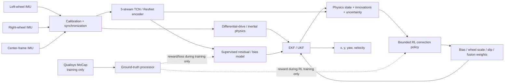
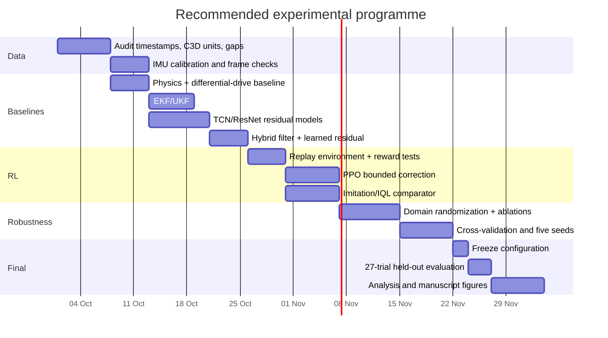

# Reinforcement Learning for a Three-IMU Wheelchair Trajectory System / การประเมิน Reinforcement Learning สำหรับระบบประมาณวิถีรถเข็นด้วย IMU สามตัว

## Executive summary — English

**Research question.** The project has three inertial sensors—left-wheel IMU, right-wheel IMU, and center-frame IMU—and Qualisys motion capture available as ground truth during training. The dataset described by the researcher contains **101 training trials and 27 held-out test trials**, with known concerns about synchronization, sensor/trajectory scale, and missing C3D segments. These project-specific facts are taken from the researcher's description; the underlying dataset itself was not available for direct inspection in this analysis.

### Bottom-line judgment

**Reinforcement learning is appropriate as a research extension, but it is not the best first-line or end-to-end trajectory estimator for this dataset.** The strongest research design is:

\[
\boxed{
\text{3 IMUs}
\rightarrow
\text{calibration/synchronization}
\rightarrow
\text{wheelchair physics}
\rightarrow
\text{EKF/UKF + TCN/ResNet residual}
\rightarrow
\text{small RL adaptive correction}
}
\]

The RL agent should learn **bounded adjustments to quantities such as gyro bias, left/right speed scale, slip/asymmetry, or sensor-fusion weights**, rather than directly generating \(x,y,\psi\). This recommendation is consistent with a broad trend in learned inertial odometry: successful systems increasingly retain physical integration or filtering and learn only the difficult residuals, uncertainty, biases, or pseudo-measurements. TLIO tightly couples learned motion constraints with an EKF; AI-IMU learns adaptive filter noise for a wheeled vehicle; recent IMU-debiasing work explicitly learns bias dynamics while retaining inertial kinematics; and a 2026 RL-VIO study uses RL for scheduling and adaptive fusion rather than replacing the entire estimator. citeturn17view0turn17view2turn17view5turn2view1

There is unusually strong literature relevance to your sensor configuration. **WMINet**, published first as a 2025 preprint and subsequently indexed by IEEE, studies wheel-mounted inertial positioning with multiple wheel IMUs and a chassis IMU. Its released dataset contains four wheel IMUs and one chassis IMU; the authors use wheelbase consistency as a learning constraint and report that learning-based wheel-mounted positioning outperformed their model-based and prior learned baselines. Their dataset, however, contains substantially longer continuous recordings—24 training trajectories with about 32 minutes per IMU—and their task is supervised learning, not RL. This strongly supports exploiting your left/right-wheel geometry, but it does **not** establish that RL is necessary. citeturn4view0

The **101/27 trial count is enough to investigate a small RL correction policy**, especially because this is an estimator rather than a physical-control policy: recorded IMU sequences can be replayed repeatedly while the policy chooses different estimator corrections and Qualisys supplies training rewards. A recent RL-based VIO paper uses essentially this pattern—a Gym-style replay environment over recorded real trajectories, supervised initialization, then PPO fine-tuning. citeturn19view3 However, 101 trials are **not enough evidence to justify a high-capacity end-to-end RL pose estimator**, because the effective diversity is determined by independent trajectories, manoeuvres, sessions, surfaces, speeds, users and slip conditions—not by the millions of overlapping IMU windows that can be extracted from those trials. RoNIN, by comparison, used 42.7 hours, 276 sequences and 100 subjects to study generalizable neural inertial navigation. citeturn16view0

The **highest-priority scientific issue is therefore data integrity rather than RL algorithm choice**. Qualisys C3D exports can use millimetres, centimetres or metres, with millimetres the documented default; export settings can also alter beginning/end frames and whether event timing refers to original or cropped time. A unit mistake can therefore create a catastrophic scale error, while inconsistent cropping can produce apparent sensor lag. citeturn9search1 Multi-IMU calibration also requires temporal and spatial alignment; Kalibr explicitly supports spatial, temporal and intrinsic multi-IMU calibration because these errors materially affect inertial estimation. citeturn9search2 Training RL before resolving these issues risks producing a policy that learns to compensate for dataset artefacts rather than wheelchair dynamics.

### Recommended role of RL

| Role | Recommendation | Why |
|---|---:|---|
| RL directly predicts \(x,y,\psi\) | **Do not prioritize** | High-dimensional, weakly constrained, data-hungry; accumulated trajectory errors make reward credit assignment difficult |
| RL predicts \(\Delta v,\Delta\omega\) | **Possible secondary experiment** | Lower-dimensional than full pose, but partially duplicates supervised residual learning |
| RL adapts gyro bias | **Strong candidate** | Slowly varying bias creates long-horizon yaw/position drift; explicit bias learning is supported by recent IMU literature citeturn17view5 |
| RL adapts \(k_L,k_R\) speed scales | **Strong candidate** | Directly exploits two wheel-mounted IMUs and can represent unequal effective wheel radius/calibration |
| RL adapts slip coefficients | **Strongest novel candidate** | Slip is motion-dependent and violates fixed differential-drive assumptions |
| RL selects fusion weights / filter covariance | **Strong candidate** | AI-IMU demonstrated the value of dynamically adapting Kalman-filter confidence for wheeled dynamics; recent RL-VIO directly learns adaptive fusion weights. citeturn17view2turn19view3 |
| RL replaces EKF/UKF | **Not recommended initially** | Removes a useful physics/stability prior without clear evidence that the dataset supports it |

My primary hypothesis would therefore be:

> **H1: A bounded RL policy that adapts wheel speed/slip and gyro-bias corrections will reduce long-horizon position and yaw drift relative to the best physics + EKF/UKF + supervised-residual baseline, particularly during turning, pivoting, slopes and other high-slip/high-dynamic manoeuvres.**

A sensible **success threshold** is not “RL beats physics.” That is too easy. RL should have to beat the **strongest non-RL hybrid baseline**. Based on the evidence available, I would pre-register a practically interesting target of roughly **≥5% reduction in aggregate position RMSE and/or yaw RMSE with a confidence interval indicating a consistent benefit**, and regard approximately **10–15%** as a strong result. This is a project decision criterion rather than a claim that the literature guarantees such a gain. For context only, the 2026 RL-VIO study reports one adaptive-fusion ablation where EKF fusion had 0.127 m ATE and RL fusion 0.112 m—an approximately 11.8% reduction—and another backend experiment with a larger improvement; these results are not directly transferable to wheelchair inertial odometry. citeturn19view3

The two charts below are **research-planning hypotheses, not measured results and not literature-derived performance predictions**. Their purpose is to show the expected ordering and uncertainty that I would use when designing the experiments.

**Figure: hypothetical normalized position-RMSE range.** Full-trajectory RL deliberately has a large uncertainty band because it can either learn useful temporal structure or overfit badly; bounded RL correction is expected to be more reproducible.

**Figure: hypothetical normalized yaw-RMSE range.** The largest opportunity for adaptive RL is likely to be correcting quantities whose small persistent errors accumulate, particularly yaw bias and differential wheel-scale/slip errors.

## Technical assessment — English

### Why the three-IMU configuration is unusually suitable for hybrid estimation

Your sensors give several partially redundant estimates of the same planar motion. Under ideal differential-drive kinematics,

\[
v_t = \frac{v_{R,t}+v_{L,t}}{2},
\qquad
\omega_t = \frac{v_{R,t}-v_{L,t}}{B},
\]

where \(B\) is effective wheel separation. Integration gives

\[
\psi_{t+1}=\psi_t+\omega_t\Delta t,
\]

\[
x_{t+1}=x_t+v_t\cos\psi_t\,\Delta t,
\qquad
y_{t+1}=y_t+v_t\sin\psi_t\,\Delta t.
\]

Wheel-mounted IMUs provide rotation-related information from each side, while the center-frame IMU provides a body-motion reference. Wheel-mounted sensing can have advantages over chassis-only pure inertial integration because wheel rotation provides structured periodic excitation and can partially modulate constant inertial biases; WMINet explicitly exploits wheel-mounted sensors and a fixed wheelbase constraint. citeturn4view0

The complementary structure is important. A discrepancy such as

\[
\omega_{\text{wheel}}
=
\frac{v_R-v_L}{B}
\neq
\omega_{\text{centre gyro}}
\]

is not merely “noise.” Depending on manoeuvre and calibration, it can contain information about slip, wheel-scale mismatch, gyro bias, frame misalignment or transient dynamics. A learning system should therefore be designed to **explain disagreements between sensors**, rather than simply concatenate all 18 raw accelerometer/gyroscope channels and ask one network to discover the entire estimator.

This follows the successful hybrid principle seen in AI-IMU: a conventional inertial/filter model captures what is already understood, while a network dynamically adapts the quantities that are difficult to specify manually. In that work, the neural component adapts noise parameters governing wheeled-vehicle pseudo-measurements, including the fact that lateral-motion assumptions become less reliable during slip or turns. citeturn17view2

### Dataset suitability: 101 train and 27 test trials

The key distinction is between **number of windows** and **number of independent experimental conditions**.

At 100–120 Hz, even a modest set of trajectories can produce hundreds of thousands of overlapping windows. That is useful for supervised TCN/ResNet fitting, but overlapping windows from one trial are strongly correlated and do not provide the same generalization evidence as independent trajectories. RoNIN used 42.7 hours from 276 sequences and 100 participants, and explicitly separated subjects to test out-of-distribution generalization. citeturn16view0 WMINet likewise separated complete trajectories into train and test sets rather than randomly splitting individual windows. citeturn4view0

For your project, **101 independent training trials are reasonable for a low-dimensional residual/correction model but small for unconstrained RL**. The effective adequacy depends critically on whether those 101 trials cover:

- straight motion at several speeds;
- left and right turns;
- pivots or near-zero-radius rotation;
- acceleration/deceleration;
- slalom or repeated direction changes;
- slopes;
- wheel slip or low-traction conditions;
- different wheelchair/user/load conditions;
- multiple collection sessions.

If some manoeuvre categories contain only a handful of trials, the agent can appear excellent on random-window validation yet fail when an entire manoeuvre is withheld. The final split must therefore occur **by whole trial, and preferably by session and manoeuvre**, never by overlapping windows.

There is an important nuance concerning “offline RL.” Your raw 101 trajectories are **not automatically an offline-RL dataset**, because conventional offline RL requires tuples such as

\[
(s_t,a_t,r_t,s_{t+1})
\]

and your recorded data do not contain historical actions corresponding to “adjust gyro bias by \(+0.02\)” or “reduce left-wheel scale by \(1\%\).” CQL was specifically developed to learn policies from static state-action datasets while controlling the out-of-distribution action-value problem; IQL similarly avoids querying unseen actions during value learning. citeturn18view0turn21view0

You can nevertheless make RL highly practical here because the **RL action modifies the estimator, not the physical wheelchair**. At training time, replay the logged IMUs, let the policy choose a correction, propagate the estimator state, and compare the resulting pose against synchronized Qualisys ground truth. Different policy actions create different estimator trajectories even though the physical measurements are fixed. The recent dual-agent VIO work follows this recorded-trajectory replay approach for PPO fusion fine-tuning. citeturn19view3

This means the best initial RL formulation is closer to a **logged-data estimator simulator** than classical robot-control RL.

### Data quality could dominate every algorithmic result

Before comparing RL and non-RL models, I would define three hard dataset gates.

**Synchronization gate.** Every left-wheel, right-wheel, center IMU and MoCap sample must be mapped into a common clock. Multi-sensor temporal calibration is explicitly treated as a calibration variable in established tools such as Kalibr. citeturn9search2 For this wheelchair system, a useful validation is to derive Qualisys yaw-rate from the rigid-body orientation and compare it against center-IMU \(g_z\), while wheel angular signals can provide a second independent timing cue. Estimate lag only on training data and verify it on withheld trajectories.

A lag \(\tau\) creates a target of approximately

\[
y(t)\leftrightarrow x(t+\tau),
\]

which means a neural network can easily “learn” the delay. It may then fail after synchronization changes. RL is especially vulnerable because the reward itself becomes temporally misassigned.

**Scale and coordinate-frame gate.** Qualisys documentation states that C3D trajectory units can be exported in metres, centimetres or millimetres and identifies millimetres as the default option. It also provides coordinate conversion settings and different choices for original versus cropped event timing. citeturn9search1 Therefore every dataset manifest should explicitly record:

\[
\text{MoCap position unit},
\quad
\text{gyro unit},
\quad
\text{acceleration unit},
\quad
\text{sampling rate},
\quad
\text{axis convention},
\quad
\text{time origin}.
\]

Gyroscope deg/s versus rad/s, acceleration in \(g\) versus \(\mathrm{m/s^2}\), or C3D mm versus m must never be left for a network to “absorb.”

**Missing-C3D gate.** Qualisys export options can exclude empty/non-full portions of measurements, so cropping and missing trajectory handling have to be documented rather than inferred from array lengths. citeturn9search1 For ground-truth gaps, create an explicit validity mask \(m_t\). The training loss/reward should be:

\[
L =
\frac{\sum_t m_tL_t}
{\sum_t m_t},
\]

rather than treating missing samples as zeros or silently interpolating arbitrary gaps. Long gaps should split an episode. Very short interpolation, if used at all, should be subjected to a sensitivity analysis so that the reported improvement cannot be explained by interpolation choices.

### Baseline hierarchy

A rigorous RL paper needs strong baselines. Pure double integration is not enough. RoNIN showed how quickly unconstrained IMU integration can fail because bias is magnified by repeated integration, while learned velocity representations can greatly improve robustness. citeturn16view0 TLIO goes further by combining learned displacement/uncertainty with an EKF rather than relying purely on neural integration. citeturn17view0 AI-IMU combines learned noise adaptation with an invariant EKF for wheeled dynamics and reports strong vehicle dead-reckoning results. citeturn17view2

| Method | Main output | Data requirement | Main advantage | Main weakness | Research expectation for your project |
|---|---|---|---|---|---|
| Wheelchair kinematics | \(v,\omega,x,y,\psi\) | Calibration only | Transparent, deterministic, interpretable | Slip/bias accumulates | Mandatory baseline |
| EKF | State + bias + covariance | Modest | Efficient; explicitly estimates uncertainty | Linearization/model tuning | Very strong baseline |
| UKF | Same | Modest | Better nonlinear approximation without Jacobians | More computation/tuning | Useful EKF comparator |
| TCN residual | \(\Delta v,\Delta\omega\) or bias | Paired IMU–MoCap | Good temporal receptive field | Dataset-dependent | High priority |
| 1D ResNet residual | Same | Paired IMU–MoCap | Stable supervised training; RoNIN found consistent cross-dataset performance citeturn16view0 | Fixed window | High priority |
| TCN/ResNet + EKF | learned measurement/residual + state filter | Paired data | Physics + learning + uncertainty | More components | Expected strongest non-RL |
| Full-pose RL | \(x,y,\psi\) or pose increment | Large/diverse trajectories | Long-horizon objective | Sample-inefficient; weakly constrained | Experimental negative/control arm |
| RL adaptive correction | bias/scale/slip/fusion | Replayable paired data | Optimizes long-term drift while preserving physics | Reward/action design | **Recommended RL design** |

WMINet is particularly important as a baseline inspiration because it found that a wheelbase constraint improved a multi-wheel-IMU learned estimator and used one-second, 120-sample windows in its dataset. citeturn4view0 I would therefore treat a **wheelbase-consistent supervised model** as something RL must beat, not omit.

### Why TCN/ResNet before RL

RoNIN evaluated ResNet, LSTM and TCN backbones for inertial navigation, using roughly one-second input history for its ResNet and a 253-frame receptive field for its TCN; the authors found strong results but substantially longer training for recurrent/TCN variants than ResNet. citeturn16view0 More recent 2026 inertial-odometry research continues to emphasize physics-consistent or differentiable inertial training rather than replacing navigation with RL. DINS-IO, for example, imposes a differentiable inertial-consistency objective that jointly constrains velocity and accelerometer bias, and can use limited labelled data for metric calibration. citeturn17view4 PLATO similarly learns inertial preintegration/bias dynamics from accurate trajectory observations while retaining the inertial model. citeturn17view3

The methodological message for your work is strong: **first learn the part of the physics that is wrong; only then test whether sequential decision optimization adds value.**

## Recommended experimental design — English

### Proposed system

At deployment, the Qualisys branches disappear completely. The policy must never receive a MoCap-derived quantity as an observation; ground truth is permitted only in the **training loss/reward**. Otherwise the experiment contains target leakage.

### Suggested supervised architecture

I would start with a **three-stream temporal encoder**.

Left and right wheel streams can share encoder weights because the sensor roles are symmetric; the center-frame encoder should have independent parameters. For each sensor:

\[
X_i\in\mathbb{R}^{T\times6}
=
[a_x,a_y,a_z,g_x,g_y,g_z].
\]

A practical starting architecture is:

| Component | Recommended starting configuration |
|---|---|
| Window | 1.0–2.0 s, resampled to a common rate |
| Wheel encoder | Shared 1D TCN, 4 residual stages, 64 channels |
| Center encoder | Separate TCN, same size |
| TCN kernels | 3 or 5 |
| Dilations | 1, 2, 4, 8, optionally 16 |
| Dropout | 0.05–0.15 |
| Fusion | Concatenate left/right/center latent vectors + physics features |
| Fusion MLP | 256 → 128 |
| Output | \(\Delta v,\Delta\omega\), optionally log-variance and bias estimates |
| Optimizer | Adam/AdamW |
| LR | \(10^{-3}\) initially; reduce-on-plateau or cosine decay |
| Batch | 64–256 windows |
| Regularization | weight decay \(10^{-5}\)–\(10^{-4}\), trial-level augmentation |

These are project starting values, not claimed optima. RoNIN's TCN also uses residual temporal blocks, while WMINet demonstrates that one-second wheel-IMU windows are viable for wheel-mounted positioning. citeturn16view0turn4view0

A useful supervised objective is:

\[
\mathcal L_{\text{sup}}
=
\lambda_v
\,\mathrm{Huber}(\hat v-v^{GT})
+
\lambda_\omega
\,\mathrm{Huber}(\hat\omega-\omega^{GT})
+
\lambda_p
\,\mathcal L_{\text{integrated-pose}}
+
\lambda_B
\,\mathcal L_{\text{wheelbase}}
+
\lambda_s
\,\mathcal L_{\text{smooth}}.
\]

WMINet explicitly incorporates a fixed wheel-distance constraint into its training loss, demonstrating the value of injecting geometric structure rather than relying solely on trajectory MSE. citeturn4view0 RoNIN similarly found that integrated/strided velocity losses can be preferable to noisy instantaneous velocity targets. citeturn16view0

For uncertainty prediction, output \(\log\sigma_v^2,\log\sigma_\omega^2\) and add Gaussian negative log likelihood:

\[
\mathcal L_{\text{NLL}}
=
\frac{e^2}{2\sigma^2}
+
\frac12\log\sigma^2.
\]

The learned variance can then become an EKF measurement covariance or an RL state feature, which is conceptually similar to learning dynamic confidence in AI-IMU and adaptive RL fusion. citeturn17view2turn2view1

### Recommended RL formulation

I recommend **two small RL agents as experiments**, not one giant end-to-end agent.

**Agent R1 — parameter-correction policy**

\[
a_t =
[
\delta b_{g_z},
\delta\log k_L,
\delta\log k_R
].
\]

Here \(b_{g_z}\) corrects yaw gyro bias and \(k_L,k_R\) scale wheel-derived speeds:

\[
v'_L=k_Lv_L,\qquad
v'_R=k_Rv_R.
\]

The difference between \(k_L\) and \(k_R\) can absorb effective asymmetric wheel-scale/slip effects without letting RL move the pose arbitrarily.

A later action set can introduce explicit slip:

\[
a_t=
[
\delta b_{g_z},
\delta k_L,
\delta k_R,
\delta\lambda_L,
\delta\lambda_R
],
\]

but five simultaneously adaptable parameters create identifiability problems, so this should be an ablation rather than the starting model.

**Agent R2 — adaptive-fusion policy**

The actor outputs bounded weights,

\[
a_t =
[w_v,w_\omega,w_b]\in[0,1]^3,
\]

controlling interpolation between physical/filter estimates and learned corrections. Recent RL-VIO uses the same broad idea: the policy outputs bounded mixing weights for position, velocity and orientation and optimizes long-horizon trajectory error. citeturn2view1 This is likely the safest RL variant because the policy can be made a convex mixer rather than an unconstrained pose generator.

The observation should be compact:

\[
s_t =
[
z_{\text{TCN}},
v_L,v_R,
v_{\text{phys}},\omega_{\text{phys}},
g_{z,\text{center}},
r_{\omega},
r_v,
\operatorname{diag}(P_t),
a_{t-1}
].
\]

Here \(z_{\text{TCN}}\) is a **frozen supervised latent representation**, \(P_t\) is filter covariance, and residuals such as

\[
r_\omega =
\omega_{\text{wheel}}
-
g_{z,\text{center}}
\]

tell the agent when sensors disagree.

Freezing the temporal encoder for the first RL experiments is important. It dramatically reduces the number of policy parameters and prevents PPO from relearning IMU feature extraction from only 101 trajectories. The recent adaptive VIO work likewise pretrains supervised components before RL fine-tuning rather than training the full pipeline from scratch. citeturn19view0

### Reward

Use normalized, robust errors rather than raw metre/degree scales:

\[
\begin{aligned}
r_t = -[
&1.0\,\rho(e_{p,t}/s_p)
+0.5\,\rho(e_{\psi,t}/s_\psi)\\
&+0.2\,\rho(e_{v,t}/s_v)
+0.01\|a_t\|_2^2
+0.02\|a_t-a_{t-1}\|_2^2
].
\end{aligned}
\]

Here \(\rho\) is Huber loss and \(s_p,s_\psi,s_v\) are robust scales calculated **only from the training fold**. Add a terminal term,

\[
r_T \leftarrow r_T
-
2\,\rho(e_{\mathrm{endpoint}}/s_p),
\]

so the policy sees both short-term accuracy and long-horizon drift.

This deliberately resembles recent RL fusion work, which combines dense pose-error shaping with a long-horizon trajectory objective and uncertainty regularization. citeturn19view3

The reward can additionally penalize implausible correction:

\[
r_{\text{constraint}}
=
-\lambda_c
\mathbf 1[\text{action bound violated}],
\]

although a better implementation is to make violations impossible by construction.

### Safety and stability constraints

For estimator RL, “safety” primarily means preventing divergence. If the estimate later feeds wheelchair control, those estimation failures become directly safety-relevant.

Use normalized actor outputs:

\[
u_t=\tanh(f_\theta(s_t))\in[-1,1].
\]

Map \(u_t\) to **calibration-derived ranges** rather than arbitrary unlimited corrections. For example,

\[
b_{g_z}
\in
[b_0-3\sigma_b,b_0+3\sigma_b].
\]

For wheel scales, an initial engineering search range such as

\[
k_L,k_R\in[0.85,1.15]
\]

may be used only as a starting prior; it should be narrowed to actual calibration uncertainty once measured.

Also constrain the **rate of change**:

\[
|a_t-a_{t-1}|\leq\delta_{\max}.
\]

This prevents an agent from alternating large positive/negative corrections to exploit reward quirks.

For adaptive fusion, enforce

\[
0\le w_i\le1
\]

and use a convex combination. Constrained RL methods such as CPO were developed specifically to optimize return while respecting expected constraints, but for this project explicit action projection/clipping is simpler and easier to audit. citeturn18view5

### PPO hyperparameters: primary RL experiment

PPO is the strongest first choice because your estimator can be replayed as an interactive environment and because a recent closely related adaptive VIO implementation successfully used PPO after supervised initialization. The original PPO work emphasizes repeated minibatch optimization while limiting policy changes; the recent VIO implementation used \(10^6\) environment steps, \(\gamma=0.99\), GAE \(=0.95\), clip \(=0.2\), batch 64 and 10 epochs per update. citeturn6search0turn19view0

I would start slightly more conservatively:

| PPO setting | Recommended search |
|---|---|
| Policy/value network | 2 × 128 MLP, SiLU or Tanh |
| Temporal encoder | frozen TCN/ResNet |
| Actor output | tanh-bounded continuous actions |
| Learning rate | \(1\times10^{-4},\,3\times10^{-4}\) |
| \(\gamma\) | 0.99 |
| GAE \(\lambda\) | 0.95 |
| PPO clip | 0.10 and 0.20 |
| Batch | 128 or 256 |
| Epochs/update | 5–10 |
| Entropy coefficient | 0.005–0.02 |
| Value coefficient | 0.5 |
| Gradient clipping | 0.5 |
| Replay-environment steps | 0.5–1.0 million |
| Seeds | minimum 5 |
| Early stopping | validation ATE/yaw RMSE, not training reward |
| Reward | running normalization + bounded/clipped outlier handling |

The central comparison should be **PPO R1 versus PPO R2**, not a large search over many fashionable RL algorithms.

### Offline RL and imitation learning

Offline RL becomes worthwhile after constructing a meaningful behavior-policy dataset. Generate correction actions using an “oracle” trajectory optimizer or a high-quality smoother using training MoCap, giving

\[
\mathcal D=
\{s_t,a_t^{teacher},r_t,s_{t+1}\}.
\]

First perform behavior cloning:

\[
L_{BC}
=
\|a_\theta(s_t)-a_t^{teacher}\|^2,
\]

then fine-tune with RL.

This resembles curriculum/pretraining approaches and substantially reduces the chance that an RL policy spends its limited data budget discovering obvious corrections. DAgger formalized the value of iteratively querying an expert on states induced by the learned policy, although in this project a fully offline teacher-generated variant is operationally simpler. citeturn18view3

For an offline-RL comparator, **IQL** is attractive because it avoids evaluating arbitrary out-of-dataset actions during its value-learning step. Its original implementation used two-layer 256-unit networks, Adam at \(3\times10^{-4}\), and \(\tau=0.7,\beta=3\) for locomotion tasks; those are reasonable starting hyperparameters, not wheelchair-specific optima. citeturn21view0turn21view1

Recommended IQL starting point:

| Parameter | Value |
|---|---:|
| Q/V/policy MLP | 2 × 256 |
| Learning rate | \(3\times10^{-4}\) |
| Batch | 256 |
| Discount | 0.99 |
| Expectile \(\tau\) | 0.7; ablate 0.8 |
| Advantage inverse temperature \(\beta\) | 3.0 |
| Target update | 0.005 |
| Training | 250k–1M gradient steps |
| Policy dropout | 0.1 if overfitting appears |

CQL is another valid comparator and explicitly addresses optimistic Q-values for out-of-distribution actions, but it is generally more cumbersome to tune. Its foundational paper shows why naively applying ordinary off-policy RL to static data can generate optimistic values for unsupported actions. citeturn18view0

### Model-based RL, domain randomization and sim-to-real

This project already contains a strong physics model, making model-based augmentation conceptually attractive. However, an inaccurate learned simulator can produce its own distribution shift. MBPO's central strategy is to use **short model-generated rollouts** specifically to limit compounding model error. citeturn18view2 Therefore I would not train the wheelchair policy in long fully synthetic trajectories initially.

Instead, randomize nuisance parameters during replay:

\[
b_g,\ b_a,\ k_L,\ k_R,\ B,\ r_L,\ r_R,\ \tau_{\text{sync}},
\]

plus measurement noise, dropped packets and slip intensity. Parameter ranges should come from your measured calibration/session variability wherever possible.

Domain randomization was developed to bridge simulation and reality by exposing policies to variability during training; dynamics randomization similarly demonstrated sim-to-real control transfer by varying physical dynamics. citeturn7search0turn18view4 Here the same idea is best interpreted as **session-to-session robustness augmentation**, not as a substitute for real trials.

A particularly useful robustness experiment is deliberately perturbing synchronization and scale during training:

\[
\tau\sim U[-\tau_{\max},\tau_{\max}],
\qquad
k\sim U[1-\epsilon_k,1+\epsilon_k],
\]

then testing on the *correctly calibrated* 27 trials. The important condition is that randomization magnitudes should remain physically plausible.

## Evaluation, compute, risks, and next steps — English

### Train/validation/test protocol

Keep the **27 held-out test trials untouched until every architecture, reward weight, hyperparameter and action definition is frozen**.

Within the 101 development trials, use five-fold **grouped** cross-validation:

\[
101 \rightarrow
\text{approximately }80
\text{ training}
+
21
\text{ validation}
\]

per fold, with exact counts varying due to stratification.

Group by complete trial. If possible, additionally group by acquisition session/day, user and manoeuvre family. Never place overlapping windows from the same trial in train and validation. This follows the broader inertial-navigation practice of testing on independent sequences/subjects rather than treating windows as independent observations. citeturn16view0turn4view0

After model selection, retrain on all 101 trials and run **exactly one locked final evaluation** on the 27 test trials.

Report the following at minimum:

| Metric | Purpose |
|---|---|
| Position RMSE / ATE, m | Primary trajectory accuracy |
| Yaw RMSE, degrees | Primary orientation accuracy |
| Relative trajectory error at fixed horizons | Local drift |
| Endpoint position error | Accumulated drift |
| Endpoint yaw error | Heading accumulation |
| Drift / path length, % | Normalizes trials of different lengths |
| Position error vs time | Shows drift growth |
| Velocity RMSE | Diagnoses translation errors |
| Yaw-rate RMSE | Diagnoses turning errors |
| 95th-percentile error | Tail robustness |
| Maximum trial error | Catastrophic failure detection |
| Action saturation fraction | Detects RL relying on limits |
| Per-manoeuvre metrics | Detects hidden failure modes |

ATE and RTE are established inertial-odometry evaluation concepts; RoNIN explicitly reports both absolute and relative trajectory errors, while WMINet reports position RMSE and total-distance-normalized error. citeturn16view0turn4view0

For statistical comparison, compute paired trial-by-trial differences on the same 27 test trajectories and report bootstrap confidence intervals. Do not report only the mean across millions of samples, because that would make the apparent \(n\) artificially enormous.

### Mandatory ablations

| Ablation | Scientific question |
|---|---|
| Center IMU only vs wheels only vs all three | Does multi-IMU fusion really help? |
| Left + center vs right + center | Is one wheel disproportionately informative? |
| Physics vs EKF vs UKF | How much comes from filtering? |
| TCN vs ResNet | Is temporal architecture important? |
| Physics+filter vs +TCN/ResNet | How much comes from supervised learning? |
| RL bias only | Is bias adaptation sufficient? |
| RL wheel scales only | Is scale/slip the main gain? |
| Bias + scales | Does joint adaptation help? |
| RL fusion weights | Does decision-based fusion beat parameter adaptation? |
| Supervised correction vs PPO | Does RL itself add value? |
| PPO from scratch vs supervised initialization | Is imitation/pretraining responsible for the gain? |
| No domain randomization vs randomization | Does augmentation improve held-out robustness? |
| Unconstrained vs bounded action | Are action constraints essential? |
| Correct sync vs deliberately perturbed sync | Is performance robust to timing? |
| With vs without wheelbase loss | Does physical geometry improve generalization? |

The **most important ablation is supervised correction versus RL correction using the same encoder, same action variables and approximately the same parameter count**. Without that comparison, an improvement cannot credibly be attributed to reinforcement learning rather than simply adding another neural network.

### Expected-gain interpretation

The following ranges are **pre-experimental research hypotheses**, not claims from existing wheelchair experiments.

| Method | Relative position-error reduction vs raw physics | Confidence in expectation | Interpretation |
|---|---:|---|---|
| Physics | 0% | High | Reference |
| EKF/UKF | ~5–30% | Medium | Depends heavily on calibrated noise/model |
| TCN/ResNet residual | ~15–45% | Medium | Likely useful if train/test dynamics match |
| TCN/ResNet + EKF/UKF | ~25–55% | Medium | Expected strongest conventional hybrid |
| Full-pose RL | −30% to +50% | Low | High variance; could be worse than baseline |
| Hybrid + bounded RL | ~30–60% vs physics | Low–medium | Main hypothesis |
| RL incremental gain over strongest hybrid | **~5–15% target** | Low–medium | Proper test of whether RL is worthwhile |

The literature supports the *direction* of this expectation rather than these exact ranges: learning can substantially reduce inertial drift, wheel-mounted learned positioning can improve over simpler baselines, learned adaptive filter confidence can improve wheeled inertial navigation, and RL adaptive fusion has recently outperformed fixed/EKF fusion in a VIO ablation. citeturn4view0turn17view2turn19view3

### Compute and estimated training time

There is **no specific compute constraint supplied by the researcher**, so the following assumes a modern single GPU with roughly 16–24 GB VRAM and a multi-core CPU. These are engineering estimates, not benchmarked times on your dataset because trial duration and native sample rate were not supplied.

| Experiment | Hardware | Approx. one run | Full research budget |
|---|---|---:|---:|
| Physics | CPU | seconds–minutes | <1 CPU-hour |
| EKF/UKF sweep | CPU | minutes | 2–8 CPU-hours |
| TCN/ResNet one fold | 1 GPU | ~20–90 min | 2–8 GPU-hours for 5 folds |
| Supervised multi-seed study | 1 GPU | ~0.5–2 h/seed | 10–30 GPU-hours |
| PPO 0.5–1M replay steps | CPU + 1 GPU | ~1–4 h/seed | 5–20 GPU-hours/model/fold set |
| IQL/CQL | 1 GPU | ~1–4 h/run | 10–30 GPU-hours |
| Major ablation matrix | 1 GPU | — | roughly 40–120 GPU-hours |
| Final retraining | 1 GPU | ~1–4 h/model | ~5–15 GPU-hours |

These estimates are plausible because the recommended RL policy is a very small MLP and the encoder can be frozen; the dominant cost will often be repeated trajectory replay and cross-validation rather than neural-network size. Historical context illustrates how dataset scale matters: RoNIN reported approximately 10 hours for its ResNet and 30–40 hours for TCN/LSTM on a 1080 Ti while training on a much larger 42.7-hour dataset. citeturn16view0 WMINet trained its network for 400 epochs with batch size 128 on its wheel-mounted dataset. citeturn4view0

A **single GPU is sufficient** for the proposed research. Multi-GPU training would improve throughput for folds/seeds but is not technically necessary.

### Main failure modes

| Failure mode | What happens | Mitigation |
|---|---|---|
| IMU–MoCap time offset | Model learns phase shift instead of motion | Cross-correlation + per-trial timestamp audit; lock common time base |
| C3D unit mismatch | Position-scale error dominates all losses | Read/export units explicitly; convert once; unit tests citeturn9search1 |
| Missing C3D interpreted as zero | False reward spikes | Validity mask; split long gaps |
| Window leakage | Unrealistically low validation error | Split entire trials before window generation |
| RL overfits 101 trials | High train reward, poor 27-test performance | Small policy, frozen encoder, CV, domain randomization |
| Reward hacking | Policy exploits metric or saturation | Multi-term reward, action regularizer, trajectory visual inspection |
| Excessive correction | Estimator becomes unstable | Hard magnitude/rate bounds |
| Bias/scale/slip non-identifiability | Different parameters explain same error | Introduce actions progressively; ablate separately |
| Manoeuvre imbalance | Straight-line performance hides pivot/slalom failure | Stratified folds + per-manoeuvre reporting |
| Ground-truth leakage | Excellent training/test-like result impossible in deployment | GT only in reward/loss, never policy state |
| Simulation mismatch | Model-based RL exploits fake dynamics | Short rollouts + real replay; MBPO-style caution citeturn18view2 |
| Offline Q extrapolation | Unrealistic corrections get inflated value | IQL/CQL or behavior constraints rather than ordinary off-policy RL citeturn18view0turn21view0 |
| RL gain comes from extra parameters | Unfair conclusion | Parameter-matched supervised policy baseline |
| Random seed dependence | “Improvement” disappears in another run | ≥5 RL seeds and confidence intervals |

### Prioritized research timeline

The priority order should be:

| Priority | Action | Go/no-go criterion |
|---:|---|---|
| **P0** | Build automated synchronization/unit/gap audit | No unexplained time/scale discrepancies |
| **P0** | Establish physics + EKF/UKF baseline | Reproducible held-out CV |
| **P1** | Train TCN and ResNet residual models | Demonstrable gain over filter alone |
| **P1** | Build strongest hybrid baseline | Freeze baseline before RL |
| **P2** | Implement PPO R1: bias + wheel-scale correction | Stable actions; validation improvement |
| **P2** | Implement PPO R2: adaptive fusion | Compare against R1 and EKF |
| **P3** | Teacher imitation + IQL | Only after useful teacher actions exist |
| **P3** | Domain randomization/model-based augmentation | Only after real-data pipeline is stable |
| **P4** | Full-trajectory RL | Research ablation, not preferred deployment path |
| **Final** | Unlock the 27-test set | Only once design is frozen |

**Decision rule:** if bounded RL does not produce a repeatable improvement over the strongest TCN/ResNet + EKF/UKF model across folds, seeds and manoeuvres, the scientifically correct conclusion is that **RL is not justified for this dataset**. That would still be a strong research result: it would establish that supervised physics-informed residual learning captures most exploitable information and that the added sequential-decision complexity does not pay for itself.

A positive result is more interesting if the advantage is concentrated in **physically interpretable regimes**—for example pivot turns, slope transitions or detected wheel disagreement—than if RL merely improves the overall average by an opaque fraction.

Finally, the literature search identified Thai-language academic work on autonomous wheelchairs, including a Chiang Mai University repository entry on autonomous wheelchair development, but I did **not** identify a Thai primary publication that directly evaluates RL for multi-wheel-IMU trajectory correction comparable to this project. citeturn10search3 The strongest directly applicable technical evidence is therefore currently international work on wheel-mounted inertial localization, learned inertial odometry, adaptive Kalman filtering and RL-based sensor fusion. citeturn4view0turn17view0turn17view2turn19view3

## บทสรุปผู้บริหาร — ภาษาไทย

**คำถามหลักของงานวิจัย:** โครงการนี้ใช้ IMU สามตัว ได้แก่ IMU ที่ล้อซ้าย, IMU ที่ล้อขวา และ IMU ที่เฟรมกลางของ wheelchair และมี Qualisys Motion Capture เป็น ground truth ในช่วง training โดยมีข้อมูลตามที่ผู้วิจัยระบุคือ **101 trials สำหรับ training และ 27 trials สำหรับ held-out test** รวมทั้งมีปัญหาที่ทราบอยู่แล้วเรื่อง synchronization, scale/unit และช่วงข้อมูล C3D ที่ขาดหาย

### ข้อสรุปหลัก

**RL เหมาะที่จะเป็นส่วนขยายของงานวิจัย แต่ยังไม่ควรใช้เป็นตัวประมาณ trajectory แบบ end-to-end หลัก**

โครงสร้างที่แนะนำคือ

\[
\boxed{
\text{3 IMUs}
\rightarrow
\text{calibration/synchronization}
\rightarrow
\text{physics}
\rightarrow
\text{EKF/UKF + TCN/ResNet}
\rightarrow
\text{RL correction ขนาดเล็ก}
}
\]

กล่าวคือ RL ไม่ควรสร้าง \(x,y,\psi\) โดยตรง แต่ควรเรียนรู้การปรับค่าเล็ก ๆ เช่น

\[
\Delta b_{gyro},
\quad
\Delta k_L,
\quad
\Delta k_R,
\quad
\Delta \lambda_{\text{slip}},
\]

หรือเรียนรู้ **fusion weight / confidence** ระหว่างข้อมูลจาก wheel IMU, center IMU, physics model และ neural residual model

แนวทางนี้สอดคล้องกับงาน inertial odometry ที่ประสบความสำเร็จหลายสาย งาน TLIO รวม learned displacement กับ EKF; AI-IMU ใช้ deep learning ปรับ noise/confidence ของ Kalman filter สำหรับรถล้อ; งาน debiasing IMU ล่าสุดเน้นเรียนรู้ bias dynamics โดยยังคงสมการ inertial physics; และงาน RL-VIO ปี 2026 ใช้ RL สำหรับ adaptive fusion และ scheduling แทนที่จะให้ RL แทน estimator ทั้งระบบ. citeturn17view0turn17view2turn17view5turn2view1

มีงานที่ตรงกับ configuration ของโครงการอย่างน่าสนใจคือ **WMINet** ซึ่งศึกษาการประมาณตำแหน่ง mobile robot จาก wheel-mounted IMUs และ chassis IMU โดย dataset ของงานมี IMU สี่ตัวที่ล้อและหนึ่งตัวที่ chassis และมีการใช้ wheelbase constraint ใน loss. ผลงานรายงานว่า learned wheel-IMU approach ให้ผลดีกว่า model-based และ learning baseline ที่นำมาเปรียบเทียบ. citeturn4view0 สิ่งนี้เป็นหลักฐานที่ดีว่าโครงสร้างของข้อมูล **ล้อซ้าย + ล้อขวา + chassis** มี information ที่มีประโยชน์ต่อ learning แต่ไม่ได้หมายความว่า RL จำเป็น

จำนวน **101 training trials** เพียงพอสำหรับการทดลอง RL policy ที่มี action dimension ต่ำและ parameter จำนวนน้อย แต่ถือว่าน้อยสำหรับ end-to-end RL ขนาดใหญ่ โดยเฉพาะเมื่อเปรียบเทียบกับ RoNIN ซึ่งใช้ข้อมูล 42.7 ชั่วโมง, 276 sequences และ 100 คน เพื่อศึกษาการ generalize ของ neural inertial navigation. citeturn16view0

อย่างไรก็ตามโครงการนี้มีข้อได้เปรียบสำคัญ: RL action ไม่ได้ควบคุม wheelchair จริง แต่ควบคุม **estimator** ดังนั้นสามารถ replay IMU trajectory เดิมหลายครั้ง แล้วให้ policy เลือก correction ที่ต่างกัน จากนั้นคำนวณ reward ด้วย Qualisys ได้ งาน RL-VIO ล่าสุดใช้แนวคิด Gym-style replay environment กับ recorded trajectories และ PPO เช่นเดียวกัน. citeturn19view3

ดังนั้นผมประเมินว่า:

> **RL เหมาะกับโครงการนี้ในบทบาท adaptive bias/slip/scale/fusion correction มากกว่า full trajectory estimation อย่างชัดเจน**

และโจทย์วิจัยที่มีคุณค่ามากที่สุดน่าจะเป็น:

> **Can a bounded reinforcement-learning policy learn motion-dependent wheel-slip, speed-scale, and gyroscope-bias corrections that reduce long-term wheelchair trajectory drift beyond a physics + EKF/UKF + supervised TCN/ResNet baseline?**

### เงื่อนไขสำคัญก่อนเริ่ม RL

ต้องแก้ data quality ก่อน เพราะ Qualisys C3D สามารถ export position เป็น m, cm หรือ mm และ documentation ระบุ mm เป็นค่า default; export setting ยังสามารถเปลี่ยนช่วงข้อมูลต้น/ท้ายและ reference ของ event time ระหว่าง original กับ cropped recording ได้. citeturn9search1

ดังนั้น error จากหน่วยหรือเวลาอาจรุนแรงกว่าความแตกต่างระหว่าง RL algorithms ทั้งหมด

Calibration หลาย IMU ก็ควรถือเป็นปัญหา spatial + temporal calibration อย่างเป็นระบบ; Kalibr รองรับทั้ง temporal/spatial multi-IMU calibration เนื่องจาก error ประเภทนี้ส่งผลโดยตรงต่อ inertial estimation. citeturn9search2

ลำดับที่ถูกต้องจึงควรเป็น

\[
\text{Data integrity}
>
\text{Physics/filter baseline}
>
\text{Supervised residual}
>
\text{RL}.
\]

## การประเมินทางเทคนิค — ภาษาไทย

### เหตุผลที่ sensor configuration นี้เหมาะกับ hybrid estimation

ภายใต้ differential-drive model,

\[
v =
\frac{v_R+v_L}{2},
\qquad
\omega =
\frac{v_R-v_L}{B}.
\]

จากนั้น

\[
\psi_{t+1}
=
\psi_t+\omega\Delta t,
\]

\[
x_{t+1}
=
x_t+v\cos\psi_t\Delta t,
\qquad
y_{t+1}
=
y_t+v\sin\psi_t\Delta t.
\]

จุดสำคัญคือระบบมีหลายแหล่งข้อมูลสำหรับ yaw dynamics:

\[
\omega_{\text{wheel}}
=
\frac{v_R-v_L}{B},
\]

ในขณะที่ center IMU มี

\[
\omega_{\text{center}}
\approx g_{z}.
\]

ดังนั้น residual

\[
r_\omega
=
\omega_{\text{wheel}}
-
\omega_{\text{center}}
\]

สามารถเป็น feature ที่สำคัญมากต่อการตรวจจับ slip, unequal wheel scale, gyro bias หรือ transient dynamics

งาน WMINet แสดงให้เห็นว่า wheel-mounted IMU มี structure ที่สามารถใช้เรียนรู้ positioning ได้ และการใส่ wheelbase constraint ช่วยให้ model ใช้ geometry จริงของรถ แทนการเรียนจาก raw signal เพียงอย่างเดียว. citeturn4view0

นี่เป็นเหตุผลหนึ่งที่ไม่ควรเริ่มด้วย

\[
18\text{-channel raw IMU}
\rightarrow
RL
\rightarrow
x,y,\psi.
\]

ควรเปลี่ยนเป็น

\[
18\text{-channel IMU}
\rightarrow
\text{physics + temporal features}
\rightarrow
\text{small correction policy}.
\]

แนวทาง AI-IMU สนับสนุนหลักการเดียวกันโดยใช้ filter/kinematics สำหรับส่วนที่เรารู้ physics อยู่แล้ว และให้ network เรียนรู้ dynamic confidence/noise ซึ่งยากต่อการ tune ด้วยมือ โดยเฉพาะเมื่อ wheel dynamics เปลี่ยนจาก straight motion ไปเป็น turning/slip. citeturn17view2

### ความเหมาะสมของ 101/27 trials

สิ่งที่ต้องระวังคือ

\[
\text{จำนวน windows}
\neq
\text{จำนวน independent experiments}.
\]

แม้ 101 trials สามารถแบ่งเป็น IMU windows ได้หลายแสน window แต่ windows ที่ overlap ภายใน trial เดียวกันมี correlation สูง

ดังนั้นห้ามทำ random window split แล้วนำบาง windows จาก trial เดียวกันไปทั้ง train และ validation เพราะจะเกิด leakage

RoNIN ใช้การแบ่ง sequence/subject เพื่อวัด generalization จริง และ WMINet ก็แยก complete trajectories สำหรับ train/test. citeturn16view0turn4view0

สำหรับ 101 trials ผมแนะนำ:

\[
5\text{-fold grouped CV}
\]

ภายใน development set และเก็บ 27 test trials ไว้ untouched จนจบ

ถ้ามีข้อมูล maneuver label ควร stratify อย่างน้อย:

| กลุ่ม | ตัวอย่าง |
|---|---|
| Straight | slow / normal / fast |
| Turning | left / right |
| Pivot | CW / CCW |
| Repeated turns | slalom |
| Grade | uphill / downhill |
| Dynamic | acceleration / braking |
| High-slip | sharp turn / slope transition |

ถ้า 101 trials ส่วนใหญ่เป็น straight แล้วมี pivot เพียงไม่กี่ครั้ง จำนวน sample จะดูเยอะ แต่ effective RL coverage จริงต่ำมาก

### Offline RL ไม่ได้เกิดขึ้นโดยอัตโนมัติ

Traditional offline RL ต้องมี

\[
(s_t,a_t,r_t,s_{t+1}).
\]

แต่ไฟล์ IMU+MoCap ปัจจุบันไม่มี action เช่น

\[
a_t =
\text{“increase gyro bias correction”}.
\]

ดังนั้น raw recordings ยังไม่ใช่ offline-RL dataset โดยตรง

CQL ถูกพัฒนาขึ้นมาเพื่อแก้ปัญหา policy เลือก actions นอก distribution ของ static dataset แล้ว Q-function ให้ค่าดีเกินจริง. citeturn18view0 IQL หลีกเลี่ยงการ query unseen actions ระหว่าง value learning และจึงเหมาะกว่า ordinary off-policy RL เมื่อ dataset เป็น fixed dataset. citeturn21view0

แต่สำหรับโครงการนี้มีทางเลือกที่ดีกว่า คือสร้าง **estimator replay environment**:

\[
\text{recorded IMU}
\rightarrow
\text{policy action}
\rightarrow
\text{new estimator state}
\rightarrow
\text{compare with MoCap}
\rightarrow
r_t.
\]

นั่นทำให้ PPO สามารถ interact กับ estimator ได้หลายครั้งโดยไม่ต้องเก็บ wheelchair trial ใหม่ และมี precedent โดยตรงจาก RL-VIO ที่ใช้ recorded IMU/VO trajectories สำหรับ PPO fine-tuning. citeturn19view3

### Data quality

ควรมี automated validation สำหรับทุก trial ก่อนเข้าระบบ training

**Synchronization**

เปรียบเทียบ

\[
\dot\psi_{\text{Qualisys}}
\]

กับ

\[
g_{z,\text{center}}
\]

ด้วย cross-correlation และตรวจ wheel-rotation cue เพิ่มอีกชุด

ค่าหน่วงเวลาไม่ควร estimate จาก test set เพื่อหลีกเลี่ยง leakage

Kalibr ถือ temporal alignment เป็น calibration parameter โดยตรงใน multi-sensor calibration. citeturn9search2

**Scale/unit**

ต้องบันทึก manifest ต่อ trial:

| Field | ตัวอย่าง |
|---|---|
| MoCap unit | m / cm / mm |
| gyro | rad/s / deg/s |
| accelerometer | m/s² / g |
| IMU rate | Hz |
| MoCap rate | Hz |
| axes | x/y/z convention |
| orientation | quaternion ordering |
| start time | absolute/cropped |
| validity | C3D mask |

Qualisys documentation ระบุว่าหน่วย C3D เลือกได้ระหว่าง m, cm และ mm และค่า default เป็น mm. citeturn9search1

**Missing C3D**

กำหนด

\[
m_t =
\begin{cases}
1,&GT\ valid\\
0,&GT\ missing.
\end{cases}
\]

แล้วใช้

\[
L =
\frac{\sum_t m_tL_t}
{\sum_t m_t}.
\]

ถ้าช่วง gap ยาว ให้ split episode แทนการ interpolate อย่างไม่มีหลักเกณฑ์

### Baseline ที่ RL ต้องเอาชนะ

ไม่ควรเปรียบเทียบ RL กับ double integration เพียงอย่างเดียว เพราะ baseline จะอ่อนเกินไป

RoNIN แสดงว่าการ double-integrate IMU โดยไม่มี strong constraints เกิด drift อย่างรวดเร็ว และ learned velocity representation สามารถลดปัญหานี้ได้มาก. citeturn16view0 TLIO แสดงแนวทาง learned measurement + EKF. citeturn17view0 AI-IMU แสดง learned adaptive filtering สำหรับ wheeled vehicle. citeturn17view2

ดังนั้น baseline ladder ที่ควรใช้คือ:

| ID | Method |
|---|---|
| B0 | Raw physics / differential drive |
| B1 | Physics + EKF |
| B2 | Physics + UKF |
| B3 | TCN residual |
| B4 | ResNet residual |
| B5 | TCN/ResNet + EKF |
| B6 | Learned uncertainty + EKF |
| R0 | Full trajectory RL |
| R1 | RL bias/scale correction |
| R2 | RL adaptive fusion |

ตัวที่สำคัญที่สุดคือ

\[
R1,R2
\quad\text{vs}\quad
B5/B6
\]

ไม่ใช่

\[
RL
\quad\text{vs}\quad
B0.
\]

ถ้า RL ชนะ raw physics แต่ไม่ชนะ supervised hybrid ก็ไม่มีเหตุผลเชิงวิศวกรรมเพียงพอที่จะใช้ RL

## แบบทดลองและสถาปัตยกรรมที่แนะนำ — ภาษาไทย

### Supervised feature model

แนะนำให้ใช้ three-stream encoder:

\[
X_L,\ X_R,\ X_C
\in\mathbb{R}^{T\times6}.
\]

left/right ใช้ shared weights เพื่อใช้ symmetry ของ wheel sensors ส่วน center มี encoder แยก

configuration เริ่มต้น:

| Parameter | ค่าเริ่มต้น |
|---|---|
| Input window | 1–2 s |
| Encoder | 1D TCN |
| Channels | 64 |
| Residual blocks | 4 |
| Kernel | 3 หรือ 5 |
| Dilations | 1, 2, 4, 8 |
| Dropout | 0.05–0.15 |
| Fusion MLP | 256 → 128 |
| Batch | 64–256 |
| LR | \(10^{-3}\) |
| Output | \(\Delta v,\Delta\omega\), variance, optional bias |

RoNIN ใช้ทั้ง ResNet และ TCN สำหรับ inertial navigation และ WMINet แสดงว่าหน้าต่างประมาณหนึ่งวินาทีมีประโยชน์กับ wheel-mounted IMU. citeturn16view0turn4view0

Loss:

\[
\mathcal L =
\lambda_vL_v+
\lambda_\omega L_\omega+
\lambda_pL_{\text{integrated trajectory}}
+
\lambda_BL_{\text{wheelbase}}
+
\lambda_sL_{\text{smooth}}.
\]

การใช้ integrated displacement loss มีเหตุผลเพราะ instantaneous velocity ที่ derive จาก MoCap อาจ noisy; RoNIN ใช้ integrated/strided loss ด้วยเหตุผลคล้ายกัน. citeturn16view0

สามารถเพิ่ม uncertainty:

\[
L_{\mathrm{NLL}}
=
\frac{e^2}{2\sigma^2}
+
\frac12\log\sigma^2.
\]

จากนั้น \(\sigma^2\) ใช้เป็น input ให้ EKF หรือ RL

### RL Agent ที่หนึ่ง: bias + scale adaptation

เริ่มด้วย action dimension เพียงสาม:

\[
a_t=
[
\delta b_{g_z},
\delta\log k_L,
\delta\log k_R
].
\]

แล้ว

\[
v_L'=k_Lv_L,
\qquad
v_R'=k_Rv_R,
\]

\[
v'=
\frac{v_R'+v_L'}2,
\]

\[
\omega'=
\frac{v_R'-v_L'}B.
\]

center gyro ให้ independent yaw reference:

\[
\omega_C'
=
g_{z,C}-b_{g_z}.
\]

filter จึงสามารถ fuse \(\omega'\) กับ \(\omega_C'\)

ไม่ควรเปิด slip action, wheel-scale action และ velocity correction ทั้งหมดพร้อมกันตั้งแต่แรก เพราะ action parameters หลายตัวอาจอธิบาย error เดียวกันได้และเกิด identifiability problem

### RL Agent ที่สอง: adaptive fusion

ให้ policy output

\[
w_v,w_\omega,w_b \in[0,1]
\]

และทำ convex fusion

\[
\hat v =
w_vv_{\text{learned}}
+
(1-w_v)v_{\text{physics}},
\]

\[
\hat\omega =
w_\omega\omega_{\text{learned}}
+
(1-w_\omega)\omega_{\text{physics}}.
\]

รูปแบบนี้ใกล้กับ RL adaptive fusion ในงาน VIO ปี 2026 ซึ่งให้ agent ปรับ fusion weight ตามสถานะการเคลื่อนที่และ sensor confidence. citeturn2view1turn19view3

### State

แนะนำ:

\[
s_t =
[
z_{\mathrm{TCN}},
v_L,
v_R,
v,
\omega,
g_{z,C},
r_v,
r_\omega,
\operatorname{diag}(P),
a_{t-1}
].
\]

โดย \(z_{\mathrm{TCN}}\) เป็น frozen latent feature

ใน phase แรกควร freeze encoder แล้ว train เฉพาะ small MLP policy เพราะ recent RL-VIO ก็ใช้ supervised pretraining ก่อน PPO เพื่อลด training instability. citeturn19view0

### Reward

\[
\begin{aligned}
r_t=-[
&1.0\,\rho(e_p/s_p)
+0.5\,\rho(e_\psi/s_\psi)\\
&+0.2\,\rho(e_v/s_v)
+0.01\|a_t\|^2\\
&+0.02\|a_t-a_{t-1}\|^2
].
\end{aligned}
\]

เพิ่ม endpoint penalty:

\[
r_T
\leftarrow
r_T-
2\rho(e_{\mathrm{end}}/s_p).
\]

MoCap ใช้คำนวณ reward ได้ใน training แต่ห้ามอยู่ใน state

โครงสร้าง dense + terminal reward คล้ายกับงาน adaptive VIO ซึ่งใช้ current pose error เพื่อ stabilize PPO และใช้ trajectory-level objective สำหรับ long-term behavior. citeturn19view3

### PPO hyperparameters

| Parameter | ค่าแนะนำ |
|---|---|
| Actor | 128-128 MLP |
| Critic | 128-128 MLP |
| Activation | SiLU/Tanh |
| LR | \(1\times10^{-4}\), \(3\times10^{-4}\) |
| \(\gamma\) | 0.99 |
| GAE | 0.95 |
| PPO clip | 0.1, 0.2 |
| Batch | 128–256 |
| Epoch/update | 5–10 |
| Entropy | 0.005–0.02 |
| Value coefficient | 0.5 |
| Max grad norm | 0.5 |
| Steps | 0.5–1M |
| Seeds | อย่างน้อย 5 |

งาน RL-VIO ล่าสุดใช้ PPO จำนวนประมาณหนึ่งล้าน environment steps, \(\gamma=0.99\), GAE 0.95, clip 0.2 และ 10 optimization epochs ต่อ update ซึ่งเป็น reference ที่ดีในการกำหนด search range. citeturn19view0 PPO ต้นฉบับถูกออกแบบมาให้ทำ minibatch updates ซ้ำโดยจำกัด policy update ไม่ให้เปลี่ยนรุนแรงเกินไป. citeturn6search0

### Imitation + Offline RL

สร้าง oracle action จาก MoCap-assisted smoother:

\[
a_t^*
=
\arg\min_a
L_{\text{trajectory}}.
\]

จากนั้น pretrain:

\[
L_{BC}
=
\|\pi(s_t)-a_t^*\|^2.
\]

แล้วค่อย PPO fine-tune

อีก experiment คือ IQL:

| IQL parameter | Starting value |
|---|---:|
| Network | 256-256 |
| LR | \(3\times10^{-4}\) |
| Batch | 256 |
| \(\gamma\) | 0.99 |
| Expectile \(\tau\) | 0.7 |
| \(\beta\) | 3 |
| Target update | 0.005 |
| Updates | 250k–1M |

ค่าดังกล่าวอ้างอิง configuration สำหรับ locomotion ใน IQL paper และควรถือเป็น initial values เท่านั้น. citeturn21view1

CQL ควรเป็น optional comparator เพราะถูกออกแบบมาให้ conservative ต่อ actions ที่ไม่ได้ปรากฏใน offline dataset. citeturn18view0

### Domain randomization

ระหว่าง train/replay randomize:

\[
b_g,\ b_a,\ k_L,\ k_R,\ B,\ r_L,\ r_R,\tau,
\]

รวมทั้ง

- IMU noise,
- packet loss,
- time offset,
- small axis misalignment,
- effective wheel scale,
- wheel slip.

แต่ distribution ควรมาจาก calibration จริงให้มากที่สุด

Domain randomization และ dynamics randomization มีหลักฐานจาก sim-to-real robotics ว่าการ expose policy ต่อ parameter variation สามารถช่วย robustness ต่อ real-world dynamics ที่ไม่ตรงกับ simulator. citeturn7search0turn18view4

สำหรับโครงการนี้ควรเรียกว่า **calibration/session randomization** มากกว่า simulation replacement

## การประเมินผล ทรัพยากร ความเสี่ยง และขั้นตอนถัดไป — ภาษาไทย

### Protocol การประเมิน

ใช้ 101 trials สำหรับ development เท่านั้น

\[
5\text{-fold grouped CV}
\]

แล้วเก็บ

\[
27\text{ trials}
\]

เป็น final test แบบ locked

อย่าใช้ test trials สำหรับ:

- synchronization parameter tuning,
- scale tuning,
- hyperparameter selection,
- reward design,
- early stopping,
- model choice.

เมื่อทุกอย่าง freeze แล้วค่อย train final model ด้วย 101 trials และ run test 27 trials เพียงครั้งเดียว

### Metrics

Primary:

\[
RMSE_{pos}
=
\sqrt{
\frac1N
\sum_t
\|
p_t-\hat p_t
\|^2
}
\]

และ

\[
RMSE_{\psi}
=
\sqrt{
\frac1N
\sum_t
\operatorname{wrap}(\psi_t-\hat\psi_t)^2
}.
\]

ควรรายงานเพิ่ม:

| Metric | เหตุผล |
|---|---|
| Position ATE | accuracy ทั้ง trajectory |
| Yaw RMSE | orientation |
| Relative trajectory error | local drift |
| Endpoint position | long-term accumulation |
| Endpoint yaw | heading drift |
| Error/path length | เทียบ trials ความยาวต่างกัน |
| Error vs time | วิเคราะห์ drift rate |
| Velocity RMSE | translation diagnosis |
| Yaw-rate RMSE | turning diagnosis |
| P95 error | robustness |
| Worst-trial error | catastrophic failure |
| Action saturation | RL stability |
| Per-manoeuvre metrics | ดูว่า RL ช่วยสถานการณ์ใด |

RoNIN ใช้ ATE และ RTE ใน inertial-navigation evaluation และ WMINet ใช้ position RMSE รวมทั้ง normalized distance error. citeturn16view0turn4view0

### Ablation ที่จำเป็น

การทดลองสำคัญที่สุดคือ:

\[
\text{Supervised correction}
\quad
\text{vs}
\quad
\text{RL correction}
\]

โดยใช้ **encoder เดียวกัน, state เดียวกัน, action variables เดียวกัน และ parameter count ใกล้กัน**

มิฉะนั้นจะสรุปไม่ได้ว่า improvement มาจาก RL หรือเพียงแค่ model มี capacity เพิ่มขึ้น

ablation matrix ควรครอบคลุม:

| Experiment | สิ่งที่ทดสอบ |
|---|---|
| Center only / Wheels only / 3 IMUs | คุณค่าของ sensor fusion |
| Physics / EKF / UKF | คุณค่าของ filter |
| TCN / ResNet | architecture |
| With/without wheelbase loss | physical constraint |
| Bias-only RL | gyro drift |
| Scale-only RL | wheel calibration |
| Bias + scale RL | joint correction |
| RL fusion | adaptive confidence |
| BC vs BC+PPO | value of RL fine-tuning |
| PPO from scratch vs pretrained | sample efficiency |
| Domain randomization on/off | robustness |
| Action bounds on/off | stability |
| Sync perturbation | timing robustness |

### Compute

เนื่องจากไม่มีข้อจำกัด compute ที่ระบุไว้ จึงสมมติ single modern GPU 16–24 GB

| งาน | เวลาโดยประมาณ |
|---|---:|
| Physics | วินาที–นาที |
| EKF/UKF | นาที |
| TCN/ResNet ต่อ fold | 20–90 นาที |
| 5-fold supervised | ~2–8 GPU-hours |
| PPO ต่อ seed | ~1–4 ชั่วโมง |
| 5-seed PPO | ~5–20 GPU-hours ต่อ configuration |
| IQL/CQL | ~1–4 ชั่วโมง/run |
| Ablation study เต็ม | ~40–120 GPU-hours |
| Final retrain | ~5–15 GPU-hours รวม |

ตัวเลขเหล่านี้เป็น **engineering estimates** เพราะยังไม่ทราบ trial duration และ sample rate ของ dataset จริง

งาน RoNIN รายงานประมาณ 10 ชั่วโมงสำหรับ ResNet และ 30–40 ชั่วโมงสำหรับ TCN/LSTM บน GPU 1080 Ti กับ dataset 42.7 ชั่วโมง ซึ่งใหญ่กว่า project dataset อย่างมาก. citeturn16view0

จึงไม่มีเหตุผลทางเทคนิคที่โครงการนี้จะต้องใช้ multi-GPU ใน phase แรก

### ความเสี่ยง

**ความเสี่ยงสูงสุดคือ RL เรียนรู้ artefact ของ dataset**

ตัวอย่าง:

\[
\text{wrong timestamp}
\rightarrow
\text{policy learns phase compensation},
\]

หรือ

\[
\text{wrong C3D scale}
\rightarrow
\text{policy learns abnormal speed scale}.
\]

Qualisys export settings ทำให้ unit/time interpretation ต้องตรวจอย่างชัดเจน. citeturn9search1

**ความเสี่ยงที่สองคือ parameter ambiguity**

ถ้าอนุญาตให้ RL เปลี่ยน

\[
k_L,k_R,\lambda_L,\lambda_R,\Delta v,\Delta\omega
\]

พร้อมกัน model อาจใช้หลาย parameter อธิบาย error แบบเดียวกันและไม่มี physical interpretation

จึงควรเพิ่ม action ทีละกลุ่ม

\[
b_g
\rightarrow
b_g+k
\rightarrow
b_g+k+\lambda.
\]

**ความเสี่ยงที่สามคือ overfitting**

101 trials ไม่ใช่ dataset ที่ใหญ่สำหรับ RL จึงควรใช้:

- frozen supervised encoder,
- small MLP actor,
- grouped CV,
- five seeds,
- early stopping,
- bounded action,
- domain randomization.

**ความเสี่ยงที่สี่คือ offline RL extrapolation**

ordinary off-policy methods สามารถ assign Q-value สูงให้ unseen actions; CQL ถูกออกแบบมาเพื่อแก้ปัญหานี้ และ IQL หลีกเลี่ยง explicit unseen-action maximization. citeturn18view0turn21view0

**ความเสี่ยงที่ห้าคือ model-based simulation error**

ถ้าใช้ learned simulator อย่าสร้าง long synthetic rollouts ตั้งแต่แรก เพราะ model error สามารถสะสม; MBPO ใช้ short model rollouts เพื่อจำกัดปัญหานี้. citeturn18view2

### ลำดับงานที่แนะนำ

**P0 — Data audit ก่อน**

สร้าง report ต่อ trial:

\[
\{
\text{duration},
f_{IMU},
f_{MoCap},
unit,
time\ offset,
missing\%,
axis,
start/end
\}.
\]

ต้องแก้ synchronization, scale และ missing C3D ก่อน train model

**P0 — Physics + EKF/UKF**

ให้มี baseline ที่ reproducible และสามารถ plot trajectory ทุก trial ได้

**P1 — Supervised TCN/ResNet**

ทำนาย

\[
\Delta v,\Delta\omega
\]

หรือ bias/residual ไม่ใช่ absolute \(x,y\)

**P1 — Strong hybrid baseline**

\[
\text{Physics}
+
\text{TCN}
+
\text{EKF}
\]

นี่ควรเป็น model ที่ RL ต้องเอาชนะ

**P2 — PPO bias/scale correction**

เริ่ม action เพียง

\[
[
\delta b_{gz},
\delta k_L,
\delta k_R
].
\]

**P2 — PPO adaptive fusion**

เปรียบเทียบกับ parameter correction

**P3 — Imitation + IQL/CQL**

ทำเมื่อมี teacher correction dataset ที่ดีแล้ว

**P3 — Domain randomization**

เพิ่ม robustness หลัง real-data pipeline stable

**P4 — Full trajectory RL**

ทำเพื่อ publication ablation ได้ แต่ไม่ควรเป็น deployment candidate หลัก

### เกณฑ์ตัดสินว่า RL “work” หรือไม่

ผมจะแยกเป็นสามระดับ

**RL ไม่คุ้ม**

\[
\Delta RMSE < 5\%
\]

เมื่อเทียบกับ strongest supervised hybrid หรือผลไม่สม่ำเสมอระหว่าง folds/seeds

ในกรณีนี้คำตอบเชิงวิจัยคือ physics-informed supervised learning เพียงพอแล้ว และ RL เพิ่ม complexity โดยไม่มีประโยชน์ชัดเจน

**RL มีประโยชน์**

\[
5\%-15\%
\]

improvement ที่ repeat ได้บน 27 test trials และไม่เกิดจาก trial subset เดียว

**RL เป็น contribution ที่แข็งแรง**

RL ลดทั้ง position และ yaw drift อย่างสม่ำเสมอ โดย improvement เด่นใน manoeuvres ที่ physics model ควรล้มเหลว เช่น

\[
\text{pivot},
\quad
\text{slope},
\quad
\text{sharp turns},
\quad
\text{wheel disagreement/slip}.
\]

ผลแบบนี้จะมีคุณค่ามากกว่าการลด average RMSE เล็กน้อยโดยไม่ทราบสาเหตุ เพราะสามารถอธิบายได้ว่า policy เรียนรู้ **adaptive correction ต่อ violation ของ differential-drive assumptions**

### ข้อเสนอสุดท้ายสำหรับโครงการ

จากหลักฐานปัจจุบัน ลำดับ model ที่มีโอกาสเป็นระบบดีที่สุดคือ

\[
\boxed{
\begin{aligned}
&\text{Left wheel IMU}\\
&\text{Right wheel IMU}\\
&\text{Center IMU}
\end{aligned}
}
\rightarrow
\boxed{\text{calibration + synchronization}}
\rightarrow
\boxed{\text{wheelchair kinematics}}
\rightarrow
\boxed{\text{TCN/ResNet residual}}
\rightarrow
\boxed{\text{EKF/UKF}}
\rightarrow
\boxed{\text{bounded RL adaptation}}.
\]

**ข้อสรุปเชิงวิจัยจึงไม่ใช่ “RL จะ work หรือไม่” แบบ yes/no แต่คือ:**

> **RL มีเหตุผลทางวิทยาศาสตร์เมื่อใช้เป็น adaptive correction layer ที่ optimize long-horizon drift; ข้อมูล 101 training trials น่าจะเพียงพอสำหรับ policy ขนาดเล็กใน logged-trajectory replay environment แต่ยังไม่สนับสนุนการใช้ RL แบบ end-to-end เป็น trajectory estimator หลักโดยไม่มี strong physics/supervised priors.**

หลักฐานที่ตรงกับโครงการมากที่สุดมาจาก wheel-mounted inertial positioning ของ WMINet, hybrid learned-filter methods เช่น TLIO และ AI-IMU, งาน IMU bias learning ล่าสุด และ RL adaptive fusion ใน VIO. citeturn4view0turn17view0turn17view2turn17view5turn19view3

ใน literature ภาษาไทย การค้นหาพบงานจาก Chiang Mai University ที่เกี่ยวข้องกับการพัฒนารถเข็นคนพิการเคลื่อนที่อัตโนมัติ แต่ยังไม่พบ primary Thai publication ที่ตรงกับโจทย์ **RL + multi-wheel IMU trajectory correction + MoCap supervision** โดยตรง. citeturn10search3 ดังนั้นหลักฐาน technical ที่แข็งแรงที่สุดสำหรับการออกแบบ experiment นี้ยังมาจาก international inertial-navigation and reinforcement-learning literature.