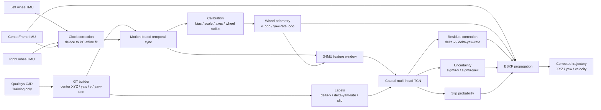

# ระบบสาม IMU + Qualisys สำหรับการสร้างเส้นทางรถเข็นและแก้ Drift: การวิเคราะห์ `trial_07` และข้อเสนอระบบที่ให้ความแม่นยำสูง

## บทสรุปผู้บริหาร

จากการตรวจไฟล์จริง `trial_07.csv` และ `trial_07.c3d` ข้อสรุปที่สำคัญที่สุดคือ **ไม่ควรฝึก neural network ให้รับ IMU แล้วทำนาย \(x,y\) trajectory โดยตรง** เป็นแนวทางหลัก แต่ควรให้ฟิสิกส์ของล้อและ frame IMU สร้าง odometry ก่อน แล้วให้ neural network เรียนเฉพาะ **ความผิดพลาดของโมเดล** ได้แก่

\[
\Delta v = v_{\mathrm{GT}}-v_{\mathrm{wheel}}
\]

\[
\Delta\dot{\psi}
=
\dot{\psi}_{\mathrm{GT}}
-
\dot{\psi}_{\mathrm{wheel}}
\]

พร้อมกับความน่าจะเป็นของ wheel slip และ uncertainty ของค่าที่แก้แล้ว จากนั้นนำผลไป fuse ใน **Error-State EKF/ESKF** ซึ่งเป็นแนวทางแบบ hybrid physics + learning

\[
\boxed{
3\mathrm{IMUs}
\rightarrow
\text{wheel kinematics}
\rightarrow
\text{TCN residual/slip}
\rightarrow
\text{ESKF}
\rightarrow
\text{trajectory}
}
\]

เหตุผลสำคัญมาจากทั้งวรรณกรรมและข้อมูลจริงของคุณเอง งาน AI-IMU ของ Brossard et al. แสดงว่าการให้ neural network ปรับความเชื่อมั่นหรือ covariance ของข้อจำกัดทางฟิสิกส์ภายใน Kalman filter สามารถลด drift ได้มาก โดยใช้ CNN ขนาดเล็กแทนการทำ end-to-end trajectory regression; งานดังกล่าวรายงาน translational error เฉลี่ย 1.10% บน KITTI แต่ตัวเลขนั้น **ไม่ควรนำมาเป็นความแม่นยำที่คาดหวังของ wheelchair โดยตรง** เพราะ dynamics และ dataset ต่างกันมาก. citeturn0view1turn6view0turn6view2turn6view3

Paper MDPI ที่คุณให้มา — Zandbergen et al. — เป็นงาน drift-free IMU สำหรับการเคลื่อนไหว quasi-cyclical โดยใช้สมมติฐานว่าการเคลื่อนไหวเกือบอยู่ในระนาบสองมิติและค่าเฉลี่ยของการเคลื่อนที่แต่ละ cycle ค่อนข้างคงที่ งานนั้นได้ผลดีมากในการวิ่ง แต่สมมติฐานดังกล่าวใช้ได้กับบางส่วนของ `10x5` หรือ propulsion cycle เท่านั้น และจะถูกละเมิดอย่างชัดเจนใน `pivot`, `slalom`, `sprint`, และ `slope`; ดังนั้นแนวคิดเรื่องการใช้ motion constraints มีประโยชน์ แต่ DFOD ไม่ควรเป็น estimator หลักของระบบนี้. citeturn1search0turn1search3

สิ่งที่น่าสนใจมากจาก `trial_07` คือ **ข้อมูลยืนยันว่าการมี center/frame IMU เพิ่มเข้ามามีประโยชน์อย่างชัดเจน**:

| ผลจาก `trial_07` | ค่าที่ตรวจพบ |
|---|---:|
| Trial จาก metadata | `10x5UP 7` |
| IMU streams | `L`, `R`, `C` |
| จำนวน sample รวม CSV | 55,118 |
| L / R / C samples | 18,366 / 18,375 / 18,377 |
| IMU median sample interval | 9,766 µs |
| IMU effective rate | **102.40 Hz** |
| Qualisys marker rate | **100 Hz** |
| C3D frames | 18,031 |
| C3D duration | ≈180.31 s |
| MoCap trajectories | `L_FAL`, `R_FAL` |
| C3D position units | mm |
| Force-plate analog channels | 12 @ 1000 Hz |
| missing IMU samples จาก `missing_before` | 0 |
| usable two-marker GT | **≈88.87%** |
| GT frames ที่ marker ไม่สมบูรณ์ | 2,006 frames ≈11.13% |
| longest marker gap | ≈2.76 s |
| median \(L\!-\!R\) marker separation | ≈0.645 m |
| MoCap–IMU temporal offset จาก motion correlation | ≈0.780 s |
| corr(center `gx`, GT yaw rate) หลัง sync | **≈0.996** |

Qualisys C3D รองรับการบันทึก trajectory และ analog data ในไฟล์เดียว โดย sampling rate ของ analog ต้องเป็น integer multiple ของ marker rate; ข้อมูลในไฟล์ของคุณสอดคล้องกับโครงสร้างนั้นที่ 100 Hz สำหรับ 3D points และ 1000 Hz สำหรับ analog channels. citeturn2search0turn2search2turn2search6

ที่สำคัญกว่านั้น การทดลอง exploratory calibration บน `trial_07` พบว่า wheel-only differential odometry แม้จะ fit local velocity ได้ดี แต่สะสม heading error สูงในระยะยาว ขณะที่ baseline ง่าย ๆ ที่ใช้ **ความเร็วจาก wheel IMUs + yaw rate จาก center IMU** ให้ผลประมาณ ATE RMSE \(0.40\) m และ endpoint drift ประมาณ **1.21% ของระยะทางราว 71.9 m** ใน trial นี้ อย่างไรก็ตามนี่เป็น **in-sample calibration** เพราะ scale/bias ถูก fit จาก trial เดียวกัน จึงเป็น upper-bound เชิงวิศวกรรม ไม่ใช่ผล validation ที่สามารถรายงานเป็น final performance ได้

ดังนั้น recommendation หลักคือ:

> **ใช้ causal TCN ขนาดเล็กเป็น multi-task residual/uncertainty/slip model แล้ว fuse กับ center-IMU ESKF**  
> ไม่ใช่ LSTM หรือ Transformer เป็นโมเดลแรก และไม่ใช่ end-to-end \(IMU\rightarrow x,y\).

TCN เหมาะกับโจทย์นี้เพราะ causal dilated convolution สามารถสร้าง receptive field ยาวโดยไม่ต้องมี recurrent state และงาน sequence-modeling ดั้งเดิมของ TCN พบว่า convolutional architecture เป็น strong starting point เทียบกับ canonical recurrent networks; RoNIN ก็ทดลอง TCN/LSTM/ResNet สำหรับ neural inertial odometry โดยตรง. citeturn8search0turn8search2

## สิ่งที่พบจากไฟล์จริงและการสร้าง Ground Truth

### โครงสร้างและคุณภาพข้อมูล IMU

`trial_07.csv` มี columns:

`session_id, wheel, seq, timestamp_device_us, timestamp_pc_monotonic_ns, ax_raw, ay_raw, az_raw, gx_raw, gy_raw, gz_raw, packet_id, sequence_class, missing_before`

ทั้งสาม stream มี device timestamp ที่ต่อเนื่องมาก โดย median interval เท่ากับ \(9766\,\mu s\) หรือประมาณ \(102.396\) Hz และไม่มี sample ที่ถูกระบุว่า missing ใน `missing_before`

อย่างไรก็ตาม **ห้ามใช้ `timestamp_pc_monotonic_ns` ของแต่ละ row เป็น sample timestamp โดยตรง** เพราะข้อมูลแสดงว่า IMU ถูกส่งมาเป็น packet ประมาณ 10 samples ต่อ packet และ samples ภายใน packet เดียวกันได้รับ PC timestamp เดียวกัน ส่วน packet-to-packet spacing อยู่ราว 100 ms

วิธีที่เหมาะสมคือ fit affine clock model แยกสำหรับแต่ละ IMU:

\[
t_{\mathrm{PC}}
=
\alpha_i t_{\mathrm{device},i}+\beta_i
\]

จาก `timestamp_device_us` ของ sample ท้าย packet กับ `timestamp_pc_monotonic_ns` ของ packet และใช้ robust regression เพื่อลดผลของ BLE/USB/network scheduling jitter

ค่าที่ผม fit จากไฟล์ได้ประมาณ:

| IMU | clock scale error | robust packet-timing residual |
|---|---:|---:|
| Center | −14 ppm | ≈5 ms |
| Left | +8 ppm | ≈30 ms |
| Right | +7 ppm | ≈7 ms |

ดังนั้นปัญหาไม่ใช่ sampling loss แต่เป็น **clock offset + packet arrival jitter + small clock skew** โดยเฉพาะ left IMU

### แกน IMU

จาก variance ของ raw gyroscope:

| sensor | axis ที่เด่น | interpretation |
|---|---|---|
| Left wheel | `gz` | wheel spin axis |
| Right wheel | `gz` | wheel spin axis |
| Center/frame | `gx` | wheelchair yaw axis |

ใน wheel IMUs, standard deviation ของ `gz` อยู่ประมาณ \(992\) และ \(1017\) raw counts ซึ่งสูงกว่า `gx,gy` อย่างชัดเจน ส่วน center IMU มี `gx` standard deviation ประมาณ 249 counts แต่ `gy,gz` มีเพียงราว 21–22 counts

ที่สำคัญคือหลัง temporal alignment แล้ว center `gx` มี correlation กับ Qualisys yaw-rate ประมาณ

\[
\rho \approx 0.996
\]

ซึ่งเป็นหลักฐานจากข้อมูลจริงที่แข็งแรงว่า `gx_C` คือแกนหลักสำหรับ yaw rotation ของ frame

ค่าที่ CSV บันทึกเป็น **raw integer counts** และไม่มี metadata ระบุ accelerometer/gyroscope scale ดังนั้นยังไม่ควรประกาศว่าเป็น \(m/s^2\) หรือ \(deg/s\) ด้วย scale factor ใดจนกว่าจะทราบ IMU model/configuration หรือใช้ static + controlled rotation calibration

จาก exploratory fit ของ `trial_07`:

\[
\dot{\psi}_{GT}
\approx
0.001213\,g_{x,C}-0.01354
\]

โดย coefficient \(0.001213\) มีหน่วยประมาณ rad/s ต่อ raw count แต่ค่านี้เป็น empirical trial-specific calibration และไม่ควรแทน factory scale factor

### C3D และข้อจำกัดของ Ground Truth ปัจจุบัน

ไฟล์ C3D ระบุ:

\[
f_{\mathrm{MoCap}}=100\;\mathrm{Hz}
\]

มี trajectories เพียงสองตัว:

\[
L_{\mathrm{FAL}},\qquad R_{\mathrm{FAL}}
\]

และ position units เป็น `mm`

Qualisys อนุญาตให้ global coordinate system ถูก translate/rotate ได้ใน QTM ดังนั้นแม้ข้อมูล trial นี้บ่งชี้อย่างชัดเจนว่าแกน \(Z\) ทำหน้าที่เป็น vertical axis แต่ pipeline ไม่ควร hard-code สมมติฐานดังกล่าวสำหรับ dataset ทั้งหมดโดยไม่ตรวจ calibration metadata หรือ static trial ก่อน. citeturn2search1turn2search4

กำหนด wheelchair body frame เป็น

\[
x_B=\text{forward},\quad
y_B=\text{left},\quad
z_B=\text{up}
\]

จาก markers สามารถสร้างตำแหน่ง center:

\[
\mathbf p_C
=
\frac{\mathbf p_L+\mathbf p_R}{2}
\]

และ lateral direction:

\[
\mathbf y_B=
\frac{\mathbf p_L-\mathbf p_R}
{\|\mathbf p_L-\mathbf p_R\|}
\]

ถ้า \(\mathbf z_G\) คือ vertical axis:

\[
\mathbf x_B=
\frac{\mathbf y_B\times\mathbf z_G}
{\|\mathbf y_B\times\mathbf z_G\|}
\]

จากนั้น

\[
\psi_{GT}
=
\operatorname{atan2}(x_{B,y},x_{B,x})
\]

และ unwrap ก่อนหา derivative

\[
\dot{\psi}_{GT}
=
\frac{d\psi_{GT}}{dt}
\]

สำหรับตำแหน่ง:

\[
\mathbf v_{GT}=
\frac{d\mathbf p_C}{dt}
\]

และ forward velocity:

\[
v_{GT}
=
\mathbf x_B^\top\mathbf v_{GT}
\]

**ข้อจำกัดสำคัญ:** marker สองจุดให้ center และ lateral axis/yaw ได้ดี แต่ **ไม่สามารถกำหนด full 6-DoF orientation อย่างเป็นเอกลักษณ์** ได้ ดังนั้นจาก `trial_07.c3d` ปัจจุบัน เราสร้าง GT ที่น่าเชื่อถือได้ประมาณ

\[
[x,y,z,\psi,v,\dot{\psi}]
\]

แต่ยังไม่มี independent MoCap ground truth สำหรับ roll/pitch ของ wheelchair frame

สำหรับ slope trials ควร re-export จาก QTM เป็น rigid-body 6DOF หรือเก็บ frame markers อย่างน้อยสามจุดที่ไม่อยู่บนเส้นเดียวกัน ถ้ามี marker data เหล่านั้นอยู่ใน QTM ต้นฉบับ Qualisys สามารถ export 3D trajectories และ rigid-body-associated data ตาม configuration ของ QTM/C3D export ได้. citeturn2search2turn2search8

### Marker dropout เป็นปัญหาที่ต้องแก้ก่อน training

`trial_07` มี valid frames ที่สอง markers อยู่ครบประมาณ **88.87%** เท่านั้น มี invalid 2,006 frames และ gap ต่อเนื่องยาวที่สุดประมาณ **2.76 s**

C3D format เก็บ XYZ พร้อม point-quality/residual information และ convention สำหรับ invalid 3D points; จึงควรใช้ทั้ง point status และ geometric consistency ไม่ใช่ตรวจ XYZ อย่างเดียว. citeturn2search3turn2search6turn2search9

ผมแนะนำกฎสร้าง GT mask:

\[
m_t=
\begin{cases}
1,&
L,R\;\text{valid และ }
0.60<\|\mathbf p_R-\mathbf p_L\|<0.69\,m\\
0,&\text{otherwise}
\end{cases}
\]

จากข้อมูล `trial_07` median separation คือประมาณ

\[
0.6448\;m
\]

แต่ **ไม่ควรถือ 0.6448 m เป็น wheel track width โดยอัตโนมัติ** เพราะขึ้นกับตำแหน่ง marker จริงบน frame

สำหรับ training ให้ discard window ทุก window ที่ intersect invalid GT หรืออย่างน้อย margin ±0.2 s รอบ gap และ **ห้าม interpolate gap 1–3 s แล้วใช้เป็น supervised label** เพราะ network จะเรียนรู้ค่าที่เรา interpolate เองแทนที่จะเรียนจาก MoCap

การ interpolate ระยะสั้น เช่น ≤50–100 ms อาจใช้สำหรับ smoothing derivative ได้ แต่ควรเก็บ `gt_quality_mask` ไว้และไม่ใช้ interpolated long gaps ใน loss

## Synchronization, wheel odometry และ failure modes

### วิธี synchronize ที่แนะนำ

ระบบควรทำสองชั้น

**ชั้น IMU-to-IMU**

fit

\[
t^{PC}_i=\alpha_i t^{device}_i+\beta_i
\]

แยก `L`, `R`, `C` แล้ว resample ทั้งหมดเข้าสู่ common time grid เช่น 100 Hz

**ชั้น IMU-to-Qualisys**

เพราะ C3D ไม่มี `timestamp_pc_monotonic_ns` เดียวกับ CSV จึงต้องหา global temporal offset จาก motion signature

ตัวเลือกที่ดีที่สุดในข้อมูลนี้คือ center yaw:

\[
g_{x,C}(t)
\leftrightarrow
\dot{\psi}_{GT}(t+\tau)
\]

และ optimize

\[
\tau^\star=
\arg\max_\tau
\left|
\operatorname{corr}
\left(
g_{x,C}(t),
\dot{\psi}_{GT}(t+\tau)
\right)
\right|
\]

จาก `trial_07` ได้ประมาณ:

\[
\tau^\star\approx -0.780\,s
\]

หรือกล่าวอีกแบบคือ Qualisys เริ่มบันทึก motion ประมาณ 0.78 s ก่อนจุดเริ่มของ common IMU timeline ที่ map จาก PC timestamp

หลัง alignment correlation สูงถึงประมาณ

\[
\rho=0.9957
\]

จึงถือว่า signal pair นี้เหมาะมากสำหรับ fine synchronization

สำหรับ dataset ทั้งชุดควร automate ขั้นตอนนี้และ reject trial ถ้า peak correlation ต่ำ เช่น \(<0.8\) หรือ correlation peak กว้างผิดปกติ

### Wheel angular velocity

จากข้อมูลจริงใช้ `gz` เป็น axle-axis gyro:

\[
\omega_L
=
s_L(g_{z,L}-b_L)
\]

\[
\omega_R
=
-s_R(g_{z,R}-b_R)
\]

เครื่องหมายลบของ right wheel เกิดจาก sensor mounting orientation ตรงข้ามกันใน `trial_07`

ให้หา \(b_L,b_R\) จาก `static` trial โดยเฉพาะ ไม่ใช่จาก mean ของ dynamic trial และควร estimate:

\[
b_g,\quad
\sigma_g,\quad
\sigma_{bg}
\]

รวมทั้ง Allan deviation หากต้องการ model bias random walk สำหรับ ESKF อย่างจริงจัง

จากนั้น

\[
v_L=r_L\omega_L,\qquad
v_R=r_R\omega_R
\]

classical differential-drive model คือ

\[
v_{\mathrm{odo}}
=
\frac{v_R+v_L}{2}
\]

\[
\dot{\psi}_{\mathrm{odo}}
=
\frac{v_R-v_L}{B_{\mathrm{eff}}}
\]

โดย \(B_{\mathrm{eff}}\) ควร calibrate จาก maneuver ที่มี turn/pivot ไม่ใช่ใช้ physical marker separation เพียงอย่างเดียว

ข้อมูล `trial_07` ให้หลักฐานที่น่าสนใจมาก: การ fit local forward velocity ให้

\[
v
\approx
0.0003574
\frac{g_{z,L}-g_{z,R}}{2}
\]

ใน raw-count representation และถ้าสมมติ wheel gyros มี scale ใกล้กับ center gyro จะได้ wheel radius ประมาณ

\[
r\approx0.295\,m
\]

ซึ่งสมเหตุสมผลทางกายภาพ แต่ต้องยืนยันกับ radius จริงของ wheelchair

ในทางกลับกัน \(B_{\mathrm{eff}}\) ที่ fit จาก yaw dynamics ได้ประมาณ \(0.49\) m ขณะที่ marker separation คือประมาณ \(0.645\) m ความแตกต่างขนาดนี้เป็นสัญญาณสำคัญว่า simple no-slip differential model ไม่สามารถอธิบาย turning behavior ทั้งหมดของ `10x5UP` ได้ และเป็นเหตุผลโดยตรงที่ควรเรียน \(\Delta\dot{\psi}\) หรือ uncertainty แทนการพยายาม tune \(B\) เพียงค่าเดียว

Manual wheelchairs มี wheel geometry, tire radius, camber และ track width ที่แตกต่างกัน และงาน wheelchair sensing ล่าสุดก็ใช้ wheel-hub IMUs ร่วมกับ frame-mounted IMU เพื่อดึง angular velocity และ mobility features; งาน validation อื่นยังแสดงว่า wheel-mounted IMU angular velocity สามารถสัมพันธ์กับ marker-based wheelchair measurements ได้สูงมากภายใต้ controlled propulsion. citeturn3search10turn3search14

### Classical baseline ที่พบจาก trial นี้

เมื่อ calibrate จาก trial เดียวกัน ผล local residual ของ classical wheel speed อยู่ในระดับประมาณ:

\[
RMSE_v \approx 0.022\;m/s
\]

แต่ wheel-difference yaw model มี

\[
RMSE_{\dot{\psi}}\approx0.084\;rad/s
\]

และ accumulated heading error ใหญ่มากเมื่อ integrate ทั้ง trial

นี่คือเหตุผลที่ trajectory drift สามารถแย่ แม้ instantaneous velocity RMSE ดูดี

ใน exploratory experiment ที่เปลี่ยนมาใช้

\[
v=v_{\mathrm{wheel}}
\]

และ

\[
\dot{\psi}=
\dot{\psi}_{center\ gyro}
\]

หลัง fit scale/bias กับ GT เดียวกัน ผลประมาณ:

| exploratory metric | ผล |
|---|---:|
| traveled distance | ≈71.9 m |
| ATE RMSE | ≈0.40 m |
| yaw RMSE | ≈9.1° |
| endpoint error | ≈0.87 m |
| endpoint drift | **≈1.21%** |

ผลนี้ **ยังไม่ใช่ validation accuracy** เพราะใช้ trial เดียวกันในการหา calibration parameter และประเมิน performance แต่เป็นหลักฐานที่ดีมากว่า architecture ที่ถูกต้องควรให้

- wheel IMUs เป็นแหล่ง forward speed
- center IMU เป็นแหล่ง attitude/yaw dynamics
- learning model แก้เฉพาะ residual/slip
- ESKF จัดการ bias และ uncertainty

ไม่ควรให้ wheel-difference เป็นแหล่ง heading เพียงตัวเดียว

### Failure modes ที่โมเดลต้องเรียนรู้

สำหรับ maneuver ของคุณ failure modes แยกได้ชัดเจน:

| Maneuver family | สิ่งที่ stress-test | failure หลัก |
|---|---|---|
| `static` | bias/noise | gyro bias, accel offset |
| `10x5`, `10x5up` | straight + repeated turns | accumulated yaw bias, wheel asymmetry |
| `Pvar`, `Pvcr`, `Celw`, `Ar` | pivot | lateral scrub, caster dynamics, invalid no-slip assumption |
| `Sl`, `Slup` | changing curvature | rapid \(B_{\rm eff}\) variation, lateral slip |
| `Sp`, `7_5_mspt` | high acceleration | vibration, tire deformation, impulsive propulsion |
| `SlopeF`, `SlopeB` | pitch/gravity | gravity projection, effective rolling radius/load |
| slope + turn groups | combined | slip + pitch + yaw + caster dynamics |

AI-IMU ใช้แนวคิดเดียวกันในระดับ general wheeled vehicle คือ kinematic constraints มีความน่าเชื่อถือไม่เท่ากันใน straight และ turn จึงให้ network dynamically change covariance แทนการบังคับ constraint เท่ากันตลอดเวลา. citeturn5view0turn6view0

## Labels, features และโมเดลที่ควร train

### การสร้าง residual labels

หลัง synchronization และ calibration:

\[
v_{GT}(t)
=
\mathbf x_B^T \dot{\mathbf p}_{GT}
\]

\[
r_{GT}(t)=\dot{\psi}_{GT}(t)
\]

\[
v_{odo}(t)
=
\frac{v_L(t)+v_R(t)}{2}
\]

\[
r_{odo}(t)
=
\frac{v_R(t)-v_L(t)}{B_{\mathrm{eff}}}
\]

สร้าง labels:

\[
\boxed{
\Delta v(t)=v_{GT}(t)-v_{odo}(t)
}
\]

\[
\boxed{
\Delta r(t)
=
r_{GT}(t)-r_{odo}(t)
}
\]

โดย \(r=\dot\psi\)

ผล prediction:

\[
v^*=v_{odo}+\widehat{\Delta v}
\]

\[
r^*=r_{odo}+\widehat{\Delta r}
\]

ไม่ควรใช้ finite difference ตรง ๆ กับ raw MoCap เนื่องจาก differentiation ขยาย noise ให้ filter/smooth **GT เท่านั้น** แบบ offline ก่อนสร้าง labels เช่น Savitzky–Golay หรือ zero-phase Butterworth แล้วตรวจ PSD เพื่อเลือก cutoff

ในการวิเคราะห์ exploratory ของ `trial_07` ผมใช้ Savitzky–Golay window 31 samples ที่ 100 Hz เพื่อดูโครงสร้าง signal แต่ final preprocessing ควรเลือก bandwidth จากทุก maneuver ไม่ใช่ยึด 31 samples อัตโนมัติ

### Slip labels

แทนการกำหนด slip จาก \(\Delta v\) อย่างเดียว ให้คำนวณ wheel-specific GT velocities:

\[
v_{L,GT}
=
v_{GT}
-
\frac{B}{2}r_{GT}
\]

\[
v_{R,GT}
=
v_{GT}
+
\frac{B}{2}r_{GT}
\]

จากนั้น

\[
e_L=v_{L,odo}-v_{L,GT}
\]

\[
e_R=v_{R,odo}-v_{R,GT}
\]

และ lateral velocity จาก MoCap:

\[
v_{lat,GT}
=
\mathbf y_B^T
\mathbf v_{GT}
\]

ให้สร้าง continuous slip severity ก่อน:

\[
S=
\sqrt{
\left(\frac{e_L}{\sigma_L}\right)^2+
\left(\frac{e_R}{\sigma_R}\right)^2+
\lambda
\left(\frac{v_{lat}}{\sigma_{lat}}\right)^2
}
\]

โดย \(\sigma\) หา robustly จาก clean straight sections ของ **training set เท่านั้น**

binary slip label สามารถนิยามจาก

\[
S>\tau
\]

ต่อเนื่องอย่างน้อยประมาณ 100 ms

โดยตั้ง \(\tau\) จาก 99th percentile หรือ median \(+3\,MAD\) ของ clean straight data แทนการกำหนด threshold แบบ arbitrary

นี่สำคัญมากสำหรับ pivot เพราะ pivot ไม่ได้หมายถึง sensor failure แต่ classical no-slip geometry อาจไม่ถูกต้องอย่างเป็นระบบ

### Feature sets ที่ควรทดสอบ

| Feature set | Input | จุดประสงค์ | Priority |
|---|---|---|---|
| Wheel-minimal | \(g_{z,L},g_{z,R}\) | classical spin information | baseline |
| Wheels-6D | \(a_L,g_L,a_R,g_R\) | vibration/slip/wheel phase | สูง |
| Frame-only | \(a_C,g_C\) | attitude/yaw/inertial baseline | ablation |
| Three-IMU raw | 18 channels | full raw sensor context | สูง |
| Physics-enhanced | 18 raw + \(v_{odo},r_{odo},\omega_L,\omega_R,\omega_R-\omega_L,\|a_i\|\) | ให้ network เรียน residual ง่ายขึ้น | **แนะนำ** |
| Filter-aware | physics-enhanced + roll/pitch, bias estimates, innovation history | stage-two refinement | หลัง baseline stable |

ผมแนะนำประมาณ **24–28 input channels** หลัง feature engineering แต่ไม่ควรใส่ derivative ทุกอย่างจน redundant

### โมเดลที่ควรเลือก

| Model | ข้อดี | ข้อเสีย | Recommendation |
|---|---|---|---|
| Plain 1D-CNN | เร็ว, ง่าย, params น้อย | receptive field จำกัด | baseline |
| **Causal TCN** | long receptive field, parallel training, online causal | ต้อง tune dilation/window | **ตัวหลัก** |
| LSTM | natural sequence state | inference sequential, training ช้ากว่า, state reset issues | strong baseline |
| Transformer | long-range attention, flexible | data hungry, heavier, unnecessary สำหรับ 2–3 s windows | secondary experiment |
| Direct trajectory network | implementation ดูง่าย | error integration/generalization แย่, physical constraints หาย | ไม่แนะนำ |

TCN ใช้ causal convolutions, dilation และ residual connections เพื่อเพิ่ม temporal receptive field และงาน original TCN แนะนำ convolutional architecture เป็น strong starting point สำหรับ sequence modeling; RoNIN ยืนยันว่าทั้ง TCN/LSTM สามารถใช้กับ IMU-to-motion regression ได้. citeturn8search0turn8search2

Transformer ใช้ self-attention เพื่อเชื่อม long-range dependencies ได้โดยตรง แต่สำหรับโจทย์นี้ window ที่จำเป็นอยู่ระดับเพียงไม่กี่วินาทีและ dataset wheelchair มักเล็กกว่า large-scale sequence datasets มาก จึงควรเป็น comparison model ไม่ใช่ primary model; มีงาน inertial Transformer ใหม่ ๆ เช่น iMoT ที่ชี้ให้เห็นศักยภาพของ attention ใน inertial navigation แต่ไม่ได้ทำให้ Transformer เป็นตัวเลือกที่ดีที่สุดโดยอัตโนมัติสำหรับ dataset ขนาดเล็กของ wheelchair. citeturn10search0turn10search1

### TCN architecture ที่ผมแนะนำ

Resample เป็น

\[
100\;Hz
\]

และใช้ causal window

\[
T=256\;samples=2.56\;s
\]

เพราะยาวพอให้เห็น propulsion dynamics + onset ของ turn แต่ยัง deploy online ได้

โครงสร้าง:

| component | configuration |
|---|---|
| Input | 24–28 features × 256 samples |
| Block count | 6 |
| Channels | 64, 64, 64, 96, 96, 128 |
| Kernel | 3 |
| Dilations | 1, 2, 4, 8, 16, 32 |
| Conv/block | 2 |
| Activation | GELU หรือ ReLU |
| Normalization | GroupNorm/LayerNorm |
| Dropout | 0.10–0.20 |
| Residual connections | ทุก block |
| Output heads | residual + uncertainty + slip |
| Parameters | ≈0.28–0.35 M |

receptive field สำหรับสอง convolutions ต่อ block คือ

\[
RF
=
1+
2(k-1)
\sum_i d_i
\]

ดังนั้น

\[
RF=
1+2(2)(1+2+4+8+16+32)
=
253
\]

หรือประมาณ

\[
2.53\;s
\]

แทบเท่ากับ input window 2.56 s พอดี

Output heads:

\[
[
\widehat{\Delta v},
\widehat{\Delta r},
\log\sigma_v^2,
\log\sigma_r^2,
\operatorname{logit}(p_{slip})
]
\]

แนวคิดให้ network ทำนาย uncertainty แล้วใช้ใน Kalman update มี precedent ที่แข็งแรงจากทั้ง AI-IMU และ TLIO; AI-IMU ให้ CNN ปรับ covariance ของ pseudo-measurements ส่วน TLIO ทำนาย learned motion measurement พร้อม uncertainty เพื่อนำไป fuse ใน EKF. citeturn6view0turn6view2turn4search2

### Loss function

ช่วงแรก train regression ให้ stable:

\[
L_{\mathrm{reg}}
=
Huber(\widehat{\Delta v},\Delta v)
+
\lambda_r
Huber(\widehat{\Delta r},\Delta r)
\]

จากนั้นเปลี่ยนเป็น heteroscedastic likelihood:

\[
L_v
=
\frac12
e^{-s_v}
(\widehat{\Delta v}-\Delta v)^2+
\frac12s_v
\]

\[
L_r
=
\frac12
e^{-s_r}
(\widehat{\Delta r}-\Delta r)^2+
\frac12s_r
\]

และ slip:

\[
L_{slip}
=
BCE_{\mathrm{weighted}}
\]

หรือ focal loss ถ้า slip samples น้อย

total:

\[
L=
L_v+
L_r+
\lambda_s L_{slip}
+
\lambda_{smooth}L_{temporal}
\]

TLIO ใช้วิธี pretrain ด้วย squared-error ก่อนแล้วจึงเปลี่ยนเป็น likelihood-based objective เพราะ likelihood training จาก random initialization มีปัญหาการ converge ซึ่งเป็นแนวทางที่เหมาะมากกับงานของคุณเช่นกัน. citeturn4search6

## Training, validation และ ablation ที่ reviewer เชื่อถือได้

### ห้าม random split windows

จุดนี้สำคัญที่สุดของ protocol

ถ้า window ของ trial เดียวกันถูกสุ่มกระจายเข้า train และ test network จะเห็น:

- IMU bias เดียวกัน
- mounting orientation เดียวกัน
- participant เดียวกัน
- wheel pressure/radius เดียวกัน
- motion sequence ที่อยู่ติดกัน

ผล accuracy จะ optimistic อย่างมาก

ดังนั้น unit ที่ใช้ split ต้องเป็น **whole trial หรือ whole participant**

จาก `trial_07.c3d` metadata พบ `Patient ID = WC1` แต่จากสองไฟล์นี้ไม่สามารถทราบจำนวน participant ทั้ง dataset ได้ จึงต้องถือจำนวน participant เป็น **unspecified**

### Split strategies

| Protocol | Train/Val/Test | ใช้ตอบคำถาม |
|---|---|---|
| Seen-maneuver / unseen-trial | maneuver ซ้ำได้ แต่ trial ห้ามซ้ำ | reproducibility ภายใน distribution |
| Unseen-participant | participant ห้ามข้าม split | user generalization |
| Leave-one-subject-out | train ทุกคนยกเว้นหนึ่งคน | ดีเมื่อ participant น้อย |
| **Unseen-maneuver-family** | hold out maneuver family ทั้งกลุ่ม | **generalization เชิง dynamics** |
| Cross-chair | hold out wheelchair configuration | deployment จริง ถ้ามีหลาย chair |

Unseen-maneuver split ควรแบ่ง family:

| Family | Maneuvers |
|---|---|
| straight/U-turn | `10x5`, `10x5up` |
| pivot | `Pvar`, `Pvcr`, `Celw`, `Ar` |
| slalom | `Sl`, `Slup` |
| sprint | `Sp`, `7_5_mspt` |
| slope | `SlopeB`, `SlopeF`, `SlopeFBAR`, `SlopeFBCW`, `SlopeHAR`, `SlopeHCW` |
| calibration | `static` |

ตัวอย่าง experiment ที่แข็งแรง:

**Fold slope unseen**

Train:

`10x5, 10x5up, pivot, slalom, sprint`

Test:

`Slope*`

**Fold pivot unseen**

Train:

straight + slalom + sprint + slope

Test:

`Pvar,Pvcr,Celw,Ar`

**Fold slalom unseen**

Test:

`Sl,Slup`

ด้วยวิธีนี้เราจะรู้ว่า network เรียน physical error pattern จริงหรือแค่จำ maneuver

AI-IMU เองใช้ leave-sequence-out evaluation โดย train โดยไม่เห็น sequence ที่นำมาทดสอบ ซึ่งสะท้อนหลักการเดียวกันว่าต้องป้องกัน temporal sequence leakage. citeturn6view3

### Hyperparameters เริ่มต้น

| Hyperparameter | ค่าเริ่มต้น |
|---|---:|
| resampling | 100 Hz |
| window | 256 samples / 2.56 s |
| training stride | 10 samples / 0.10 s |
| validation stride | 10–20 samples |
| deployment update | 20–100 Hz |
| optimizer | AdamW |
| initial LR | \(3\times10^{-4}\) |
| weight decay | \(10^{-4}\) |
| batch size | 64–128 windows |
| epochs | max 100–150 |
| LR schedule | cosine decay |
| warm-up | 5 epochs |
| dropout | 0.15 |
| gradient clipping | 1.0 |
| early stopping | 15 epochs |
| slip loss | class-balanced BCE / focal |
| model selection | validation trajectory RPE ไม่ใช่ window RMSE อย่างเดียว |

AI-IMU ใช้ Adam, gradient clipping, dropout และ augmentation ในการ train learned covariance adapter ซึ่งสนับสนุนการใช้ regularization แบบเดียวกัน แม้ hyperparameters ของ wheelchair ควร tune ใหม่ทั้งหมด. citeturn6view2turn6view3

### Data augmentation

ควร augment สิ่งที่เกิดขึ้นจริงใน sensor system:

\[
b_g
\leftarrow
b_g+\delta b
\]

\[
a
\leftarrow
a+n_a
\]

\[
g
\leftarrow
g+n_g
\]

รวมถึง:

- random gyro/accelerometer bias จาก distribution ของ `static`
- small scale-factor perturbation
- sensor-axis misalignment ประมาณ 1–3°
- IMU-to-IMU timing perturbation ±5–20 ms
- occasional packet loss 10–100 ms
- wheel-radius perturbation
- \(B_{\mathrm{eff}}\) perturbation
- vibration/noise augmentation
- random slope-compatible rotation ของ gravity vector

ไม่ควรใช้ aggressive arbitrary time-warp เพราะจะทำลาย physical relationship ระหว่าง angular velocity กับ translational speed

### Ablation studies ที่จำเป็น

Ablation หลักควรตอบว่าแต่ละ sensor/โมดูลช่วยอะไร:

| Experiment | สิ่งที่พิสูจน์ |
|---|---|
| classical wheel odometry | physics baseline |
| center IMU dead reckoning | pure inertial baseline |
| wheel \(g_z\) only | minimum sensor signal |
| L+R 6D | wheel vibration/slip contribution |
| center 6D only | frame information |
| L+R+C raw | value ของสาม IMUs |
| physics features + TCN | benefit จาก inductive bias |
| TCN residual only | learned correction |
| TCN uncertainty only | learned covariance |
| residual + uncertainty | full learned measurement |
| fixed ESKF covariance | classical fusion |
| slip-adaptive covariance | benefit จาก slip detection |
| no slope compensation | importance of attitude |
| TCN vs LSTM | architecture comparison |
| TCN vs Transformer | data-efficiency comparison |

และควรเพิ่ม ablation ที่มักถูกมองข้าม:

\[
\text{packet timestamp only}
\quad vs \quad
\text{affine clock fit + motion synchronization}
\]

เพราะ `trial_07` แสดงชัดว่าการ sync ที่ไม่ดีระดับ 20–30 ms สามารถเกิดได้จาก packet timing โดยเฉพาะ left stream

## ESKF และ pipeline สุดท้ายที่แนะนำ

### State vector

สำหรับ wheelchair ที่ต้องรองรับ slope ใช้ full 3D attitude ดีกว่า planar EKF

nominal state:

\[
\mathbf x=
[
\mathbf p^G,
\mathbf v^G,
\mathbf q_{GB},
\mathbf b_g,
\mathbf b_a
]
\]

error state:

\[
\delta\mathbf x=
[
\delta\mathbf p,
\delta\mathbf v,
\delta\boldsymbol\theta,
\delta\mathbf b_g,
\delta\mathbf b_a
]
\]

รวม 15 error states

ถ้าต้องการ online calibration ของ wheelchair เพิ่ม:

\[
[
k_L,k_R,B_{\mathrm{eff}}
]
\]

เป็น slowly-varying parameters ทำให้ error-state รวม 18 dimensions

แต่สำหรับ wheelchair คันเดียวที่ geometry คงที่ ผมแนะนำ calibrate \(k_L,k_R,B\) offline แล้วไม่เพิ่ม state เหล่านี้จนกว่าระบบพื้นฐานจะเสถียร

### Propagation

ใช้ **center/frame IMU เท่านั้น** ใน inertial mechanization:

\[
\boldsymbol\omega
=
\boldsymbol\omega_m-\mathbf b_g
\]

\[
\mathbf a
=
\mathbf a_m-\mathbf b_a
\]

\[
\dot{\mathbf q}
=
\frac12
\Omega(\boldsymbol\omega)\mathbf q
\]

\[
\dot{\mathbf v}^G
=
R_{GB}\mathbf a+\mathbf g
\]

\[
\dot{\mathbf p}^G
=
\mathbf v^G
\]

\[
\dot{\mathbf b}_g=\mathbf n_{bg}
\]

\[
\dot{\mathbf b}_a=\mathbf n_{ba}
\]

นี่คือ standard inertial state structure แบบเดียวกับ learned-inertial/filter literature เช่น AI-IMU และ TLIO. citeturn5view0turn4search2

### Measurement จาก wheel + TCN

TCN ให้:

\[
z_v
=
v_{odo}
+
\widehat{\Delta v}
\]

พร้อม

\[
\sigma_v^2
\]

ESKF measurement model:

\[
z_v
=
\mathbf e_x^T
R_{GB}^T
\mathbf v^G
+
n_v
\]

ถ้า center IMU ไม่ได้อยู่ตรง reference center ต้องรวม lever-arm term

\[
\boldsymbol\omega\times\mathbf r_{IC}
\]

ด้วย

สำหรับ yaw ผมไม่แนะนำให้ update instantaneous

\[
r^*=
r_{odo}+\widehat{\Delta r}
\]

กับ center gyro แบบ naïve เพราะ center gyro ถูกใช้ propagation อยู่แล้ว ทำให้ measurement/process noise correlated

วิธีที่สะอาดกว่าให้ใช้ yaw increment ใน TCN window:

\[
\Delta\psi_w
=
\int_{t-T}^{t}
\left(
r_{odo}+
\widehat{\Delta r}
\right)dt
\]

แล้ว update เทียบกับ relative orientation ของ ESKF ระหว่าง cloned states

\[
\Delta\psi_{ESKF}
=
\operatorname{Log}
\left(
R_{t-T}^T R_t
\right)_z
\]

แนวคิด relative learned measurement ภายใน Kalman filter ใกล้เคียงกับ TLIO ซึ่งใช้ learned relative displacement พร้อม uncertainty แล้ว fuse ใน cloned EKF. citeturn4search2turn4search6

### Slip probability ใช้อย่างไร

TCN ให้

\[
p_{slip}\in[0,1]
\]

อย่าใช้แค่ hard switch

ให้ map เป็น measurement covariance:

\[
R_v
=
\sigma_v^2
+
R_{v,0}
\exp(\gamma_vp_{slip})
\]

\[
R_{\psi}
=
\sigma_\psi^2
+
R_{\psi,0}
\exp(\gamma_\psi p_{slip})
\]

เช่นเมื่อ

\[
p_{slip}\rightarrow1
\]

filter จะลดความเชื่อถือ wheel measurement

และ pseudo non-holonomic constraint

\[
v_y^B\approx0
\]

ก็ควรถูก inflate covariance เช่นกันใน pivot/slalom

นี่คือส่วนที่ผมจะนำแนวคิดจาก AI-IMU มาใช้มากที่สุด: ไม่ใช่ให้ network แทน Kalman filter แต่ให้ network บอกว่า **เมื่อใด physical constraint ควรถูกเชื่อมากหรือน้อย**. citeturn5view0turn6view0

### Pipeline สุดท้าย

**Qualisys อยู่เฉพาะด้านซ้ายใน training/evaluation branch และต้องไม่เข้า inference pipeline**

เมื่อ deploy จริง input มีเพียง IMUs สามตัวและ calibration parameters

## การประเมินความแม่นยำ เป้าหมาย และ deployment

### Metrics

ห้ามใช้เพียง pointwise \(x,y\) RMSE

ควรรายงาน:

\[
ATE
=
\sqrt{
\frac1N
\sum_i
\|
\mathbf p_i-\mathbf p_i^{GT}
\|^2
}
\]

และ relative pose error ที่ระยะคงที่

\[
RPE@1m,\qquad RPE@5m
\]

รวมถึง

\[
RMSE_\psi,\quad
RMSE_{\dot\psi},\quad
EndpointError
\]

และ

\[
Drift\%
=
100
\frac{
\|\mathbf p_{end}-\mathbf p_{end}^{GT}\|
}{
D_{travelled}
}
\]

Relative-distance metrics มีเหตุผลมากสำหรับ odometry เพราะแยก local drift rate ออกจากระยะเวลาทดลอง; AI-IMU/KITTI ก็ประเมิน relative translational/rotational error บน sub-trajectories ขนาดต่าง ๆ และ modern neural inertial work ใช้ ATE และ distance-relative trajectory error เช่นกัน. citeturn6view3turn10search1

ควรรายงาน metrics แยกตาม maneuver:

\[
ATE_{\mathrm{straight}},
ATE_{\mathrm{pivot}},
ATE_{\mathrm{slalom}},
ATE_{\mathrm{slope}},
ATE_{\mathrm{sprint}}
\]

ไม่ใช่ aggregate อย่างเดียว

โดยเฉพาะควรมี:

\[
RMSE_{\dot\psi}^{pivot}
\]

และ

\[
Drift_{\%}^{slope}
\]

เพราะสองกลุ่มนี้น่าจะเป็น failure case หลัก

### Baselines และ engineering targets

จาก `trial_07` มี evidence ว่า calibrated wheel speed + center gyro สามารถเป็น baseline ที่แข็งแรงมาก จึงไม่ควรตั้งเป้าเพียง "ดีกว่า raw wheel odometry"

ผมแนะนำ target hierarchy:

| ระดับ | Seen trials | Unseen maneuver family |
|---|---:|---:|
| Minimum useful | drift <5% | <8% |
| Strong thesis/paper target | **<2%** | **<4%** |
| Excellent | **<1–1.5%** | **<3%** |

และควรตั้ง relative targets:

\[
ATE_{\mathrm{TCN+ESKF}}
<
0.5\,
ATE_{\mathrm{classical}}
\]

หรืออย่างน้อย

\[
>30\%
\]

reduction ใน ATE/RPE บน held-out participants/trials

สำหรับ `RPE@5m` engineering target ที่น่าสนใจคือ

\[
<0.20-0.30\,m
\]

และ yaw RPE:

\[
<5^\circ
\]

ใน seen maneuvers

ตัวเลขเหล่านี้คือ **เป้าหมายการออกแบบ ไม่ใช่ predicted performance** จนกว่าจะ run whole-dataset cross-validation

ไม่ควรใช้ 1.10% ของ AI-IMU เป็น benchmark ตรง ๆ เพราะผลนั้นมาจากรถยนต์บน KITTI และ learned constraint structure คนละแบบกับ manual wheelchair. citeturn0view1turn6view3

### Model size และ latency

TCN ที่เสนอมีประมาณ \(0.3\) million parameters

ที่ float32:

\[
0.3M\times4
\approx
1.2\;MB
\]

ดังนั้นเหมาะกับ embedded CPU/phone/edge computer มากกว่า Transformer ขนาดใหญ่

window 2.56 s **ไม่ได้หมายความว่ามี latency 2.56 s หลัง warm-up** เพราะเป็น causal history buffer หลัง buffer เต็มแล้ว network สามารถ emit output ทุก sample

แนะนำ deployment:

\[
ESKF:100\;Hz
\]

\[
TCN:20-50\;Hz
\]

เช่น inference ทุก 2–5 IMU samples

เป้าหมาย engineering:

- neural inference <10 ms ต่อ update บน target device
- RAM <20 MB ทั้ง pipeline
- int8 quantization หลังตรวจ accuracy
- no future samples
- startup warm-up 2.56 s
- fallback ไป classical ESKF เมื่อ neural confidence ต่ำ

### Calibration procedure ก่อนใช้งาน

แต่ละ session:

**Static 10–30 s**

หา

\[
b_{g,L},
b_{g,R},
b_{g,C},
b_{a,C}
\]

พร้อม noise covariance

**Axis check**

หมุน wheel ทีละข้างเพื่อยืนยัน `gz` และ sign

หมุน wheelchair frame เล็กน้อยเพื่อยืนยัน center yaw axis

**Wheel radius calibration**

straight 5–10 m:

\[
r_i
=
\arg\min
\|
v_{GT}-v_{wheel}
\|
\]

หรือวัด radius จริงร่วมด้วย

**Effective track calibration**

ใช้ทั้ง CW และ CCW pivot:

\[
B_{eff}^{CW},
\qquad
B_{eff}^{CCW}
\]

ถ้าสองค่าต่างกันอย่างมีนัยสำคัญ นั่นคือ evidence ว่าควรเรียน nonlinear residual มากกว่าใช้ \(B\) เดียว

**Slope calibration**

ใช้ `SlopeF/SlopeB` ตรวจ frame IMU roll/pitch และ gravity compensation โดยไม่ tune ด้วย test trials

### Visualizations ที่ควรอยู่ใน paper

จาก `trial_07` ควรมีอย่างน้อย:

**Trajectory overlay**  
GT vs wheel-only vs wheel+center-gyro vs TCN vs TCN+ESKF

**Time series**

\[
\omega_L,\omega_R,\dot\psi_C,
\dot\psi_{GT}
\]

**Residual time plot**

\[
\Delta v(t),\quad
\Delta\dot\psi(t)
\]

โดยวางสี background ตาม maneuver หรือ slip probability

**Residual versus curvature**

\[
\Delta\dot\psi
\quad vs\quad
\dot\psi_{GT}
\]

เพื่อแสดงว่าความผิดพลาดเพิ่มใน turn

**Slip heatmap**

time ×

\[
[e_L,e_R,v_{lat},p_{slip}]
\]

**Error versus slope angle**

สำหรับ slope trials

**Reliability/calibration curve**

\[
p_{slip}
\]

เทียบ empirical slip frequency และ predicted \(\sigma\) เทียบ actual residual

**Per-maneuver box plots**

ATE, RPE@1m, RPE@5m, yaw error, drift%

**Participant-wise scatter**

เพื่อแสดง generalization ไม่ใช่เฉพาะค่าเฉลี่ย

ภาพจาก `trial_07` ที่สร้างจากไฟล์จริงในรายงานนี้สามารถใช้เป็น prototype ของ figure pipeline ได้:

จุดที่ควรแก้ก่อนสร้าง final publication figures คือ re-export หรือ recover rigid-body/extra-marker Qualisys data ถ้ามี เพราะ gap ประมาณ 11% ใน `trial_07` สูงเกินกว่าจะ treat MoCap trajectory ทั้งไฟล์เป็น perfect ground truth

## แหล่งอ้างอิงที่ควรให้ความสำคัญและข้อสรุปสุดท้าย

ลำดับการอ่านที่เหมาะกับโครงการนี้คือ:

**Zandbergen et al., Sensors 2022 — paper MDPI ที่คุณให้มา**  
มีประโยชน์เพื่ออธิบายหลักการ drift correction จาก motion constraints และการใช้ optical motion capture validation แต่ method พึ่ง quasi-cyclical/approximately planar behavior จึงเหมาะเป็น conceptual reference มากกว่า algorithm หลักของ wheelchair ที่มี pivot/slalom/slope. citeturn1search0turn1search3

**Brossard, Barrau & Bonnabel — AI-IMU Dead-Reckoning**  
เป็น paper ที่มีผลต่อ architecture ของงานนี้มากที่สุด: IMU + Kalman filter + CNN ที่ปรับ pseudo-measurement covariance ตาม dynamics งานใช้ 1D temporal CNN ขนาดเล็กและแสดงชัดว่าความเชื่อมั่นใน non-holonomic constraints ควรเปลี่ยนระหว่าง straight และ turn. citeturn5view0turn6view0turn6view2

**Qualisys QTM documentation และ C3D specification**  
ใช้เป็น authoritative reference สำหรับ C3D rates, units, coordinate transforms, point/analog data และ export behavior. citeturn2search0turn2search1turn2search2turn2search6

**Bai, Kolter & Koltun — TCN**  
สนับสนุนการใช้ causal dilated temporal convolution เป็น sequence backbone ที่มี long receptive field โดยไม่ต้องใช้ recurrent network. citeturn8search0

**RoNIN**  
เป็นหลักฐานโดยตรงว่าการ regression motion quantities จาก IMU history ด้วย TCN/LSTM/ResNet สามารถใช้ใน neural inertial navigation ได้ และย้ำความสำคัญของ coordinate normalization และ robust motion regression. citeturn8search2turn4search9

**TLIO**  
เป็น reference ที่สำคัญสำหรับขั้นต่อจาก residual regression: network ทำนาย relative motion พร้อม uncertainty แล้ว fuse ภายใน EKF แทนการ integrate neural output แบบเปิดวง. citeturn4search2turn4search6

**Wheelchair-specific validation literature**  
งาน wheelchair IMU ล่าสุดสนับสนุนว่าการติด IMU ที่ล้อสามารถวัด rotational behavior ได้อย่างมีประสิทธิภาพ และมีระบบ wheelchair ที่ติดสาม IMUs ที่ wheel hubs และ frame/footrest ในรูปแบบใกล้เคียงกับ configuration ของคุณ ทำให้ sensor placement ที่เลือกมีเหตุผลทาง biomechanical sensing. citeturn3search10turn3search14

จากทั้งหมดนี้ architecture ที่ผมแนะนำเป็น **final research pipeline** คือ

\[
\boxed{
\begin{aligned}
&\text{Left/right wheel IMUs}
\rightarrow
\omega_L,\omega_R
\rightarrow
v_{odo},r_{odo}\\[2mm]
&\text{Center IMU}
\rightarrow
\text{attitude/yaw propagation}\\[2mm]
&\text{All 3 IMUs + physics features}
\rightarrow
\text{causal TCN}\\[2mm]
&\text{TCN}
\rightarrow
[
\Delta v,
\Delta\dot\psi,
\sigma_v,
\sigma_\psi,
p_{slip}
]\\[2mm]
&\text{corrected wheel constraints}
+
\text{center IMU}
\rightarrow
\text{ESKF}\\[2mm]
&\text{ESKF}
\rightarrow
[x,y,z,\psi,v]
\end{aligned}
}
\]

และ experiment ที่มีน้ำหนักทางวิชาการมากที่สุดไม่ใช่การแสดงว่า network fit `trial_07` ได้ดี แต่คือการพิสูจน์ว่า

\[
\boxed{
\text{Train without an entire maneuver family}
\rightarrow
\text{still reduce drift on the unseen family}
}
\]

โดยเฉพาะการ hold out **pivot**, **slalom**, และ **slope** ทีละกลุ่ม

ถ้า TCN+ESKF ยังลด ATE/RPE ได้อย่างมีนัยสำคัญในเงื่อนไขนั้น พร้อมกับรักษา drift ระดับประมาณ \(<3\!-\!4\%\) บน unseen maneuvers และต่ำกว่านั้นบน seen participants/trials จะเป็นหลักฐานที่แข็งแรงกว่าการรายงาน window-level RMSE ที่ต่ำมากแต่เกิดจาก data leakage อย่างมาก.